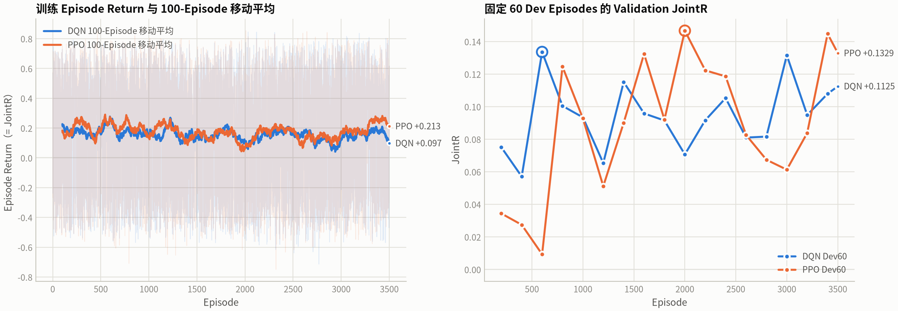
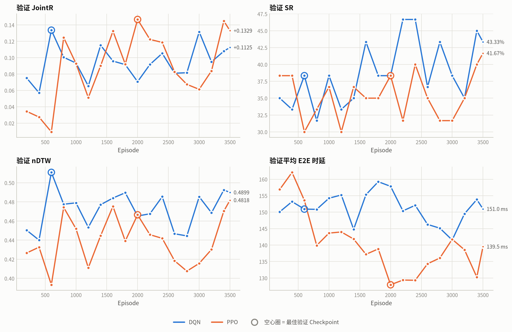
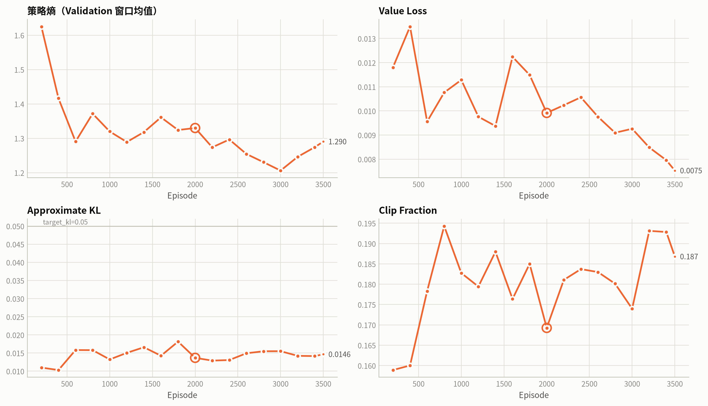
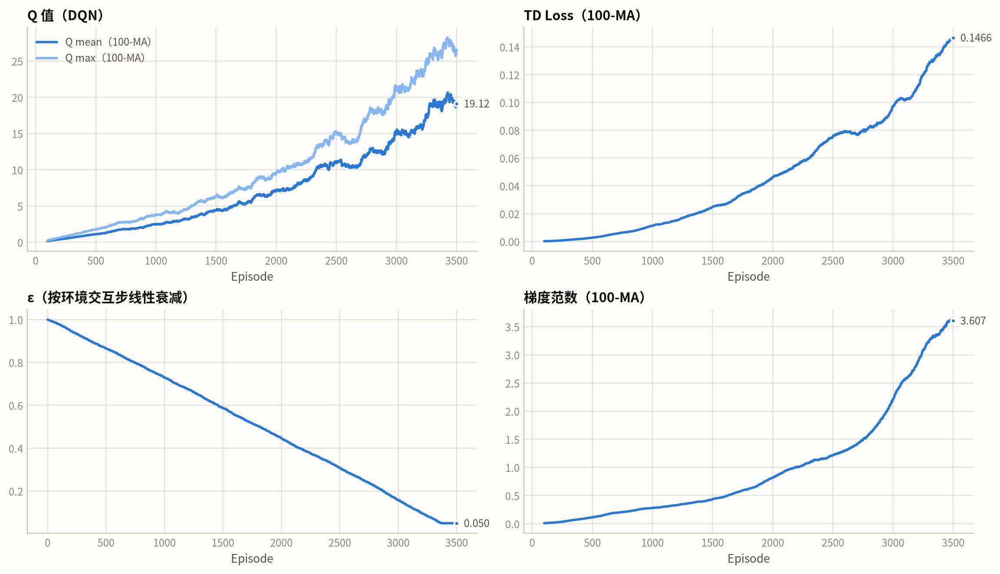
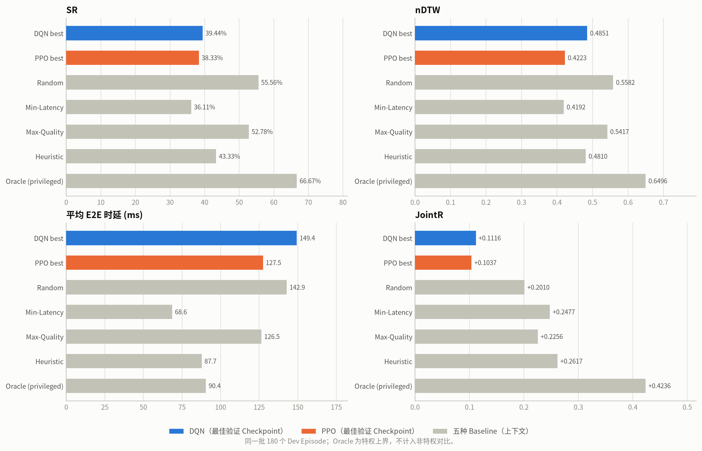

# Stage-2k：DQN 与 PPO 收敛及 Dev180 对比

- 生成时间（UTC）：2026-10-21T04:07:10.523216+00:00
- 数据来源：两个训练目录的 `training_history.json` / `training_result.json`；最终对比使用 Dev180 `summary.json`。
- 未读取 Final Test；曲线由真实逐 Episode 记录生成，无插值。

## 1. 训练与收敛

| 项 | DQN A | PPO |
|---|---:|---:|
| 运行目录 | `runs/v83_spatial_stage2/stage2k_pure_mec_v2` | `runs/v83_spatial_stage2/stage2k_ppo` |
| 已训练 Episode | 3500 | 3500 |
| 最佳验证 Episode | 600 | 2000 |
| 最佳 Dev60 JointR | 0.1336 | 0.1466 |
| 最后 Dev60 JointR | 0.1125 | 0.1329 |
| 最后 3 次趋势 | +0.00882 | +0.02457 |
| 训练状态 | `not_converged` | `not_converged` |
| `converged` | **False** | **False** |

- PPO 最终策略熵：1.2903；Value Loss：0.0075；approx KL：0.0146。

## 2. 收敛曲线

> 训练曲线来自采样策略（PPO 还有熵探索），任务分布也与 Dev 不同；100-Episode 移动平均不能直接与 Validation JointR 比较。模型选择只使用固定 Dev60 Validation。

## 3. 训练诊断

## 4. Dev180 最终对比（最佳验证 Checkpoint）

| 策略 | SR | nDTW | E2E (ms) | JointR |
|---|---:|---:|---:|---:|
| DQN A best | 39.44% | 0.4851 | 149.38 | 0.1116 |
| PPO best | 38.33% | 0.4223 | 127.45 | 0.1037 |
| Random | 55.56% | 0.5582 | 142.87 | 0.2010 |
| Min-Latency | 36.11% | 0.4192 | 68.60 | 0.2477 |
| Max-Quality | 52.78% | 0.5417 | 126.47 | 0.2256 |
| Heuristic | 43.33% | 0.4810 | 87.72 | 0.2617 |
| Oracle（特权） | 66.67% | 0.6496 | 90.44 | 0.4236 |

### 逐 Episode 配对（PPO − DQN，同一 180 个 Dev Episode）

| 指标 | 均值差 | 95% Bootstrap CI |
|---|---:|---:|
| JointR | -0.0079 | [-0.0689, +0.0526] |
| nDTW | -0.0628 | [-0.1246, -0.0021] |
| SR | -0.0111 | [-0.0889, +0.0667] |
| E2E (ms) | -21.93 | [-30.00, -14.03] |

配对胜负：PPO 胜 **105** / 负 **73** / 平 **2**（n=180）。

### 与 Baseline 的逐 Episode 配对（ΔJointR，95% CI）

| Baseline | DQN best | PPO best |
|---|---:|---:|
| Random | -0.0894 [-0.1455, -0.0349] | -0.0973 [-0.1548, -0.0419] |
| Min-Latency | -0.1360 [-0.1962, -0.0752] | -0.1440 [-0.1934, -0.0952] |
| Max-Quality | -0.1140 [-0.1621, -0.0674] | -0.1219 [-0.1843, -0.0597] |
| Heuristic | -0.1500 [-0.2044, -0.0956] | -0.1580 [-0.2130, -0.1024] |

四个非特权 Baseline 的 ΔJointR 95% CI 对 DQN 与 PPO 均位于 0 以下；两者都显著差于全部四个非特权 Baseline。

## 5. 结论与限制

- PPO **未通过预注册收敛门**（`converged != true`）。无论 Dev180 数值如何，都不能将其标记为有效的最终策略。
- DQN A 也未通过收敛门；两者的训练曲线只能作为诊断对比。
- 最佳 Checkpoint 的 Dev60 → Dev180 下降：DQN 0.1336 → 0.1116；PPO 0.1466 → 0.1037。说明用 60 个 Dev Episode 选模会对其余 120 个 Dev Episode 产生选择偏差，最终对比必须以完整 Dev180 为准。
- DQN−PPO 在完整 Dev180 上：JointR 差 -0.0079，95% CI [-0.0689, +0.0526]（不显著，CI 跨 0）。
- PPO 的 E2E 显著更低（-21.93 ms，CI [-30.00, -14.03]），nDTW 显著更低（-0.0628，CI [-0.1246, -0.0021]）；SR 差异不显著。两者是不同失败模式的权衡，而不是一方全面胜出。
- 训练奖励与 JointR 的绝对误差在训练和验证中都保持 <1e-6，没有成功终止奖励或失败惩罚。
- Final Test 未读取；是否进入独立测试必须等方案冻结后另行决定。
