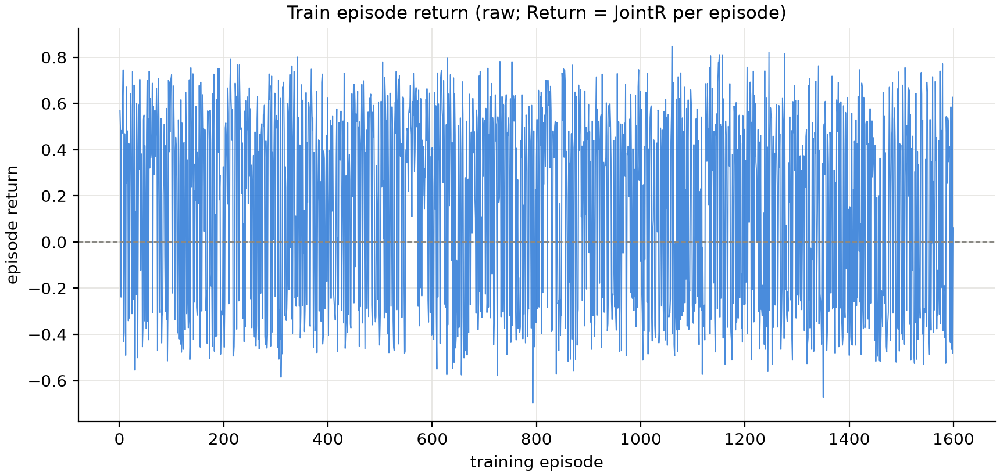
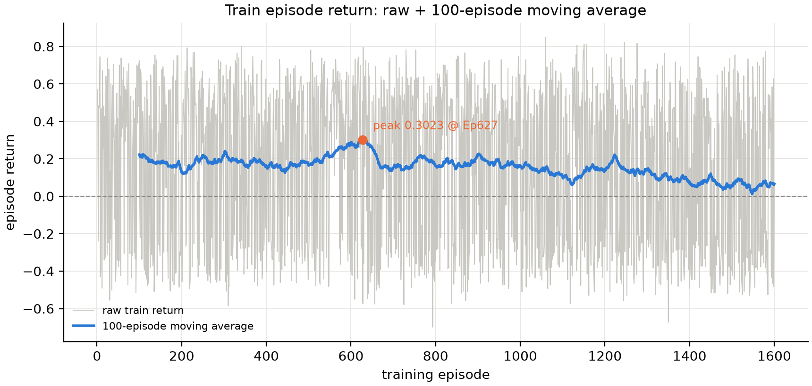
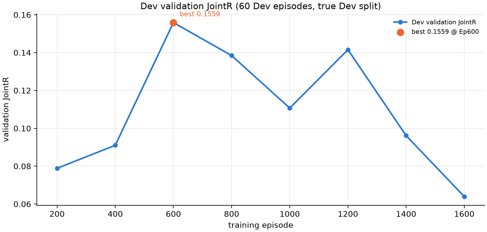
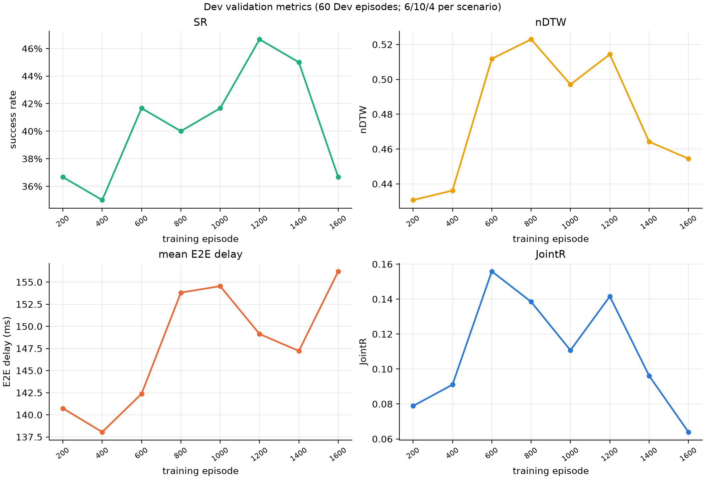
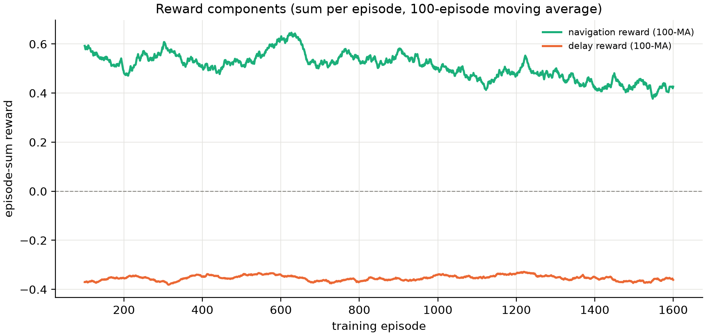
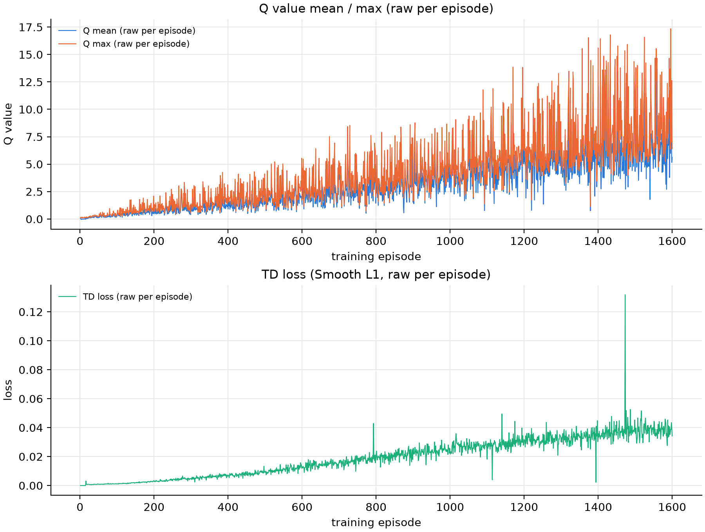

# Stage-2k Pure MEC DQN 关联实验报告

日期：2026-10-20  
分支：`experiment/v83-spatial-foundation`  
仓库：`JLU-MCNS-MEC/mec-v8.2`  
性质：标准 MLP DQN；五种 T5 MEC 冻结；DQN 状态不含任何视觉信息。

## 0. TL;DR

- 状态空间：**322 维**（2 维 UAV 位置 + 20 × 16 维 MEC 特征），`state_mode = pure_mec`，网络结构 `mlp_322_256_256_20`。
- 实际训练 **1600 / 3500** Episodes；最佳 Dev Validation Episode **600**，JointR **0.1559**。
- 训练状态：**early_stopped_no_improvement**；early_stop_triggered = **True**；converged = **False**；停止原因：**no JointR improvement over 5 validations and last-3 trend is flat/declining**。
- 逐 Episode `|Return − JointR|` 最大 **1.332e-15**，平均 **1.634e-16**。
- Association Final Test 180：**未运行**（未收敛或未执行；不消耗一次性测试集）。

## 1. DQN 状态空间

本轮使用纯 MEC 状态：DQN 输入 **322 维** = 2 维 UAV 位置 + 20 × 16 维候选 MEC 特征；另设 **20 维可用性 Mask**，只用于动作屏蔽，不重复进入 MLP。决策状态合计 342 维。

| 块 | 维度 | 内容 |
|---|---:|---|
| UAV 位置 | 2 | 当前二维位置 / 1500 m |
| 候选 MEC | 20 × 16 | 相对位置、距离、算力、带宽、上行速率、通信时延、推理时延（/10 ms）、E2E 时延、Dev Val 质量先验、SNR、模型类型 one-hot |
| 可用性 Mask | 20 | 单独的动作 Mask，用于屏蔽不可用 MEC |
| **DQN 输入合计** | **322** | `2 + 20 × 16` |
| **决策状态合计** | **342** | `322 + 20` |

每个候选 MEC 的 16 维字段：

```
relative_x, relative_y, distance,
compute_norm, bandwidth_norm, uplink_rate_norm,
communication_ms_norm, inference_ms_norm, e2e_ms_norm,
dev_val_quality_prior, snr_db_norm,
model_Small, model_Transformer-S, model_Medium,
model_Transformer-M, model_Large
```

推理时延使用专用 10 ms 归一化：统一模型中它只有约 0–10 ms，若按 100 ms 归一化会几乎恒为 0，无法提供有效区分度。

**明确排除**：RGB/视觉 PCA 特征、Goal token、目标视觉相似度、历史视觉、热图、GAB、地图检索特征及其派生特征；导航动作、Episode 步数、目标位置、目标距离、Oracle action、成功标签。

网络结构保持标准 DQN MLP：`322 → 256 → 256 → 20`，不增加 Attention / GNN / Transformer 模块。

## 2. 实验设计

| 项 | 设置 |
|---|---|
| MEC | 五种冻结 Stage-2j T5 Checkpoint，不重新训练 |
| Baseline | Random、Min-Latency、Max-Quality、Heuristic、Oracle |
| 部署 | Balanced、Quality-rich、Tradeoff-stress 三种场景 |
| 时延 | Stage-2j 八项输入实际字节 + 解析 FLOPs + 统一链路模型 |
| 奖励 | `r_nav_t + (-0.25/100) × (running_mean_E2E_t − running_mean_E2E_{t−1})`，累计严格等于 JointR |
| DQN 初始化 | 从头初始化，不复用旧 DQN 权重 |
| 训练预算 | 最长 3500 Episodes；每 200 Episodes 独立 Dev 60 验证 |
| 训练任务 | 从 Train split 分层随机抽样 3500 条（1167 Short / 1167 Medium / 1166 Long），全局随机打乱 |
| 拓扑 | 训练用 Train topology；验证用 Dev topology；Final Test 用 Test topology |
| 早停 | 依据 Validation JointR 的新最佳与趋势；单次波动不触发早停 |

## 3. 训练曲线













TensorBoard 记录：`train/episode_return`（真实训练奖励）、`train/episode_return_ma100`（100-Episode 移动平均）、`validation/joint_reward`、`validation/SR`、`validation/nDTW`、`validation/E2E_ms`、`train/loss`、`train/q_mean`、`train/q_max`。

## 4. Dev Validation 记录

| Episode | JointR | SR | nDTW | E2E (ms) | P95 (ms) | 步数 | Train Loss | Q mean | Q max |
|---:|---:|---:|---:|---:|---:|---:|---:|---:|---:|
| 200 | 0.0789 | 36.67% | 0.4307 | 140.74 | 216.05 | 186.4 | 0.00139 | 0.374 | 2.087 |
| 400 | 0.0910 | 35.00% | 0.4362 | 138.05 | 208.21 | 184.6 | 0.00493 | 1.061 | 4.255 |
| 600 | 0.1559 | 41.67% | 0.5118 | 142.37 | 212.44 | 167.6 | 0.00950 | 1.694 | 5.547 |
| 800 | 0.1384 | 40.00% | 0.5230 | 153.81 | 220.86 | 160.2 | 0.01593 | 2.669 | 8.533 |
| 1000 | 0.1107 | 41.67% | 0.4970 | 154.54 | 219.58 | 171.5 | 0.02217 | 3.381 | 8.768 |
| 1200 | 0.1415 | 46.67% | 0.5144 | 149.13 | 215.62 | 166.2 | 0.02794 | 4.467 | 13.856 |
| 1400 | 0.0961 | 45.00% | 0.4642 | 147.22 | 218.40 | 173.8 | 0.03259 | 5.462 | 16.542 |
| 1600 | 0.0639 | 36.67% | 0.4545 | 156.22 | 232.08 | 161.2 | 0.03822 | 6.575 | 17.351 |

### 4.1 同一组 Dev 60 上的 Baseline 对照

以下 Baseline 指标只取与 DQN 验证完全相同的 60 个 Episode，不是 Dev180 总体；用于同口径判断 DQN 是否具有竞争力。

| 策略 | JointR | SR | nDTW | E2E (ms) |
|---|---:|---:|---:|---:|
| DQN (no visual, best Ep600) | **0.1559** | 41.67% | 0.5118 | 142.37 |
| Random | 0.1931 | 55.00% | 0.5598 | 146.69 |
| Min-Latency | 0.2828 | 38.33% | 0.4614 | 71.41 |
| Max-Quality | 0.2091 | 46.67% | 0.5405 | 132.54 |
| Heuristic | 0.2806 | 43.33% | 0.5236 | 97.22 |
| Oracle (privileged) | 0.4425 | 65.00% | 0.6759 | 93.37 |

MEC 类型使用率（同一组 60 Episodes）：

| 策略 | Small | Transformer-S | Medium | Transformer-M | Large |
|---|---:|---:|---:|---:|---:|
| DQN (best) | 12.9% | 32.6% | 10.9% | 23.7% | 19.9% |
| Random | 17.8% | 21.3% | 20.4% | 19.0% | 21.6% |
| Min-Latency | 14.9% | 22.7% | 28.9% | 18.3% | 15.2% |
| Max-Quality | 0.0% | 31.1% | 0.1% | 68.1% | 0.6% |
| Heuristic | 7.3% | 29.2% | 13.8% | 33.6% | 16.2% |
| Oracle (privileged) | 16.9% | 18.9% | 17.1% | 28.0% | 19.1% |

Validation 使用固定的 60 个 Dev Episode（每个场景 6 Short / 10 Medium / 4 Long）；Episode UID、Episode Seed 与 Train 不相交。

## 5. 最佳 Checkpoint 与收敛状态

- 最佳 Checkpoint：`runs/v83_spatial_stage2/stage2k_pure_mec_state/checkpoints/best.pt`
- 最佳 Episode：**600**
- 最佳 Dev Validation JointR：**0.1559**
- 停止 Episode：**1600**
- 停止原因：**no JointR improvement over 5 validations and last-3 trend is flat/declining**
- 训练状态：**early_stopped_no_improvement**
- `early_stop_triggered`：**True**
- `converged`：**False**

状态定义：`improving` / `plateaued` / `early_stopped_no_improvement` / `converged` / `not_converged`。`converged` 需要最近验证形成稳定平台；早停本身不等于收敛。

## 8. 产物与提交

- 运行目录：`runs/v83_spatial_stage2/stage2k_pure_mec_state`
- Checkpoints：`checkpoints/last_full.pt`（含 Replay/RNG）、`checkpoints/best.pt`、`checkpoints/last.pt`
- TensorBoard：`runs/tensorboard/association_stage2k_pure_mec_state/`
- 训练曲线：`runs/v83_spatial_stage2/stage2k_pure_mec_state/plots/`
- 归档曲线：`v83_spatial_stage2/figures/stage2k_pure_mec_state/`
- 协议：`v83_spatial_stage2/STAGE2K_PURE_MEC_PROTOCOL.md`
- 大型权重、Replay Buffer、TensorBoard Event 和逐 Episode CSV 保留在服务器，不提交版本库。

## 9. 结论

- 未进入 Final Test（converged=false）；同口径 Dev60 最佳 Ep600 JointR **0.1559**、SR 41.67%、nDTW 0.5118、E2E 142.37 ms。
- 同一组 60 Episode 上最强非特权 Baseline Min-Latency JointR **0.2828**；Pure MEC 未超过该 Baseline。
- 未消耗一次性 Association Final Test 180。
