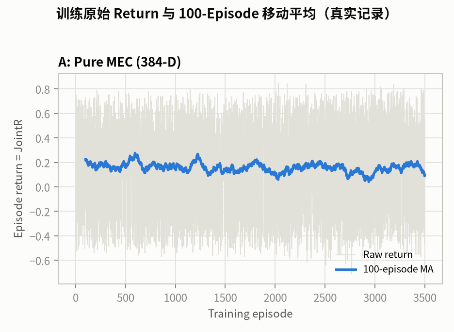
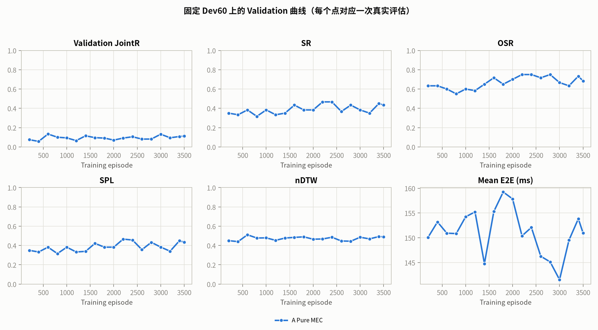
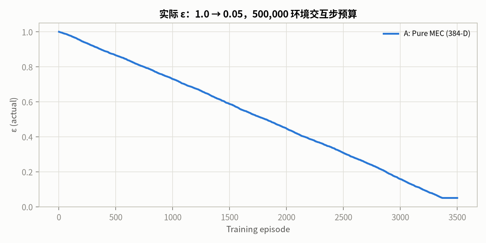
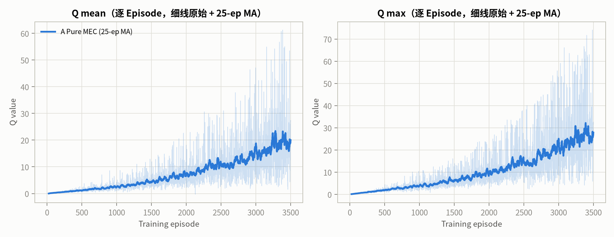
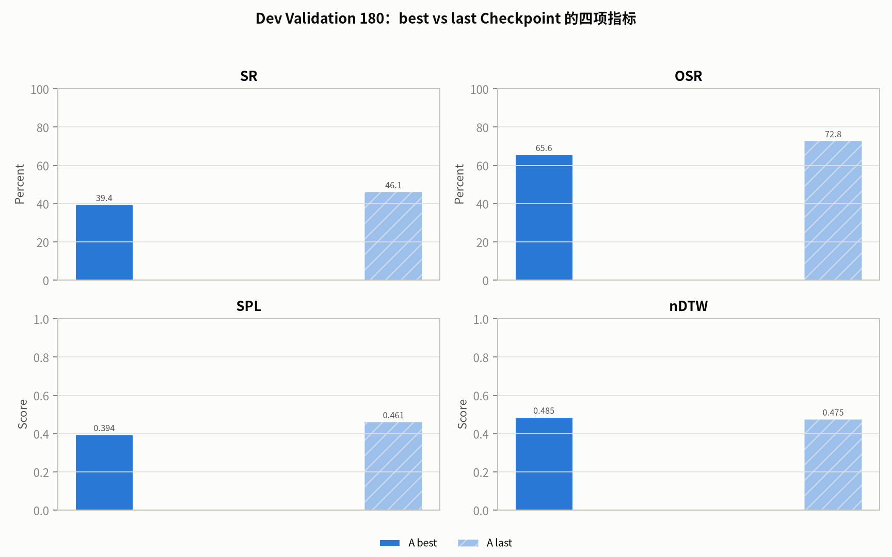
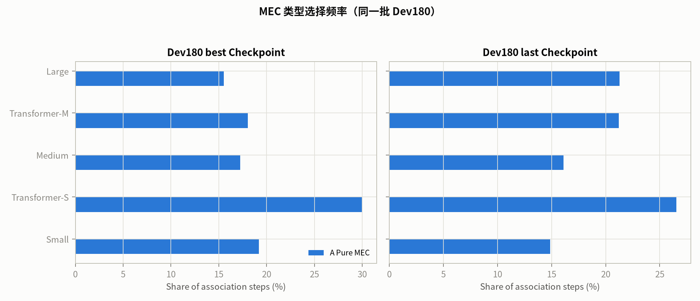

# Stage-2k v2 A：Pure MEC 实验报告

- 日期：2026-10-21T03:56:07.966497+00:00
- 运行目录：`runs/v83_spatial_stage2/stage2k_pure_mec_v2`
- 状态模式：`pure_mec_v2`，384 维 MLP 输入，404 维决策状态
- 网络：`mlp_384_256_256_20`
- TensorBoard：`runs/tensorboard/association_stage2k_pure_mec_v2/`
- 数据隔离：未读取 Stage-2j Final Test 300，未读取 Association Final Test 180。

## 0. TL;DR

- 实际训练 **3500 / 3500** Episodes，**521,491** 环境交互步；最终 ε **0.0500**。
- 最佳 Dev60 JointR **0.1336** @ Ep600；最后 Dev60 JointR **0.1125**。
- 训练状态：**not_converged**；converged = **False**；早停禁用 = **True**。
- 收敛门槛与 Final Test 决策：**retained_not_converged**（Final Test read = **False**）。
- Q 审计（固定 Dev 状态）：best→last Q mean **1.127 → 10.165**（9.0×），Q max **2.429 → 21.738**；贪心一致率 **17.14%**。
- Q 尺度在 best→last 之间有明显增长，但不构成收敛证据；收敛判定只看固定 Dev60 Validation 的稳定平台。

## 1. 状态空间

`pure_mec_v2` 的布局（由 `state_layout` 固化）：

```json
{
  "state_mode": "pure_mec_v2",
  "uav_position": [
    0,
    2
  ],
  "episode_step": {
    "index": 2,
    "normalization": "t/400"
  },
  "running_mean_e2e": {
    "index": 3,
    "normalization": "running_mean_E2E_ms/100"
  },
  "candidates": [
    4,
    384
  ],
  "availability_mask": {
    "dim": 20,
    "separate_from_mlp_input": true,
    "used_for_action_masking": true
  },
  "total_mlp_input": 384,
  "total_decision_state": 404,
  "candidate_dim": 19,
  "candidate_fields": [
    "relative_x",
    "relative_y",
    "distance",
    "compute_norm",
    "bandwidth_norm",
    "uplink_rate_norm",
    "communication_ms_norm",
    "inference_ms_norm",
    "e2e_ms_norm",
    "snr_db_norm",
    "dev_sr",
    "dev_osr",
    "dev_spl",
    "dev_ndtw",
    "model_Small",
    "model_Transformer-S",
    "model_Medium",
    "model_Transformer-M",
    "model_Large"
  ],
  "capability_fields": [
    "dev_sr",
    "dev_osr",
    "dev_spl",
    "dev_ndtw"
  ],
  "forbidden": [
    "visual/PCA",
    "goal tokens",
    "goal visual similarity",
    "history visual",
    "heatmap",
    "GAB",
    "map retrieval",
    "navigation action",
    "target position",
    "target distance",
    "oracle action",
    "success"
  ]
}
```

- 能力先验：`runs/v83_spatial_stage2/stage2k/capability_prior_v2.json`，SHA256 `7859ee81ec314a441594a36b2435f85056601c814730eca13d06e434053a0108`；split = `dev_val_180`，metrics = `['sr', 'osr', 'spl', 'ndtw']`，final_test_read = `False`。

## 2. 训练配置

| 项 | 值 |
|---|---|
| Episodes | 3500 / 3500 |
| ε 预算 | 500,000 环境交互步 |
| γ | 1.0 |
| 学习率 / Batch / Replay | 0.0001 / 128 / 50,000 |
| 训练任务 | train_4000 stratified random sample (3500) |
| 训练顺序 | `random`，seed = 40522062 |
| 训练拓扑 / 验证拓扑 | `train` / `dev` |
| 验证 | 每 200 Episodes，60 Dev episodes (6/10/4 per scenario) |
| 早停 | disabled = True；仅 NaN/Inf、Q 发散、程序错误中止 |
| 奖励 | `r_nav_t + (-0.25/100)*(running_mean_E2E_t - running_mean_E2E_{t-1})` |

## 3. 训练曲线









## 4. Dev60 Validation 记录

| Episode | JointR | SR | OSR | SPL | nDTW | E2E (ms) | Loss | Q mean | Q max | ε |
|---:|---:|---:|---:|---:|---:|---:|---:|---:|---:|---:|
| 200 | 0.0750 | 35.00% | 63.33% | 0.3499 | 0.4503 | 150.09 | 0.0004 | 0.272 | 1.251 | 0.9468 |
| 400 | 0.0571 | 33.33% | 63.33% | 0.3327 | 0.4400 | 153.19 | 0.0015 | 0.750 | 2.800 | 0.8908 |
| 600 | 0.1336 | 38.33% | 60.00% | 0.3827 | 0.5109 | 150.93 | 0.0034 | 1.233 | 4.427 | 0.8396 |
| 800 | 0.1004 | 31.67% | 55.00% | 0.3158 | 0.4775 | 150.84 | 0.0063 | 1.818 | 8.263 | 0.7863 |
| 1000 | 0.0934 | 38.33% | 60.00% | 0.3825 | 0.4790 | 154.23 | 0.0101 | 2.271 | 10.446 | 0.7306 |
| 1200 | 0.0653 | 33.33% | 58.33% | 0.3327 | 0.4534 | 155.22 | 0.0143 | 2.861 | 10.833 | 0.6758 |
| 1400 | 0.1151 | 35.00% | 65.00% | 0.3391 | 0.4771 | 144.78 | 0.0198 | 3.639 | 13.037 | 0.6164 |
| 1600 | 0.0958 | 43.33% | 71.67% | 0.4219 | 0.4840 | 155.29 | 0.0258 | 4.532 | 16.104 | 0.5559 |
| 1800 | 0.0915 | 38.33% | 65.00% | 0.3827 | 0.4896 | 159.24 | 0.0337 | 5.606 | 20.431 | 0.5037 |
| 2000 | 0.0706 | 38.33% | 70.00% | 0.3827 | 0.4652 | 157.84 | 0.0434 | 6.805 | 23.804 | 0.4462 |
| 2200 | 0.0916 | 46.67% | 75.00% | 0.4661 | 0.4675 | 150.38 | 0.0525 | 7.737 | 28.717 | 0.3879 |
| 2400 | 0.1052 | 46.67% | 75.00% | 0.4566 | 0.4854 | 152.08 | 0.0646 | 9.824 | 33.591 | 0.3375 |
| 2600 | 0.0810 | 36.67% | 71.67% | 0.3566 | 0.4466 | 146.27 | 0.0772 | 10.874 | 40.056 | 0.2789 |
| 2800 | 0.0816 | 43.33% | 75.00% | 0.4327 | 0.4444 | 145.13 | 0.0795 | 11.865 | 44.821 | 0.2237 |
| 3000 | 0.1315 | 38.33% | 66.67% | 0.3833 | 0.4854 | 141.54 | 0.0915 | 13.844 | 55.740 | 0.1582 |
| 3200 | 0.0948 | 35.00% | 63.33% | 0.3407 | 0.4686 | 149.51 | 0.1064 | 15.305 | 66.137 | 0.0975 |
| 3400 | 0.1079 | 45.00% | 73.33% | 0.4500 | 0.4925 | 153.84 | 0.1321 | 19.132 | 66.693 | 0.0500 |
| 3500 | 0.1125 | 43.33% | 68.33% | 0.4333 | 0.4899 | 150.97 | 0.1415 | 19.171 | 74.085 | 0.0500 |

## 5. Dev180 best / last

| Checkpoint | Episode | SR | OSR | SPL | nDTW | E2E (ms) | P95 (ms) | JointR |
|---|---:|---:|---:|---:|---:|---:|---:|---:|
| best | 600 | 39.44% | 65.56% | 0.3942 | 0.4851 | 149.38 | 222.73 | **0.1116** |
| last | 3500 | 46.11% | 72.78% | 0.4611 | 0.4753 | 146.87 | 217.04 | **0.1082** |



## 6. MEC 选择频率（Dev180）



| MEC | best 使用率 | last 使用率 |
|---|---:|---:|
| Small | 19.20% | 14.88% |
| Transformer-S | 30.02% | 26.54% |
| Medium | 17.24% | 16.10% |
| Transformer-M | 18.02% | 21.21% |
| Large | 15.53% | 21.26% |

## 7. Q 稳定性（只读审计）

- 固定状态数：35；行为策略：deterministic Min-Latency (checkpoint-independent)。
- best：Ep600，Q mean 1.1271，Q max 2.4287，Q std 0.0872，top-2 gap 0.0758。
- last：Ep3500，Q mean 10.1655，Q max 21.7377，Q std 0.4016，top-2 gap 0.4581。
- best/last 贪心动作一致率：**17.14%**。

## 8. 收敛与 Final Test 决策

预注册标准：完成 3500 Episodes；数值有限；至少 5 次 Dev 验证；最近 3 次 JointR 极差 ≤ 0.01；最后值 ≥ 最佳 − 0.005；且不再形成新最佳。

- `converged`：**False**
- 最佳 Dev60 JointR：**0.1336**；竞争力阈值：**0.2828**（同批 Dev60 最强非特权 Baseline，Min-Latency）
- `competitive`：**False**
- `final_test_eligible`：**False**
- 决策：**retained_not_converged**；Final Test read = **False**

## 9. 结论

- 实际训练 3500 Episodes；收敛状态 `not_converged`；最佳 Checkpoint 为 Ep600（Dev60 JointR 0.1336）。
- Dev180 best/last 与 Q 稳定性见上表；未读取一次性 Final Test。

## 10. 产物

- 训练目录：`runs/v83_spatial_stage2/stage2k_pure_mec_v2`
- Checkpoints：`runs/v83_spatial_stage2/stage2k_pure_mec_v2/checkpoints/best.pt`、`last.pt`、`last_full.pt`
- TensorBoard：`runs/tensorboard/association_stage2k_pure_mec_v2/`
- 曲线：`v83_spatial_stage2/figures/stage2k_pure_mec_v2`
- 大型权重、Replay Buffer、TensorBoard Event 与逐 Episode CSV 保留在 `runs/` 下，不提交 Git。