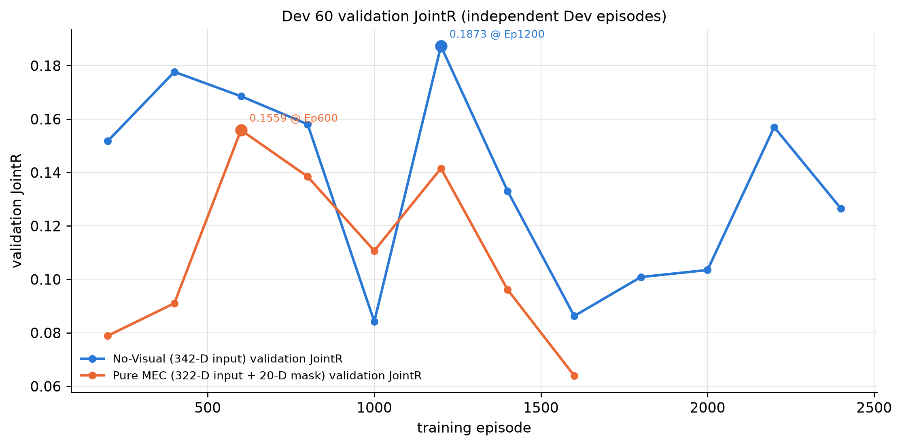
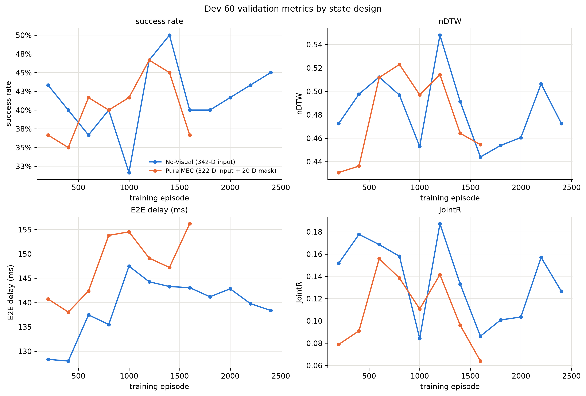
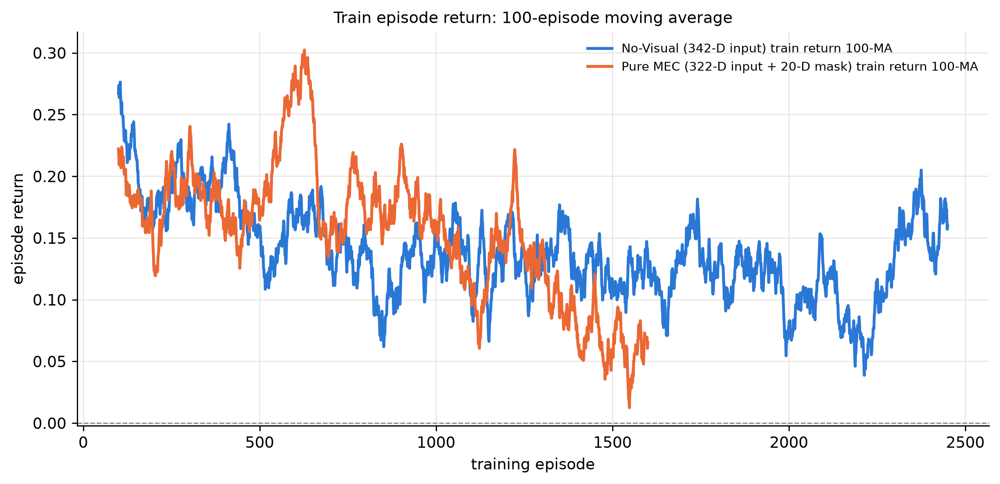
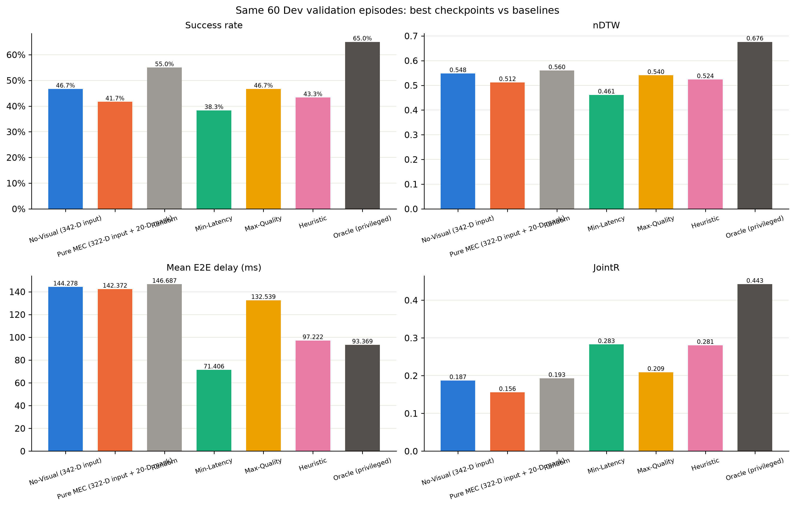

# Stage-2k 状态设计对照：No-Visual vs Pure MEC

日期：2026-10-20  
分支：`experiment/v83-spatial-foundation`  
仓库：`JLU-MCNS-MEC/mec-v8.2`

## 0. 结论摘要

- **No-Visual (342-D input)**：训练 2450 / 4000 Episodes；最佳 Ep1200，Dev60 JointR **0.1873**、SR 46.67%、nDTW 0.5480、E2E 144.28 ms；状态 `user_stopped`，converged=**False**。
  - Final Test 180：**未运行**（未满足收敛门槛或未执行）。
- **Pure MEC (322-D input + 20-D mask)**：训练 1600 / 3500 Episodes；最佳 Ep600，Dev60 JointR **0.1559**、SR 41.67%、nDTW 0.5118、E2E 142.37 ms；状态 `early_stopped_no_improvement`，converged=**False**。
  - Final Test 180：**未运行**（未满足收敛门槛或未执行）。

> 本轮对照不是严格的“只改状态”消融：no-visual 使用确定性轮转/Dev 拓扑/4000 上限；pure MEC 使用 Train 分层随机抽样/3500 上限/Train 训练拓扑。两者差异同时包含状态编码与训练协议。

## 1. 状态设计

| 项 | No-Visual | Pure MEC |
|---|---|---|
| DQN 输入维度 | 342（2 + 20 × 17） | **322（2 + 20 × 16）** |
| 可用性表示 | 每候选 1 维 availability | **独立 20 维动作 Mask** |
| 决策状态合计 | 342 | **342（322 + 20）** |
| 视觉/Goal/历史/GAB/热图 | 排除 | 排除 |
| 导航动作/步数/目标/成功标签 | 排除 | 排除 |
| 网络 | MLP 342→256→256→20 | MLP **322→256→256→20** |

两种设计的候选字段高度重叠；pure MEC 只是把 availability 从每候选特征中移出，改为独立的动作 Mask，并采用随机训练任务采样。

## 2. 训练与验证结果

| 指标 | No-Visual | Pure MEC |
|---|---:|---:|
| 实际训练 Episodes | 2450 | 1600 |
| 最大 Episodes | 4000 | 3500 |
| 最佳 Episode | 1200 | 600 |
| 最佳 Dev60 JointR | **0.1873** | **0.1559** |
| 最佳 Dev60 SR | 46.67% | 41.67% |
| 最佳 Dev60 nDTW | 0.5480 | 0.5118 |
| 最佳 Dev60 E2E | 144.28 ms | 142.37 ms |
| 训练状态 | user_stopped | early_stopped_no_improvement |
| converged | False | False |

## 3. 同一组 Dev60 上的 Baseline 对照

| 策略 | JointR | SR | nDTW | E2E (ms) |
|---|---:|---:|---:|---:|
| No-Visual best | 0.1873 | 46.67% | 0.5480 | 144.28 |
| Pure MEC best | 0.1559 | 41.67% | 0.5118 | 142.37 |
| Random | 0.1931 | 55.00% | 0.5598 | 146.69 |
| Min-Latency | 0.2828 | 38.33% | 0.4614 | 71.41 |
| Max-Quality | 0.2091 | 46.67% | 0.5405 | 132.54 |
| Heuristic | 0.2806 | 43.33% | 0.5236 | 97.22 |
| Oracle (privileged) | 0.4425 | 65.00% | 0.6759 | 93.37 |

## 4. Association Final Test 180

- 本轮没有任何状态设计进入正式 Final Test；不消耗一次性测试集。

## 5. 解释与限制

- **状态维度**：no-visual 为 342 维输入；pure MEC 为 322 维输入 + 20 维动作 Mask，决策状态合计仍为 342。两者不是“去掉 20 维信息”而是把 availability 从输入特征改为动作 Mask。
- **训练协议**：no-visual 使用确定性 3×3 轮转、Dev 拓扑、4000 上限；pure MEC 使用 Train 分层随机抽样 3500、Train 训练拓扑、Dev 验证。因此两者的差异不能单独归因于状态编码。
- **收敛**：只有 `converged=true` 的设计才允许进入 Final Test；未收敛时保留测试集。
- 所有旧 run 的权重、日志、TensorBoard 和 Final Test 产物均未覆盖。

## 6. 产物

- No-Visual run：`runs/v83_spatial_stage2/stage2k_no_visual`
- Pure MEC run：`runs/v83_spatial_stage2/stage2k_pure_mec_state`
- 对照图：`v83_spatial_stage2/figures/stage2k_state_comparison/`
- 大型权重、Replay Buffer、TensorBoard Event 和逐 Episode CSV 保留在服务器 `runs/` 下，不提交版本库。
