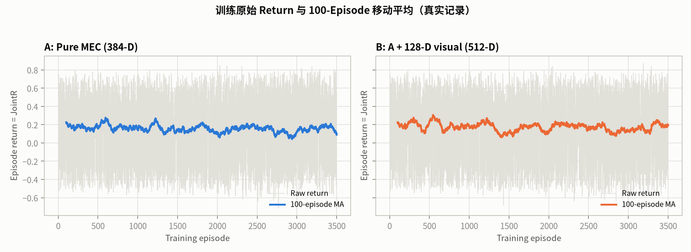
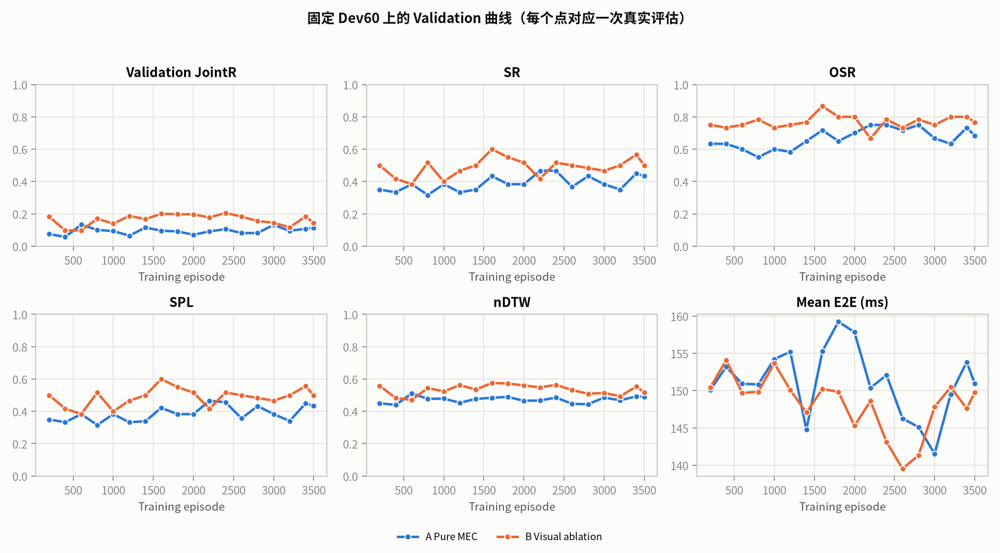
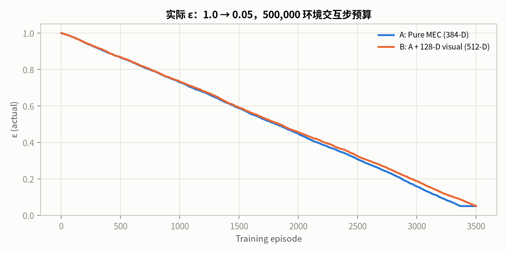
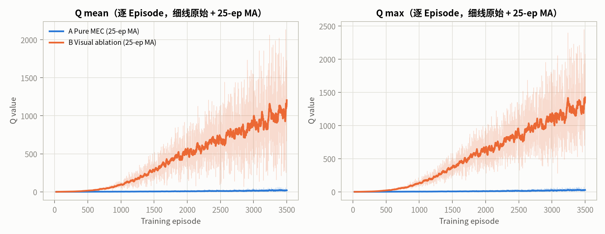
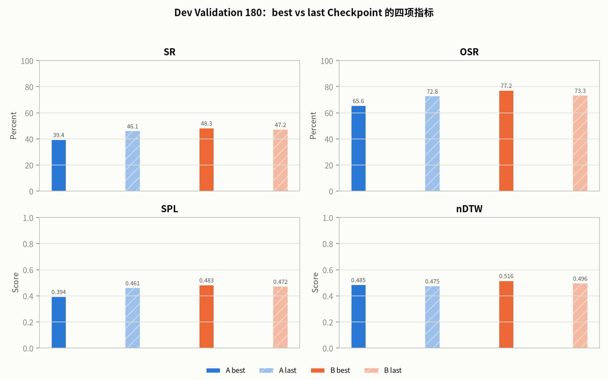
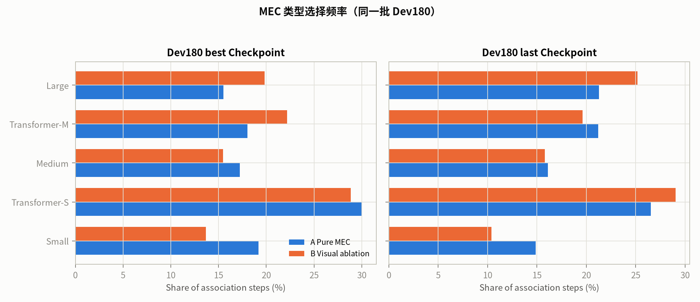

# Stage-2k v2 视觉消融对照：A Pure MEC vs B +128-D Visual

- 日期：2026-10-21T11:10:03.172470+00:00
- 分支：`experiment/v83-spatial-foundation`
- 两个变体共享 Train 3500 任务清单、随机顺序、种子、Train/Dev 拓扑、奖励、MLP 结构与 Dev60 验证。
- 未读取 Stage-2j Final Test 300；Final Test 180 是否读取由预注册门槛决定。

## 0. TL;DR

| 变体 | 实际 Episodes | 最终 ε | 最佳 Dev60 JointR | 最佳 Episode | 最后 Dev60 JointR | converged | 决策 |
|---|---:|---:|---:|---:|---:|---|---|
| A | 3500 | 0.0500 | 0.1336 | 600 | 0.1125 | False | retained_not_converged |
| B | 3500 | 0.0505 | 0.2062 | 2400 | 0.1432 | False | retained_not_converged |

## 1. 状态设计对照表

| 项 | A Pure MEC | B + Visual |
|---|---|---|
| MLP 输入维度 | **384** | **512** |
| 决策状态维度 | 404（+20 mask） | 532（+20 mask） |
| 网络 | MLP 384→256→256→20 | MLP 512→256→256→20 |
| UAV 位置 | 2 | 2 |
| Episode 步数 t/400 | 1 | 1 |
| running_mean_E2E_ms/100 | 1 | 1 |
| 候选 MEC 特征 | 20 × 19 | 20 × 19（同 A） |
| 每 MEC 能力指标 | SR/OSR/SPL/nDTW | SR/OSR/SPL/nDTW（同 A） |
| 可用性 | 独立 20-D 动作 Mask | 独立 20-D 动作 Mask |
| 视觉上下文 | **无** | **128-D 冻结 VisualProjector** |
| GAB / 热图 / 新模块 | 无 | 无；投影前 GAB/map 块置为训练均值 |
| 导航动作 / 目标位置 / Oracle / 成功标签 | 排除 | 排除 |

## 2. 训练协议一致性

| 项 | 值 |
|---|---|
| DQN seed | 20261031 |
| 顺序 seed | 40522062 |
| Train 任务数 | 3500（1167/1167/1166） |
| 训练拓扑 | Train topology |
| 验证 | 固定 Dev60，Dev topology |
| ε 预算 | 500,000 环境交互步 |
| Episodes | 3500，无早停 |
| 奖励 | 与 JointR 严格一致，无成功/失败/特权奖励 |

- 全部一致性检查通过：**True**
- Train order：3500 条，数组逐项相同 = True，SHA256 `c8ff77b0a70da28410450fefecd846d8a467857a6f00976ec7b618a1d1888e41`。
- Dev60 验证集：60 条，逐项相同 = True，SHA256 `6ac43465479b3efb1e581d33b2c8a96258ee28edb87d846dbe051dc76c589ae3`。
- 种子/拓扑/奖励/ε 预算/γ/隐藏层/能力先验：True / True / True / True / True / True / True。

由于策略动作不同，闭环轨迹和实际环境步数会不同，这是预期行为。

## 3. 训练结果

| 指标 | A | B |
|---|---:|---:|
| 实际 Episodes | 3500 | 3500 |
| 环境交互步 | 521,491 | 499,728 |
| 最终 ε | 0.0500 | 0.0505 |
| 最终 TD Loss | 0.1374 | 16.9640 |
| 最终梯度范数 | 3.3834 | 177.5414 |
| 最终 Q mean | 27.1400 | 1726.5023 |
| 最终 Q max | 32.5836 | 2073.3904 |
| 最佳 Dev60 JointR | 0.1336 | 0.2062 |
| 最佳 Episode | 600 | 2400 |
| 最后 Dev60 JointR | 0.1125 | 0.1432 |
| 训练状态 | not_converged | not_converged |

## 4. Dev180 best / last 四项指标

| 变体 | Checkpoint | Episode | SR | OSR | SPL | nDTW | E2E (ms) | JointR |
|---|---|---:|---:|---:|---:|---:|---:|---:|
| A | best | 600 | 39.44% | 65.56% | 0.3942 | 0.4851 | 149.38 | **0.1116** |
| A | last | 3500 | 46.11% | 72.78% | 0.4611 | 0.4753 | 146.87 | **0.1082** |
| B | best | 2400 | 48.33% | 77.22% | 0.4833 | 0.5162 | 139.01 | **0.1687** |
| B | last | 3500 | 47.22% | 73.33% | 0.4722 | 0.4962 | 142.84 | **0.1391** |

### 4.1 B − A 的配对差值（同一 Dev180 清单）

| Checkpoint | ΔSR (pp) | ΔOSR (pp) | ΔSPL | ΔnDTW | ΔE2E (ms) | ΔJointR |
|---|---:|---:|---:|---:|---:|---:|
| best | +8.89 | +11.67 | +0.0891 | +0.0311 | -10.37 | +0.0570 |
| last | +1.11 | +0.56 | +0.0111 | +0.0208 | -4.02 | +0.0309 |

同一 Dev180 上的 Baseline JointR：Random 0.2010、Min-Latency 0.2477、Max-Quality 0.2256、Heuristic 0.2617、Oracle 0.4236（特权）。A best 0.1116 与 B best 0.1687 都低于 Random，也低于最强非特权 Min-Latency 0.2477；B 相对 A 的提升是真实的同清单差值，但尚未达到任何非特权 Baseline 的水平。

## 5. Q 值稳定性

| 变体 | Checkpoint | Episode | Q mean | Q max | Q std | Top-2 gap | best/last 贪心一致率 |
|---|---|---:|---:|---:|---:|---:|---:|
| A | best | 600 | 1.1271 | 2.4287 | 0.0872 | 0.0758 | 17.14% |
| A | last | 3500 | 10.1655 | 21.7377 | 0.4016 | 0.4581 | 17.14% |
| B | best | 2400 | 505.4840 | 887.7803 | 10.0729 | 8.5710 | 20.00% |
| B | last | 3500 | 741.2085 | 1259.9838 | 18.3723 | 14.5827 | 20.00% |

Q 审计使用同一组固定 Dev 状态（确定性 Min-Latency 行为策略），best/last 在完全相同的状态上前向；不同变体的 Q 尺度不直接可比，稳定性只在同一变体内部比较。

- A 的训练 Q mean 从 Ep200 的 0.448 升到 Ep3500 的 27.140；best→last 审计 Q mean 1.13→10.17，属于中等尺度漂移。
- B 的训练 Q mean 从 Ep200 的 2.579 升到 Ep3500 的 1726.502（约 669×），TD Loss 从 0.0042 升到 16.96，梯度范数从 0.219 升到 177.5。best→last 审计 Q mean 505.48→741.21、Q max 887.78→1259.98。**这是明显的 Q 过估计/尺度漂移，不是收敛。** 它未触发预注册的 1e6 数值中止阈值，但足以否定 B 作为可部署候选。

## 6. MEC 选择频率

| MEC | A best | A last | B best | B last |
|---|---:|---:|---:|---:|
| Small | 19.20% | 14.88% | 13.69% | 10.39% |
| Transformer-S | 30.02% | 26.54% | 28.85% | 29.04% |
| Medium | 17.24% | 16.10% | 15.46% | 15.79% |
| Transformer-M | 18.02% | 21.21% | 22.17% | 19.61% |
| Large | 15.53% | 21.26% | 19.82% | 25.17% |

## 7. 收敛与 Final Test 门槛

| 变体 | converged | 最佳 Dev60 JointR | 阈值 | competitive | final_test_eligible | 决策 |
|---|---|---:|---:|---|---|---|
| A | False | 0.1336 | 0.2828 | False | False | retained_not_converged |
| B | False | 0.2062 | 0.2828 | False | False | retained_not_converged |

门槛在 `STAGE2K_V2_PROTOCOL.md` 中预注册：G1 收敛；G2 最佳 Dev60 JointR 严格大于同批 Dev60 最强非特权 Baseline（Min-Latency 0.2828）。任一不满足即保留一次性 Final Test。

## 8. 解释与限制

- A/B 的闭环轨迹因策略动作不同而不同，因此实际环境交互步数和最终 ε 不会逐点相同；训练任务清单、顺序、种子、拓扑、奖励和验证集相同。
- B 的 128-D 视觉上下文来自现有冻结 `VisualProjector`；投影前把 summary 的 GAB(20) 与 map(22) 块替换为训练均值，因此没有新增 GAB/热图模块，但保留了 current/goal/history 视觉 token 的池化信息。
- 能力先验来自 Stage-2j Dev Val 180（seeds 2,000,000+），与 Stage-2k Train/Dev/Test（5M/6M/7M）不相交，且 `final_test_read=false`。
- Q 值尺度随状态维度、奖励尺度和探索分布变化；本报告不把 Q 上升当作收敛。B 的 Q 绝对尺度（审计约 505–741，训练末 1726）和约 669× 的增长已超出可解释的尺度差异，标记为明显的 Q 过估计/尺度漂移；A 也有约 60× 的增长，但绝对尺度较小。两者都未形成收敛平台。
- 若未满足 G1/G2，Final Test 180 保持未读取；本报告不给出测试集成绩。

## 9. 产物

- A：`runs/v83_spatial_stage2/stage2k_pure_mec_v2`
- B：`runs/v83_spatial_stage2/stage2k_visual_ablation_v2`
- 曲线：`v83_spatial_stage2/figures/stage2k_v2_ablation`
- 大型权重、Replay Buffer、TensorBoard Event 与逐 Episode CSV 保留在 `runs/` 下，不提交 Git。