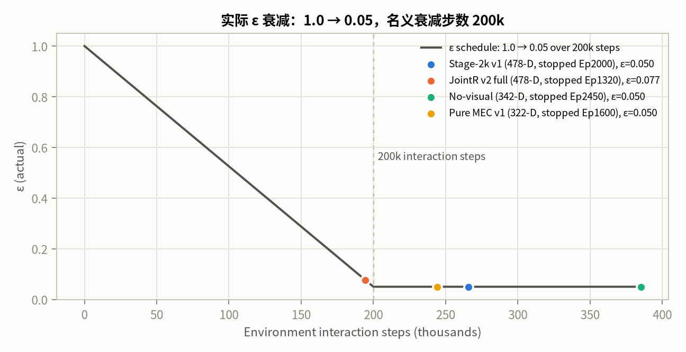
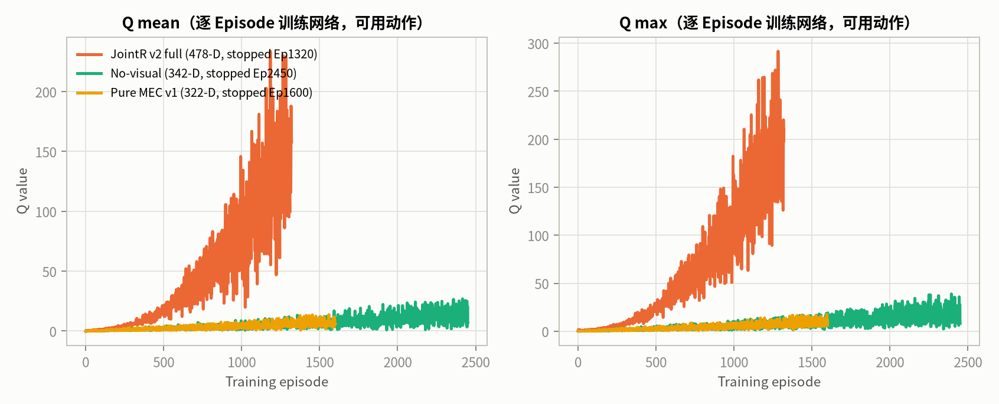
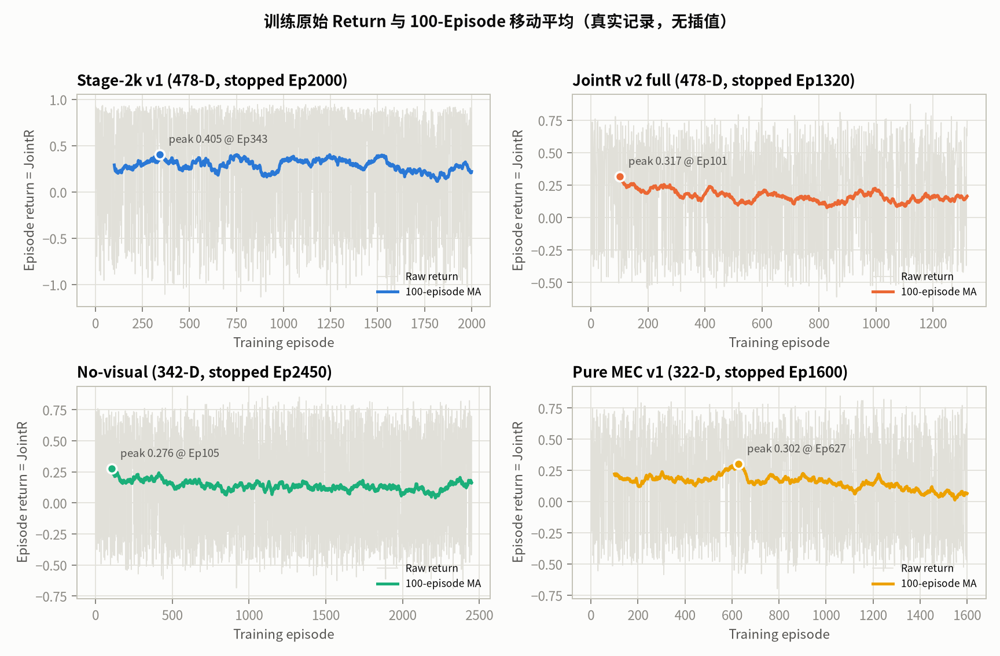
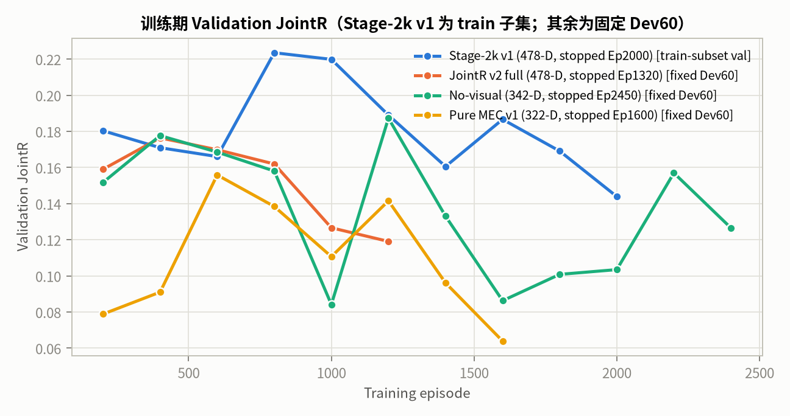

# Stage-2k v2 前置审计：ε、Q 值与奖励曲线

- 生成时间（UTC）：2026-10-20T23:51:25.026680+00:00
- 分支：`experiment/v83-spatial-foundation`
- 性质：**只读审计**；未启动训练、未修改 Checkpoint、未读取 Final Test。
- 数据来源：各运行目录下的 `training_history.json` 与 `training_result.json`；曲线直接由逐 Episode 真实记录生成，没有插值或补点。

## 0. 结论摘要

1. 现有 DQN 的 ε 名义上从 **1.0** 线性衰减到 **0.05**，衰减预算为 **200,000 个环境交互步**；`stage2k_jointr_v2`、`no_visual`、`pure_mec_v1` 的 ε 都实际到达了 0.05。
2. Q mean/max 在训练后期**持续增大**，而不是收敛到稳定平台。例如 JointR v2 full 在 Ep1200 的 Q mean/max 为 **157.82/209.75**；pure MEC v1 在 Ep1600 为 **5.62/6.40**。
3. 训练 return 的 100-Episode 移动平均有峰值，但峰值**不是收敛**。峰值之后 return 可以明显下降；而且训练任务按 band/scenario 采样，窗口组成会改变 return，不能用峰值或早停本身证明收敛。
4. 现有运行的停止都来自外部停止或基于验证集的早停。JointR v2 full、no_visual、pure MEC v1 的 `converged` 均为 **false**；Stage-2k v1 虽保存了 `converged=true`，但其验证用的是 **train 子集**，已被 `STAGE2K_DQN_CONVERGENCE_AUDIT.md` 判定为无效的 in-sample 标志。因此 v2 不应沿用 200k ε 预算或“奖励下降即停”的行为。

## 1. ε 衰减审计

| 运行 | 实际 Episodes | 环境交互步 | 名义衰减步数 | ε 首/末 | 首次到 0.05 的步数 |
|---|---:|---:|---:|---:|---:|
| Stage-2k v1 (478-D, stopped Ep2000) | 2000 | 265,956 | 200,000 | 0.9999 / 0.0500 | 200062 |
| JointR v2 full (478-D, stopped Ep1320) | 1320 | 194,332 | 200,000 | 0.9981 / 0.0769 | — |
| No-visual (342-D, stopped Ep2450) | 2450 | 385,198 | 200,000 | 0.9981 / 0.0500 | 200108 |
| Pure MEC v1 (322-D, stopped Ep1600) | 1600 | 244,150 | 200,000 | 0.9998 / 0.0500 | 200267 |

说明：ε 按**环境交互步**而不是 Episode 数衰减；每个 Episode 的步数随 band 和策略变化，因此同一个 Episode 编号在不同 run 中的 ε 不同。

## 2. Q 值增长审计

| 运行 | Q mean Ep200 → 末 | 增长倍数 | Q max Ep200 → 末 | 增长倍数 | 全局 Q max |
|---|---:|---:|---:|---:|---:|
| JointR v2 full (478-D, stopped Ep1320) | 3.227 → 157.818 | 48.9× | 4.786 → 209.749 | 43.8× | 291.62 |
| No-visual (342-D, stopped Ep2450) | 0.648 → 7.200 | 11.1× | 0.815 → 8.257 | 10.1× | 38.83 |
| Pure MEC v1 (322-D, stopped Ep1600) | 0.466 → 5.622 | 12.1× | 0.667 → 6.398 | 9.6× | 17.35 |

`stage2k_v1` 的逐 Episode 历史没有保存 Q 字段，因此不纳入 Q 曲线；其独立 Q 审计（Ep800 vs Ep2000）记录在 `STAGE2K_DQN_CONVERGENCE_AUDIT.md`。

观察：

- JointR v2 full 的 Q mean 在 1320 Episodes 内从 3.227 升到 157.818，Q max 升到 209.75；
- pure MEC v1 的 Q 尺度明显更小，但同样持续上升；
- Q 值上升与 ε 降到 0.05 同时发生，不能用“Q 还在涨”判断策略在变好，也不能仅凭 Q 尺度判断发散；需要同时看 Dev Validation、TD Loss 和梯度。

## 3. 奖励曲线审计

| 运行 | Return 均值 ± std | 100-MA 峰值 | 峰值 Episode | 100-MA 末值 | Loss 首 → 末 |
|---|---:|---:|---:|---:|---:|
| Stage-2k v1 (478-D, stopped Ep2000) | 0.2869 ± 0.6112 | 0.4054 | 343 | 0.2211 | 0.0000 → 0.7307 |
| JointR v2 full (478-D, stopped Ep1320) | 0.1721 ± 0.4206 | 0.3169 | 101 | 0.1654 | 0.0000 → 2.6527 |
| No-visual (342-D, stopped Ep2450) | 0.1424 ± 0.4316 | 0.2764 | 105 | 0.1599 | 0.0000 → 0.0782 |
| Pure MEC v1 (322-D, stopped Ep1600) | 0.1539 ± 0.4236 | 0.3023 | 627 | 0.0652 | 0.0000 → 0.0342 |

关键点：

- 训练 return 的峰值出现在早期/中期，之后并不单调；
- 100-MA 峰值不能被称为“收敛”，因为峰值后仍然可以出现长期下降；
- 训练任务的 band/scenario 组成会改变 return 的可比性，真正的模型选择必须使用固定 Dev Validation。

## 4. Validation 与停止状态

| 运行 | 验证次数 | 最佳 JointR (Episode) | 最后 JointR | 停止原因 | converged |
|---|---:|---:|---:|---|---|
| Stage-2k v1 (478-D, stopped Ep2000) | 10 | 0.2235 (Ep800) | 0.1439 | no JointR improvement over 5 validations and last-3 trend is flat/declining | True |
| JointR v2 full (478-D, stopped Ep1320) | 6 | 0.1764 (Ep400) | 0.1191 | stopped by user after 6 validations; best JointR at Ep400 and no improvement since | False |
| No-visual (342-D, stopped Ep2450) | 12 | 0.1873 (Ep1200) | 0.1266 | stopped by user to start stage2k_pure_mec_state | False |
| Pure MEC v1 (322-D, stopped Ep1600) | 8 | 0.1559 (Ep600) | 0.0639 | no JointR improvement over 5 validations and last-3 trend is flat/declining | False |

现有 `converged` 判定要求最近的验证点形成稳定平台（最近 3 次极差 ≤ 0.01，且最后值不低于最佳值 − 0.005），并且不再处于实质提升。早停本身不会令 `converged=true`。

**关于 Stage-2k v1 的 `converged=true`**：该运行训练时的 Validation 读取的是 60 个 **train Episode** + dev topology，是 in-sample 曲线；独立审计（`STAGE2K_DQN_CONVERGENCE_AUDIT.md`）已指出其 best/last Checkpoint 在真实 Dev180 上反而 last 更好。因此该标志不能作为“已收敛”的证据，v2 的收敛判定必须使用固定且独立的 60 个 Dev Episodes。

## 5. 对 v2 的直接约束

1. 两个变体共用 **EPSILON_DECAY_STEPS=500,000**；3500 Episodes 预计约 50–55 万环境交互步，ε 会在训练后段才降到 0.05。
2. **不因普通奖励下降早停**；只有 NaN/Inf、Q 明显发散或程序错误才中止。
3. 每 200 Episodes 在固定 60 个独立 Dev Episodes 上评估；最佳 Checkpoint 由 Dev JointR 选择，最后 Checkpoint 始终保留。
4. 收敛判定只看固定 Dev Validation 的稳定平台，不看训练 return 峰值；未收敛则保留 Final Test，不消耗测试集。

## 6. 产物

- 审计 JSON：`v83_spatial_stage2/figures/stage2k_v2_preexperiment/preexperiment_audit.json`
- 报告：`v83_spatial_stage2/STAGE2K_V2_PREEXPERIMENT_AUDIT.md`
- 曲线目录：`v83_spatial_stage2/figures/stage2k_v2_preexperiment/`

所有旧权重、日志、TensorBoard 与报告均未修改或覆盖。