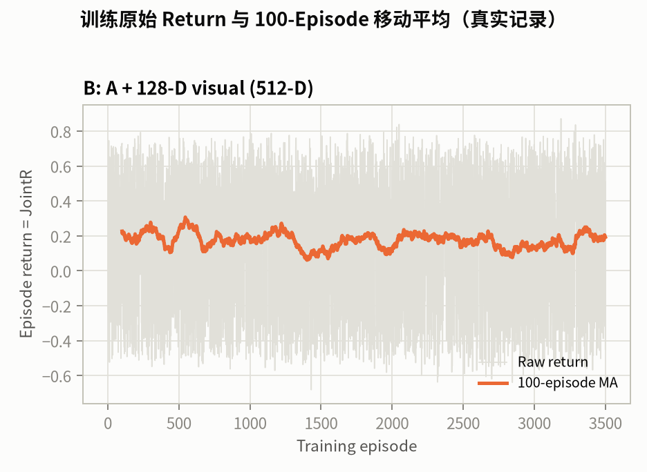
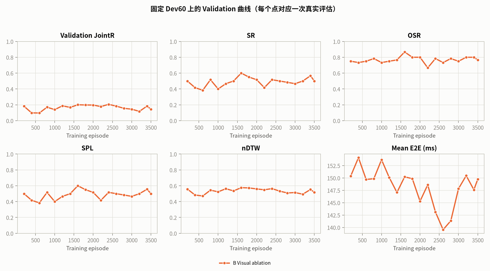
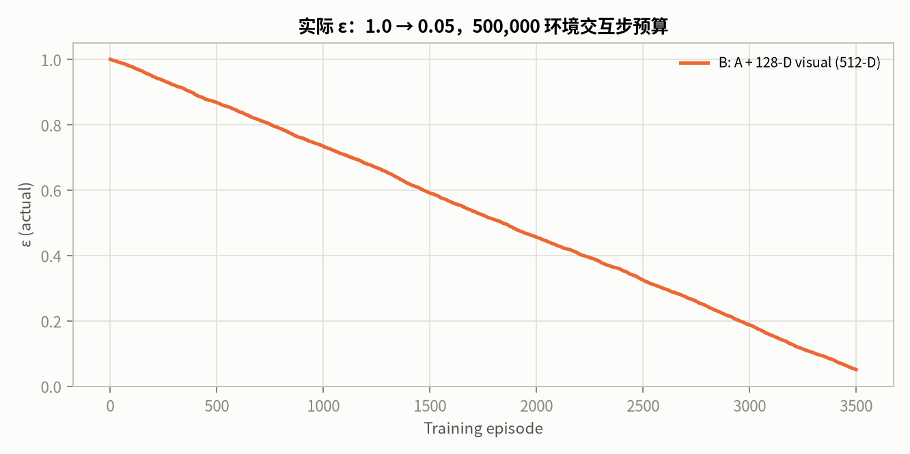
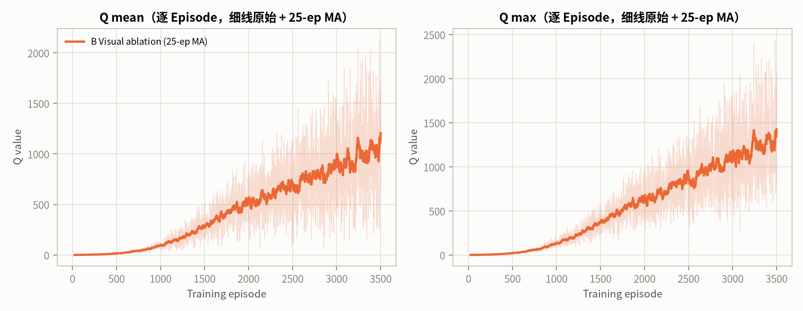
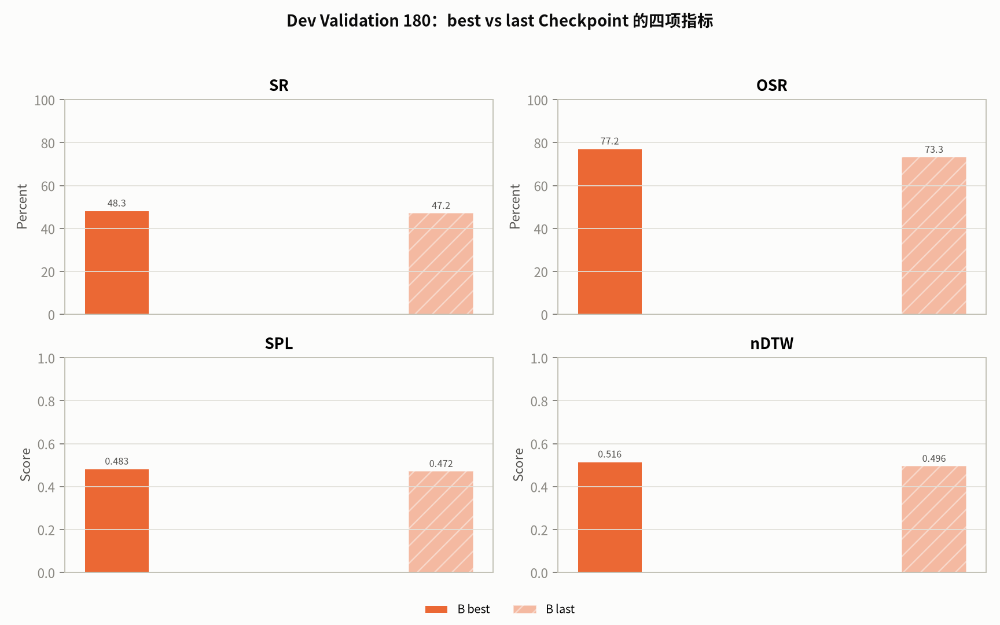
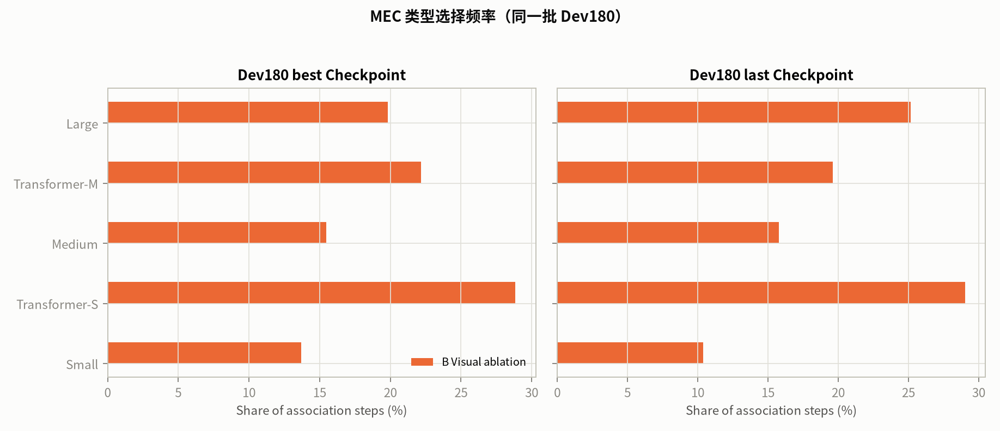

# Stage-2k v2 B：视觉消融 实验报告

- 日期：2026-10-21T10:52:12.543887+00:00
- 运行目录：`runs/v83_spatial_stage2/stage2k_visual_ablation_v2`
- 状态模式：`visual_ablation_v2`，512 维 MLP 输入，532 维决策状态
- 网络：`mlp_512_256_256_20`
- TensorBoard：`runs/tensorboard/association_stage2k_visual_ablation_v2/`
- 数据隔离：未读取 Stage-2j Final Test 300，未读取 Association Final Test 180。

## 0. TL;DR

- 实际训练 **3500 / 3500** Episodes，**499,728** 环境交互步；最终 ε **0.0505**。
- 最佳 Dev60 JointR **0.2062** @ Ep2400；最后 Dev60 JointR **0.1432**。
- 训练状态：**not_converged**；converged = **False**；早停禁用 = **True**。
- 收敛门槛与 Final Test 决策：**retained_not_converged**（Final Test read = **False**）。
- Q 审计（固定 Dev 状态）：best→last Q mean **505.484 → 741.208**（1.5×），Q max **887.780 → 1259.984**；贪心一致率 **20.00%**。
- **Q 尺度警告**：last Checkpoint 的 Q 尺度达到 741.2（mean）/ 1260.0（max），远超奖励量级，属于明显的 Q 过估计/尺度漂移；虽然未触发 1e6 数值中止阈值，但**不能**据此认为策略收敛或可部署。

## 1. 状态空间

`visual_ablation_v2` 的布局（由 `state_layout` 固化）：

```json
{
  "state_mode": "visual_ablation_v2",
  "uav_position": [
    0,
    2
  ],
  "episode_step": {
    "index": 2,
    "normalization": "t/400"
  },
  "running_mean_e2e": {
    "index": 3,
    "normalization": "running_mean_E2E_ms/100"
  },
  "candidates": [
    4,
    384
  ],
  "availability_mask": {
    "dim": 20,
    "separate_from_mlp_input": true,
    "used_for_action_masking": true
  },
  "total_mlp_input": 512,
  "total_decision_state": 532,
  "candidate_dim": 19,
  "candidate_fields": [
    "relative_x",
    "relative_y",
    "distance",
    "compute_norm",
    "bandwidth_norm",
    "uplink_rate_norm",
    "communication_ms_norm",
    "inference_ms_norm",
    "e2e_ms_norm",
    "snr_db_norm",
    "dev_sr",
    "dev_osr",
    "dev_spl",
    "dev_ndtw",
    "model_Small",
    "model_Transformer-S",
    "model_Medium",
    "model_Transformer-M",
    "model_Large"
  ],
  "capability_fields": [
    "dev_sr",
    "dev_osr",
    "dev_spl",
    "dev_ndtw"
  ],
  "forbidden": [
    "new GAB module",
    "heatmap module",
    "other new modules",
    "goal tokens as explicit state",
    "target position",
    "target distance",
    "oracle action",
    "success"
  ],
  "visual_context": [
    0,
    128
  ],
  "pure_mec_state": [
    128,
    512
  ],
  "visual_projector": "frozen Stage-2k PCA (Train-600 natural states); GAB/map blocks of the summary neutralized to the training mean"
}
```

- 能力先验：`runs/v83_spatial_stage2/stage2k/capability_prior_v2.json`，SHA256 `7859ee81ec314a441594a36b2435f85056601c814730eca13d06e434053a0108`；split = `dev_val_180`，metrics = `['sr', 'osr', 'spl', 'ndtw']`，final_test_read = `False`。
- 视觉上下文：`runs/v83_spatial_stage2/stage2k/visual_pca.npz`，SHA256 `e3cf2e84935d8a82108f7aa8fa54395c39186b90383da58df3c9fa72cdd153bd`；frozen 128-D context; GAB/map blocks neutralized to the training mean。

## 2. 训练配置

| 项 | 值 |
|---|---|
| Episodes | 3500 / 3500 |
| ε 预算 | 500,000 环境交互步 |
| γ | 1.0 |
| 学习率 / Batch / Replay | 0.0001 / 128 / 50,000 |
| 训练任务 | train_4000 stratified random sample (3500) |
| 训练顺序 | `random`，seed = 40522062 |
| 训练拓扑 / 验证拓扑 | `train` / `dev` |
| 验证 | 每 200 Episodes，60 Dev episodes (6/10/4 per scenario) |
| 早停 | disabled = True；仅 NaN/Inf、Q 发散、程序错误中止 |
| 奖励 | `r_nav_t + (-0.25/100)*(running_mean_E2E_t - running_mean_E2E_{t-1})` |

## 3. 训练曲线









## 4. Dev60 Validation 记录

| Episode | JointR | SR | OSR | SPL | nDTW | E2E (ms) | Loss | Q mean | Q max | ε |
|---:|---:|---:|---:|---:|---:|---:|---:|---:|---:|---:|
| 200 | 0.1822 | 50.00% | 75.00% | 0.5000 | 0.5582 | 150.40 | 0.0012 | 1.089 | 4.393 | 0.9478 |
| 400 | 0.0978 | 41.67% | 73.33% | 0.4166 | 0.4831 | 154.10 | 0.0209 | 5.605 | 17.059 | 0.8923 |
| 600 | 0.0966 | 38.33% | 75.00% | 0.3833 | 0.4708 | 149.69 | 0.1542 | 16.656 | 43.905 | 0.8412 |
| 800 | 0.1697 | 51.67% | 78.33% | 0.5161 | 0.5444 | 149.85 | 0.5709 | 36.982 | 88.599 | 0.7879 |
| 1000 | 0.1392 | 40.00% | 73.33% | 0.4000 | 0.5234 | 153.68 | 1.4827 | 73.190 | 211.567 | 0.7345 |
| 1200 | 0.1872 | 46.67% | 75.00% | 0.4661 | 0.5624 | 150.09 | 2.8137 | 127.557 | 313.450 | 0.6814 |
| 1400 | 0.1673 | 50.00% | 76.67% | 0.4993 | 0.5350 | 147.07 | 4.1570 | 199.405 | 488.091 | 0.6198 |
| 1600 | 0.2002 | 60.00% | 86.67% | 0.5999 | 0.5758 | 150.22 | 5.5495 | 290.982 | 623.680 | 0.5636 |
| 1800 | 0.1980 | 55.00% | 80.00% | 0.5500 | 0.5726 | 149.86 | 6.9551 | 392.594 | 871.658 | 0.5098 |
| 2000 | 0.1968 | 51.67% | 80.00% | 0.5161 | 0.5601 | 145.29 | 8.5283 | 488.063 | 987.138 | 0.4557 |
| 2200 | 0.1774 | 41.67% | 66.67% | 0.4167 | 0.5490 | 148.62 | 9.8060 | 541.323 | 1222.258 | 0.4047 |
| 2400 | 0.2062 | 51.67% | 78.33% | 0.5167 | 0.5641 | 143.13 | 11.0006 | 630.191 | 1342.023 | 0.3555 |
| 2600 | 0.1828 | 50.00% | 73.33% | 0.4999 | 0.5317 | 139.54 | 11.9748 | 683.994 | 1517.371 | 0.2978 |
| 2800 | 0.1556 | 48.33% | 78.33% | 0.4832 | 0.5090 | 141.35 | 12.5607 | 780.872 | 1683.381 | 0.2451 |
| 3000 | 0.1446 | 46.67% | 75.00% | 0.4661 | 0.5142 | 147.83 | 13.4024 | 842.225 | 1953.483 | 0.1877 |
| 3200 | 0.1171 | 50.00% | 80.00% | 0.4995 | 0.4932 | 150.47 | 14.6945 | 892.084 | 2052.897 | 0.1281 |
| 3400 | 0.1839 | 56.67% | 80.00% | 0.5560 | 0.5530 | 147.61 | 15.9425 | 1017.291 | 2397.006 | 0.0780 |
| 3500 | 0.1432 | 50.00% | 76.67% | 0.5000 | 0.5176 | 149.75 | 16.7190 | 1036.540 | 2446.196 | 0.0505 |

## 5. Dev180 best / last

| Checkpoint | Episode | SR | OSR | SPL | nDTW | E2E (ms) | P95 (ms) | JointR |
|---|---:|---:|---:|---:|---:|---:|---:|---:|
| best | 2400 | 48.33% | 77.22% | 0.4833 | 0.5162 | 139.01 | 222.76 | **0.1687** |
| last | 3500 | 47.22% | 73.33% | 0.4722 | 0.4962 | 142.84 | 221.50 | **0.1391** |



## 6. MEC 选择频率（Dev180）



| MEC | best 使用率 | last 使用率 |
|---|---:|---:|
| Small | 13.69% | 10.39% |
| Transformer-S | 28.85% | 29.04% |
| Medium | 15.46% | 15.79% |
| Transformer-M | 22.17% | 19.61% |
| Large | 19.82% | 25.17% |

## 7. Q 稳定性（只读审计）

- 固定状态数：35；行为策略：deterministic Min-Latency (checkpoint-independent)。
- best：Ep2400，Q mean 505.4840，Q max 887.7803，Q std 10.0729，top-2 gap 8.5710。
- last：Ep3500，Q mean 741.2085，Q max 1259.9838，Q std 18.3723，top-2 gap 14.5827。
- best/last 贪心动作一致率：**20.00%**。

## 8. 收敛与 Final Test 决策

预注册标准：完成 3500 Episodes；数值有限；至少 5 次 Dev 验证；最近 3 次 JointR 极差 ≤ 0.01；最后值 ≥ 最佳 − 0.005；且不再形成新最佳。

- `converged`：**False**
- 最佳 Dev60 JointR：**0.2062**；竞争力阈值：**0.2828**（同批 Dev60 最强非特权 Baseline，Min-Latency）
- `competitive`：**False**
- `final_test_eligible`：**False**
- 决策：**retained_not_converged**；Final Test read = **False**

## 9. 结论

- 实际训练 3500 Episodes；收敛状态 `not_converged`；最佳 Checkpoint 为 Ep2400（Dev60 JointR 0.2062）。
- Dev180 best/last 与 Q 稳定性见上表；未读取一次性 Final Test。

## 10. 产物

- 训练目录：`runs/v83_spatial_stage2/stage2k_visual_ablation_v2`
- Checkpoints：`runs/v83_spatial_stage2/stage2k_visual_ablation_v2/checkpoints/best.pt`、`last.pt`、`last_full.pt`
- TensorBoard：`runs/tensorboard/association_stage2k_visual_ablation_v2/`
- 曲线：`v83_spatial_stage2/figures/stage2k_visual_ablation_v2`
- 大型权重、Replay Buffer、TensorBoard Event 与逐 Episode CSV 保留在 `runs/` 下，不提交 Git。