# Stage-2l 训练奖励曲线与中后期下降分析

日期：2026-10-21  
分支：`experiment/v83-spatial-foundation`  
数据：`runs/v83_spatial_stage2/stage2l_fixed_city/`（只读）

本报告只读取训练历史、验证记录和评测产物；**没有停止或修改任何训练进程、Checkpoint 或历史实验数据**。四个已完成 Agent 为 A/DQN、A/PPO、C/DQN、C/PPO；B 仍暂停，不在本报告的 3500-Episode 曲线中。

## 1. 数据与定义

- 逐 Episode Reward：`training_history.json` 的 `episode_return`，与 JointR 对齐（导航 reward + 运行平均 E2E 惩罚）。
- MA100：从 Episode 100 起，最近 100 个训练 Episode 的算术平均。
- Validation JointR：每 200 Episodes 在 60 条固定 Dev 任务上的 `joint_reward`；共 18 个点（200…3400、3500）。
- 训练 Reward 与 Validation JointR 分开绘制，验证点不做逐 Episode 插值。
- 本报告中的“晚期”通常指 Episode ≥ 2500；DQN/PPO 诊断表的“早期/晚期”是前/后 200 个训练 Episode（PPO 的 KL/Value Loss 为前/后 3 个验证点）；MEC 使用比例的早期/中期/晚期为前 3 / 第 7–9 / 后 3 个验证点。

## 2. 四个 Agent 的训练奖励曲线

每条图同时包含原始逐 Episode Reward（浅灰）与 MA100（彩色）；星号标出 MA100 峰值，方块标出最终 MA100。峰值只表示中途最高，**不是收敛**。

### C/DQN（重点）

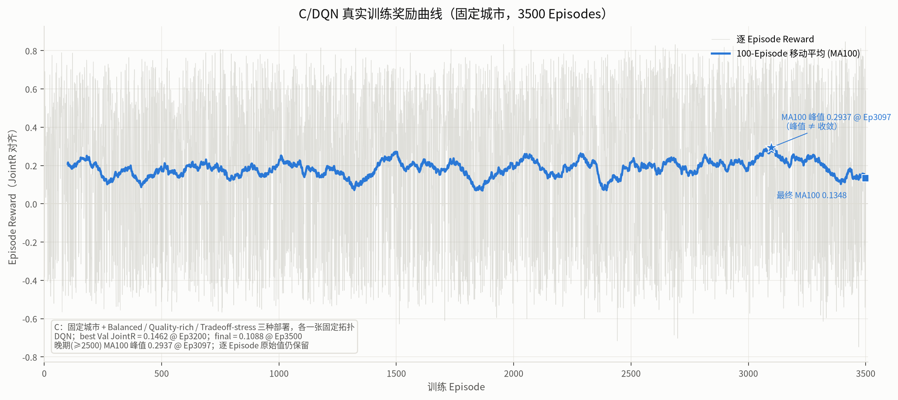

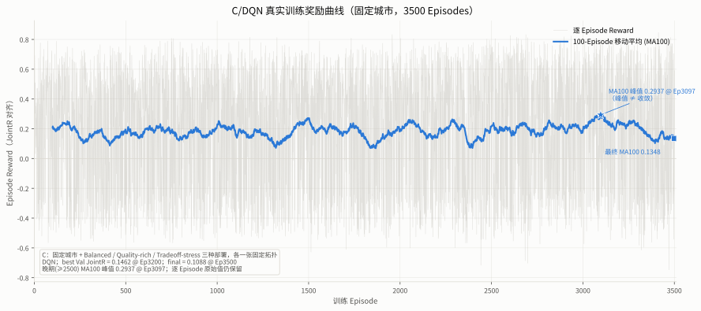

### C/PPO（重点）


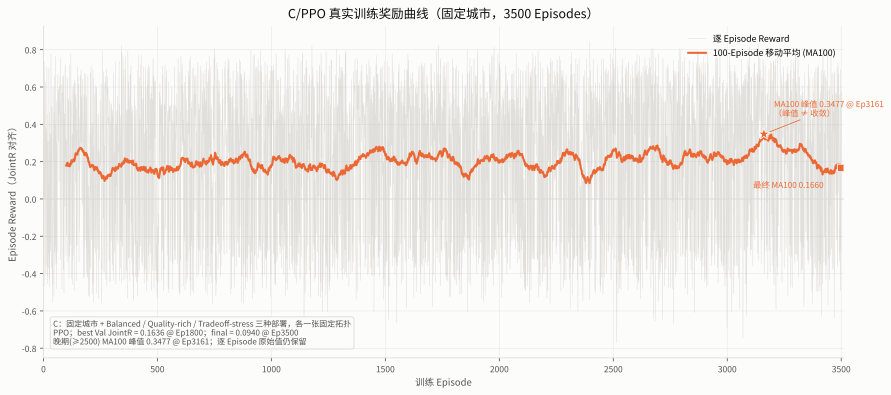

### A/DQN 与 A/PPO

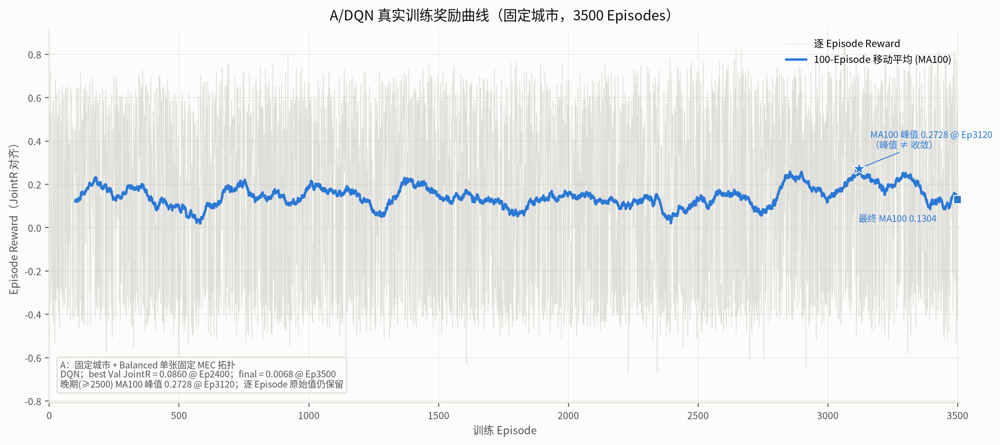

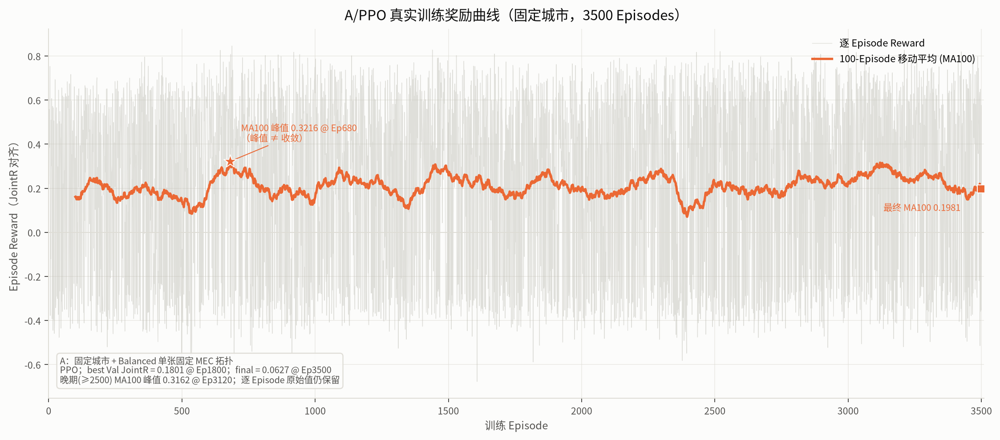

## 3. A/C 四臂 MA100 综合对比

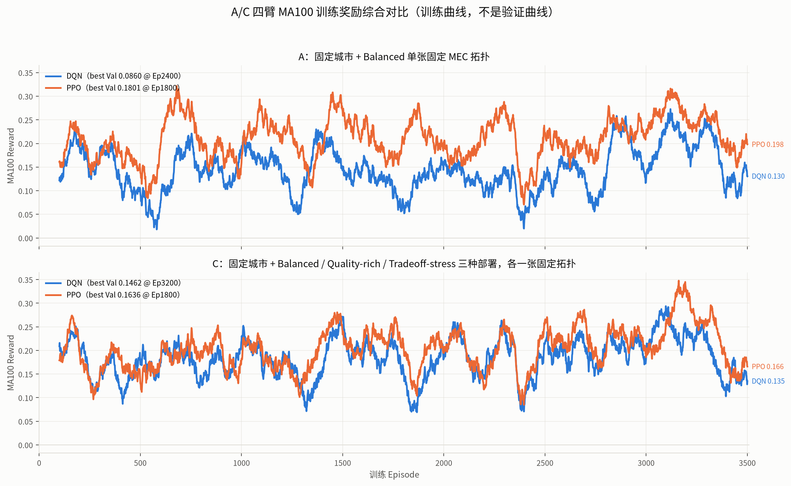

图中只画训练 MA100；验证曲线见下一节。A 为单张 Balanced 固定拓扑；C 为 Balanced / Quality-rich / Tradeoff-stress 三种部署、每种一张固定拓扑。

## 4. Dev60 Validation JointR（每 200 Episodes）

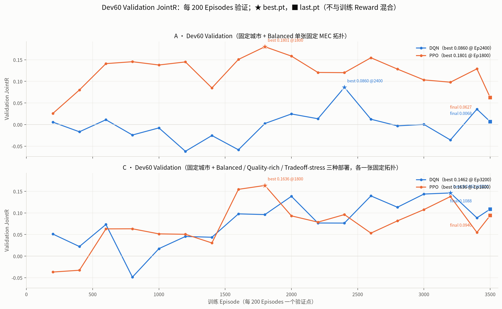

★ 标出对应 best checkpoint 的验证点，■ 标出最终（Ep3500）验证点；best checkpoint 文件名固定为 `best.pt`，最后 checkpoint 为 `last.pt`。验证点只有 18 个，连线仅辅助阅读，不能当作逐 Episode 训练曲线。

## 5. 奖励变化汇总

| Agent | MA100 峰值 | 峰值 Episode | 晚期(≥2500)峰值 | 最终 MA100 | Best Val JointR | Best Ep | Final Val JointR |
|---|---:|---:|---:|---:|---:|---:|---:|
| A/DQN | 0.2728 | 3120 | 0.2728 @ 3120 | 0.1304 | 0.0860 | 2400 | 0.0068 |
| A/PPO | 0.3216 | 680 | 0.3162 @ 3120 | 0.1981 | 0.1801 | 1800 | 0.0627 |
| C/DQN | 0.2937 | 3097 | 0.2937 @ 3097 | 0.1348 | 0.1462 | 3200 | 0.1088 |
| C/PPO | 0.3477 | 3161 | 0.3477 @ 3161 | 0.1660 | 0.1636 | 1800 | 0.0940 |

关键观察：

- A/DQN、C/DQN、C/PPO 的全局 MA100 峰值出现在 Ep3097–3161；A/PPO 的全局峰值在 Ep680，但 Ep3120 附近还有接近的晚期峰值 0.3162。
- 四个 Agent 在 3001–3200 这一 200-Episode 区间同时出现较高的训练奖励，随后在 3201–3400、3401–3500 同时回落。
- **训练 MA100 的峰值与 Dev Validation 的 best 并不对齐**：A/PPO 的 Dev best 在 Ep1800（0.1801），训练 MA100 的全局峰值却在 Ep680；C/PPO 的 Dev best 在 Ep1800（0.1636），训练 MA100 峰值在 Ep3161。因此训练曲线峰值不能作为模型选择或收敛证据。
- 四臂的 Dev best 都低于其训练 MA100 峰值，且 final Dev JointR 更低；这与“训练奖励上升但 Dev 泛化下降”一致，但不能仅凭这一点断言原因。

## 6. 中后期下降诊断

### 6.1 DQN：ε、Q 值与 TD Loss

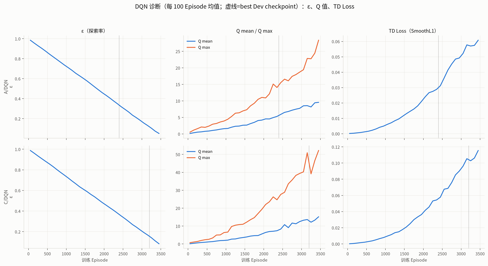

| Agent | ε 初始→最终 | Q mean 早期→晚期 | Q mean 峰值 | Q max 峰值 | TD Loss 早期→晚期 |
|---|---:|---:|---:|---:|---:|
| A/DQN | 0.999→0.050 | 0.25→9.49 | 23.73 | 28.36 | 0.00066→0.05910 |
| C/DQN | 0.999→0.069 | 0.27→14.24 | 42.58 | 52.16 | 0.00129→0.11082 |

可证实：

- ε 从约 1.0 衰减到 0.05–0.07，后期探索显著减少。
- Q mean / Q max 在训练中大幅上升（A/DQN 的 Q mean 峰值约 23.7，C/DQN 约 42.6），远高于实际 Episode Reward 的量级；TD Loss 在后期也明显高于早期。
- 这些是训练日志中直接可读的数值，不是猜测。

推测（需要额外实验）：

- Q 值持续增大而 Dev JointR 没有同步提高，可能包含 Q 过估计、replay 分布偏移或对近期任务块的过拟合；目前的日志不足以区分这些机制。
- 不能仅凭 Q 值上升判断“学到了更好的关联”；它也可能只是 target 变大。

### 6.2 PPO：熵、KL 与 Value Loss

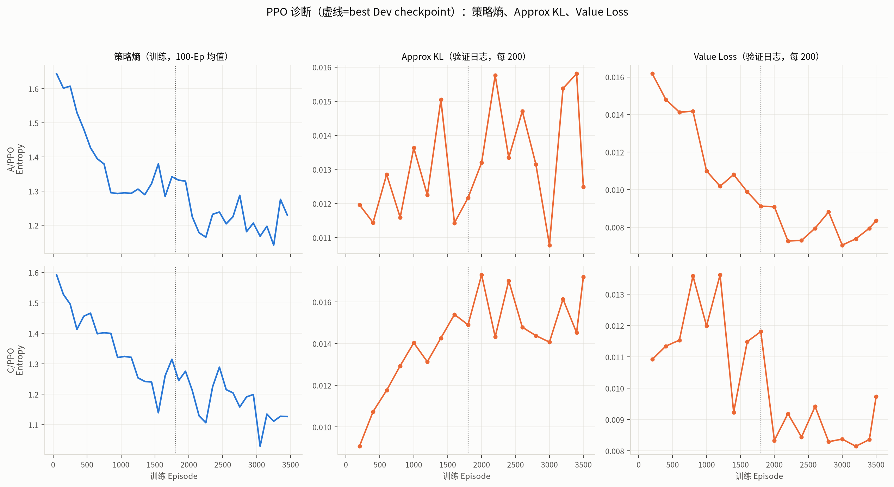

| Agent | 熵 早期→晚期 | Approx KL 早期→晚期 | Value Loss 早期→晚期 | Policy Loss 早期→晚期 |
|---|---:|---:|---:|---:|
| A/PPO | 1.623→1.253 | 0.0121→0.0146 | 0.0150→0.0079 | -0.0175→-0.0203 |
| C/PPO | 1.560→1.127 | 0.0105→0.0160 | 0.0113→0.0087 | -0.0203→-0.0226 |

可证实：

- 两臂 PPO 的策略熵都下降（A 1.62→1.25，C 1.56→1.13），策略变得更确定。
- Approx KL 保持在约 0.01–0.02，没有出现数值爆炸；Value Loss 没有同步恶化（A 0.015→0.008，C 0.011→0.009）。
- 因此 PPO 后期的 Dev 下降不是“训练发散/NaN”造成的；更可能是策略分布变窄后与 Dev 任务不匹配。

推测（需要额外实验）：

- 熵下降可能使 PPO 逐渐锁定到少数 MEC 类型；从验证时的模型使用比例可以看到晚期偏向 Small（A）或 Large（C）的迹象，但这不是因果证明。
- 训练任务顺序是全局随机打乱的，PPO 可能在后期块上过拟合；需要用独立 Dev/新拓扑做对照实验才能确认。

### 6.3 MEC 使用比例

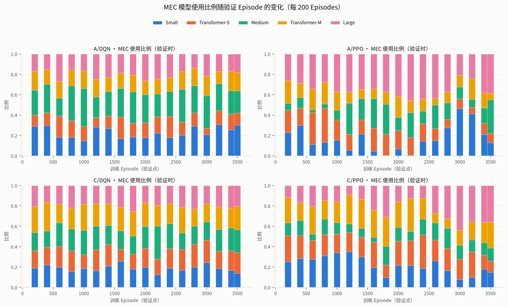

| Agent | 阶段 | Small | Transformer-S | Medium | Transformer-M | Large |
|---|---|---:|---:|---:|---:|---:|
| A/DQN | 早期(前3次) | 0.256 | 0.148 | 0.234 | 0.165 | 0.197 |
| A/DQN | 中期(第7–9次) | 0.208 | 0.157 | 0.276 | 0.153 | 0.207 |
| A/DQN | 晚期(后3次) | 0.288 | 0.136 | 0.237 | 0.164 | 0.174 |
| A/PPO | 早期(前3次) | 0.213 | 0.235 | 0.066 | 0.190 | 0.296 |
| A/PPO | 中期(第7–9次) | 0.088 | 0.191 | 0.265 | 0.102 | 0.354 |
| A/PPO | 晚期(后3次) | 0.251 | 0.088 | 0.187 | 0.138 | 0.337 |
| C/DQN | 早期(前3次) | 0.203 | 0.182 | 0.190 | 0.241 | 0.184 |
| C/DQN | 中期(第7–9次) | 0.215 | 0.160 | 0.181 | 0.228 | 0.216 |
| C/DQN | 晚期(后3次) | 0.163 | 0.189 | 0.221 | 0.216 | 0.211 |
| C/PPO | 早期(前3次) | 0.270 | 0.224 | 0.112 | 0.231 | 0.163 |
| C/PPO | 中期(第7–9次) | 0.198 | 0.189 | 0.105 | 0.281 | 0.227 |
| C/PPO | 晚期(后3次) | 0.142 | 0.167 | 0.122 | 0.212 | 0.358 |

### 6.4 任务顺序、Band 组成与实际步数

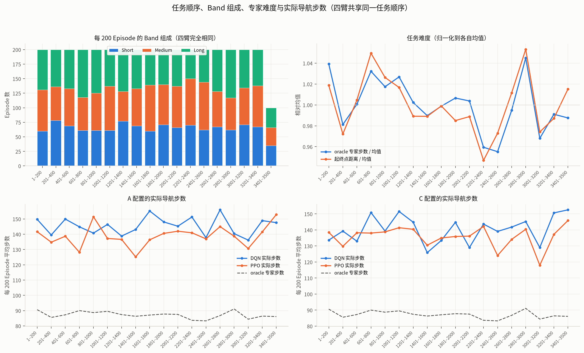

四个 Agent 使用**完全相同的 training_order.json、map_seed 和 task_seed**；四臂的历史配置都记录 `seed=20261031`（DQN 与 PPO 各自算法内部使用），但算法/网络不同，不能把相同 seed 当作相同随机过程。每个 200-Episode 块的 Short/Medium/Long 数量、oracle 专家步数和起终点距离完全相同。以下为最后三个块与早期块的对比：

| 块 | Short | Medium | Long | oracle 步数均值 | 起终点距离均值 (m) | A/DQN 实际步数 | A/PPO 实际步数 | C/DQN 实际步数 | C/PPO 实际步数 |
|---|---:|---:|---:|---:|---:|---:|---:|---:|---:|
| 1–200 | 60 | 71 | 69 | 90.6 | 330.8 | 149.7 | 141.6 | 133.7 | 138.5 |
| 601–800 | 61 | 57 | 82 | 90.0 | 340.8 | 144.8 | 128.2 | 150.8 | 138.0 |
| 2201–2400 | 70 | 80 | 50 | 83.7 | 307.5 | 151.3 | 140.9 | 143.7 | 142.2 |
| 2801–3000 | 62 | 55 | 83 | 91.1 | 342.0 | 140.4 | 138.7 | 145.2 | 140.4 |
| 3001–3200 | 71 | 63 | 66 | 84.4 | 316.3 | 136.2 | 130.7 | 129.0 | 118.0 |
| 3201–3400 | 67 | 71 | 62 | 86.4 | 320.5 | 148.9 | 141.5 | 150.6 | 137.2 |
| 3401–3500 | 35 | 31 | 34 | 86.1 | 329.6 | 147.6 | 152.9 | 152.5 | 145.8 |

可证实：

- 任务顺序与 Band 组成在四臂间逐 Episode 完全相同；因此四臂在3001–3200 同时出现高奖励、随后同时回落，至少部分来自共享任务序列。
- 3001–3200 块的实际导航步数在四臂中都较低（A/DQN 136.2、A/PPO 130.7、C/DQN 129.0、C/PPO 118.0），而 3201–3400 和3401–3500 明显升高；奖励与实际步数呈强负相关（块级 Pearson：A/DQN -0.64、A/PPO -0.57、C/DQN -0.58、C/PPO -0.74），与成功率正相关（0.52–0.65）。
- 因此“后期奖励下降”与后期实际步数增加/成功率下降是一致的；这是可观察的相关性。

推测（需要额外实验）：

- 3001–3200 块本身略“容易”（oracle 步数均值 84.4 vs 相邻块 86–91），可能放大了这次峰值；但 oracle 难度与奖励的相关性很弱且方向不一致（A/DQN +0.20、A/PPO +0.02、C/DQN -0.06、C/PPO -0.28），所以不能把峰值简单归因于任务更容易。
- 共享任务顺序/相同基础随机种子是已证实的事实；它们对相似奖励变化的因果贡献只能由跨块相关性和对照实验估计，不能仅凭相关性断言。

### 6.5 跨 Agent 奖励相关

块级（18 个 200-Episode 块）与逐 Episode 的 Pearson/Spearman 相关：

| 对比 | 块级 Pearson | 块级 Spearman | 逐 Episode Pearson |
|---|---:|---:|---:|
| A/DQN vs A/PPO | 0.601 | 0.443 | 0.636 |
| A/DQN vs C/DQN | 0.410 | 0.337 | 0.571 |
| A/DQN vs C/PPO | 0.557 | 0.404 | 0.568 |
| A/PPO vs C/DQN | 0.520 | 0.410 | 0.587 |
| A/PPO vs C/PPO | 0.727 | 0.701 | 0.563 |
| C/DQN vs C/PPO | 0.788 | 0.705 | 0.644 |

块级相关最高的是 C/DQN vs C/PPO（0.788）和 A/PPO vs C/PPO（0.727）；A/DQN vs A/PPO 为 0.601。这与共享任务顺序、共享map/task seed 以及共同的后期块结构一致，但不能证明算法本身相同。

## 7. 结论（明确不称收敛）

- 四个 Agent 都跑满 3500 Episodes；训练 MA100 的峰值出现在中后期（约 Ep3100）或早期（A/PPO Ep680），但 Dev Validation 的 best分别出现在 Ep2400/1800/3200/1800，两者不对齐。
- **训练奖励峰值不是收敛**：所有 best checkpoint 的 Dev JointR 都低于训练 MA100 峰值，final Dev JointR 更低；四臂的最终状态均为`plateaued_not_converged`。
- 固定 Dev Baseline 对照（上一轮）显示：A/PPO best 0.1801 低于Max-Quality 0.2179 与 Heuristic 0.2131；C/PPO best 0.1636 低于Min-Latency 0.1833 与 Heuristic 0.1843。因此当前学习策略还没有优于全部非特权 baseline；这与“训练曲线看起来很高”并不矛盾。
- 已证实：共享任务顺序/Band 组成、后期实际步数上升、DQN ε 衰减与Q 值/ TD Loss 上升、PPO 熵下降、训练与 Dev 不对齐。
- 推测：Q 过估计/replay 分布偏移、PPO 策略分布变窄与后期任务块过拟合；这些需要独立 Dev/新拓扑/种子重复实验验证，不能作为已证实结论。
- 没有使用 Final Test；没有修改奖励、算法、Checkpoint 或历史数据。

## 8. 产物与复现

图（PNG/SVG）：`v83_spatial_stage2/figures/stage2l_curves/`  
原始数据 CSV：`v83_spatial_stage2/figures/stage2l_curves/data/`  
复现：

```bash
python v83_spatial_stage2/stage2l_plot_training_curves.py
```

生成的 CSV：`training_curves_raw.csv`（14,000 行逐 Episode 数据）、`validation_curves.csv`、`per200_task_mix.csv`、`diagnostics_dqn.csv`、`diagnostics_ppo.csv`、`model_usage.csv`、`correlations.csv`。
