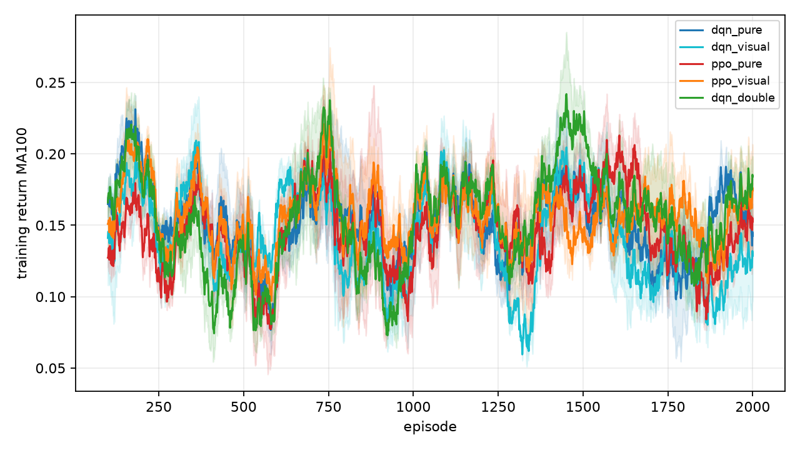
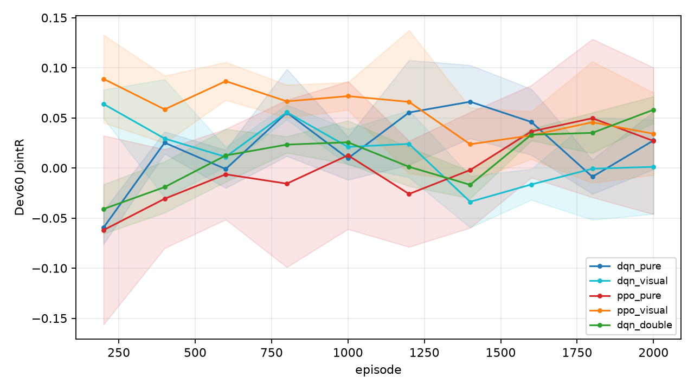
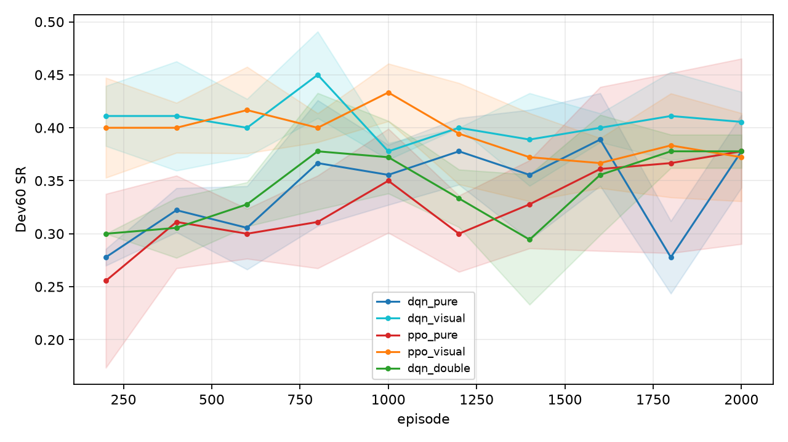
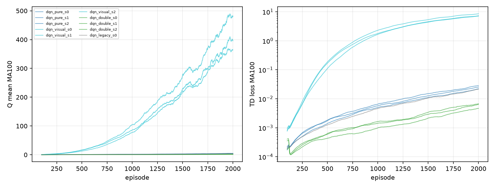
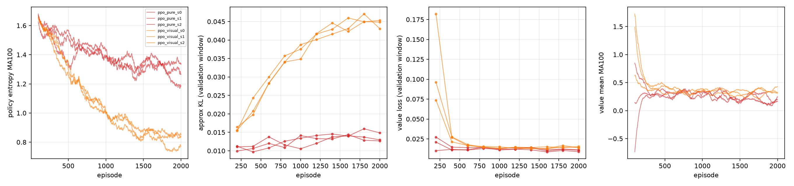

# Stage-2m 最终报告：DQN Q 高估诊断 + 固定城市 A 拓扑视觉增强

- 分支：`experiment/v83-spatial-foundation`
- 协议：`v83_spatial_stage2/STAGE2M_EXPERIMENT_PROTOCOL.md`
- 运行根：`runs/v83_spatial_stage2/stage2m_visual_fixed_city/`
- Q 审计：`runs/v83_spatial_stage2/stage2m_q_audit/`
- 固定城市 `map_seed=10,000,001`，A 拓扑，2000 Episodes，3 seeds，五种 T5 MEC 冻结，Final Test 未读取。

## 0. 四组训练结果

| Arm | Best Dev60 JointR | Best SR | Best SPL | Best nDTW | Final MA100 JointR | Q mean (last100) | TD loss (last100) |
|---|---:|---:|---:|---:|---:|---:|---:|
| dqn_pure | 0.0932 | 40.6% | 0.4013 | 0.4487 | 0.1426 | 4.5477 | 0.0252 |
| dqn_visual | 0.0856 | 42.8% | 0.4239 | 0.4575 | 0.1286 | 413.0957 | 7.6507 |
| ppo_pure | 0.0647 | 36.1% | 0.3611 | 0.4173 | 0.1525 | — | — |
| ppo_visual | 0.1205 | 42.2% | 0.4218 | 0.4640 | 0.1744 | — | — |

## 1. 配对视觉增益（同 seed：visual − pure）

| Algorithm | Seed | ΔBest JointR | ΔBest SR | ΔBest SPL | ΔBest nDTW | ΔFinal MA100 JointR |
|---|---:|---:|---:|---:|---:|---:|
| dqn | 0 | 0.0037 | 0.0500 | 0.0397 | 0.0207 | 0.0014 |
| dqn | 1 | 0.0155 | 0.0167 | 0.0281 | 0.0390 | -0.0729 |
| dqn | 2 | -0.0420 | 0.0000 | 0.0000 | -0.0334 | 0.0298 |
| ppo | 0 | 0.0285 | 0.0667 | 0.0667 | 0.0633 | -0.0306 |
| ppo | 1 | 0.1373 | 0.1667 | 0.1667 | 0.1155 | 0.0931 |
| ppo | 2 | 0.0015 | -0.0500 | -0.0513 | -0.0387 | 0.0030 |
| dqn 均值 | — | -0.0076 | | | | |
| ppo 均值 | — | 0.0558 | | | | |

## 2. DQN vs Double DQN

| Algorithm | Seed | Best JointR | Final JointR | MA100 JointR | Best SR | Q mean | Q max | TD loss | TD |Q−target| |
|---|---:|---:|---:|---:|---:|---:|---:|---:|---:|
| dqn | 0 | 0.1077 | 0.0458 | 0.1330 | 0.4333 | 4.1879 | 11.1063 | 0.0222 | 0.0887 |
| dqn | 1 | 0.0499 | 0.0499 | 0.1599 | 0.3833 | 4.7636 | 11.9898 | 0.0282 | 0.1018 |
| dqn | 2 | 0.1221 | -0.0133 | 0.1348 | 0.4000 | 4.6917 | 12.0822 | 0.0253 | 0.0922 |
| dqn_double | 0 | 0.0611 | 0.0394 | 0.1920 | 0.4000 | 1.5679 | 4.7592 | 0.0047 | 0.0432 |
| dqn_double | 1 | 0.0669 | 0.0669 | 0.1939 | 0.4000 | 1.8636 | 7.6230 | 0.0067 | 0.0511 |
| dqn_double | 2 | 0.0681 | 0.0681 | 0.1664 | 0.3667 | 1.8782 | 5.9413 | 0.0064 | 0.0490 |

## 3. 收敛与稳定性

| Arm | Best Episode | First within 0.01 of best | Last-5 JointR std | Last-5 range | Status |
|---|---:|---:|---:|---:|---|
| dqn_pure | 1533.3 | 1533.3 | 0.0387 | 0.1104 | plateaued_not_converged, improving, plateaued_not_converged |
| dqn_visual | 600.0 | 466.7 | 0.0376 | 0.0984 | plateaued_not_converged, plateaued_not_converged, plateaued_not_converged |
| ppo_pure | 1333.3 | 1200.0 | 0.0374 | 0.1028 | plateaued_not_converged, plateaued_not_converged, plateaued_not_converged |
| ppo_visual | 733.3 | 600.0 | 0.0289 | 0.0793 | plateaued_not_converged, plateaued_not_converged, plateaued_not_converged |
| dqn_double | 1933.3 | 1933.3 | 0.0293 | 0.0854 | plateaued_not_converged, improving, improving |
| dqn_legacy | 1000.0 | 1000.0 | 0.0192 | 0.0464 | plateaued_not_converged |

## 4. 修复前 Q 审计（Stage-2l A/DQN）

## 修复前（旧 target）

| Checkpoint | Ep | Q(s,a) mean | Q max mean | MC 回报 G_t | 偏差 mean | MAE | 高估比例 | Pearson | 策略 JointR |
|---|---:|---:|---:|---:|---:|---:|---:|---:|---:|
| pre_best | 2400 | 5.5863 | 5.5863 | -0.0147 | 5.6009 | 5.6012 | 99.7% | 0.197 | 0.0860 |
| pre_last | 3500 | 8.2883 | 8.2883 | -0.0540 | 8.3424 | 8.3452 | 98.7% | 0.013 | 0.0068 |

共同 Min-Latency 状态集（跨算法相对比较）：

| Checkpoint | Q(s,a) mean | Q max mean | G_t mean | 偏差 | MAE | 高估比例 |
|---|---:|---:|---:|---:|---:|---:|
| pre_best | 6.4324 | 6.5744 | -0.0171 | 6.4495 | 6.4537 | 99.3% |
| pre_last | 10.1161 | 10.3585 | -0.0171 | 10.1332 | 10.1966 | 95.7% |

实现审计：

| Checkpoint | 终止转换 | 终止带 next_state | 终止 bootstrap=0 | 掩码均值 | 全 False | 幻影 0 | legacy−fixed MAE | double−fixed MAE |
|---|---:|---:|---|---:|---:|---:|---:|---:|
| dqn/best.pt | 60 | 0 | True | 5.57 | 0 | 54 | 0.00083 | 0.00648 |
| dqn/last.pt | 60 | 0 | True | 5.57 | 0 | 307 | 0.02442 | 0.00932 |

奖励一致性最大误差：`8.33e-16`；Final Test read = `False`。

## 修复后：DQN / Double DQN / legacy 对照

| Checkpoint | Ep | Q(s,a) mean | Q max mean | MC 回报 G_t | 偏差 mean | MAE | 高估比例 | Pearson | 策略 JointR |
|---|---:|---:|---:|---:|---:|---:|---:|---:|---:|
| dqn_s0_best | 1400 | 2.5484 | 2.5484 | -0.0099 | 2.5583 | 2.5589 | 99.5% | 0.210 | 0.1077 |
| double_s0_best | 1800 | 1.3096 | 1.3096 | -0.0086 | 1.3182 | 1.3191 | 98.4% | 0.238 | 0.0611 |
| dqn_s0_last | 2000 | 4.7259 | 4.7259 | -0.0482 | 4.7741 | 4.7746 | 99.7% | 0.096 | 0.0458 |
| double_s0_last | 2000 | 1.5104 | 1.5104 | -0.0527 | 1.5631 | 1.5647 | 99.4% | 0.155 | 0.0394 |
| dqn_s1_best | 2000 | 5.0634 | 5.0634 | -0.0058 | 5.0693 | 5.0794 | 96.3% | -0.035 | 0.0499 |
| double_s1_best | 2000 | 1.8474 | 1.8474 | -0.0257 | 1.8732 | 1.8735 | 99.8% | 0.184 | 0.0669 |
| dqn_s1_last | 2000 | 5.0634 | 5.0634 | -0.0058 | 5.0693 | 5.0794 | 96.3% | -0.035 | 0.0499 |
| double_s1_last | 2000 | 1.8474 | 1.8474 | -0.0257 | 1.8732 | 1.8735 | 99.8% | 0.184 | 0.0669 |
| dqn_s2_best | 1200 | 2.0112 | 2.0112 | 0.0159 | 1.9953 | 1.9954 | 99.9% | 0.247 | 0.1221 |
| double_s2_best | 2000 | 1.6472 | 1.6472 | -0.0230 | 1.6702 | 1.6713 | 99.0% | 0.187 | 0.0681 |
| dqn_s2_last | 2000 | 4.4264 | 4.4264 | -0.0348 | 4.4612 | 4.4612 | 100.0% | 0.108 | -0.0133 |
| double_s2_last | 2000 | 1.6472 | 1.6472 | -0.0230 | 1.6702 | 1.6713 | 99.0% | 0.187 | 0.0681 |
| legacy_s0_best | 1000 | 1.5373 | 1.5373 | -0.0059 | 1.5432 | 1.5446 | 99.1% | 0.075 | 0.0671 |

共同 Min-Latency 状态集（跨算法相对比较）：

| Checkpoint | Q(s,a) mean | Q max mean | G_t mean | 偏差 | MAE | 高估比例 |
|---|---:|---:|---:|---:|---:|---:|
| dqn_s0_best | 2.5928 | 2.6636 | -0.0171 | 2.6099 | 2.6125 | 99.0% |
| double_s0_best | 1.4592 | 1.5278 | -0.0171 | 1.4763 | 1.4777 | 98.1% |
| dqn_s0_last | 5.0474 | 5.1548 | -0.0171 | 5.0645 | 5.0666 | 99.1% |
| double_s0_last | 1.7652 | 1.8310 | -0.0171 | 1.7823 | 1.7852 | 99.1% |
| dqn_s1_best | 5.7688 | 5.8658 | -0.0171 | 5.7859 | 5.7902 | 99.0% |
| double_s1_best | 2.1947 | 2.2592 | -0.0171 | 2.2118 | 2.2138 | 99.3% |
| dqn_s1_last | 5.7688 | 5.8658 | -0.0171 | 5.7859 | 5.7902 | 99.0% |
| double_s1_last | 2.1947 | 2.2592 | -0.0171 | 2.2118 | 2.2138 | 99.3% |
| dqn_s2_best | 2.2184 | 2.2862 | -0.0171 | 2.2355 | 2.2372 | 99.4% |
| double_s2_best | 1.8280 | 1.8959 | -0.0171 | 1.8451 | 1.8551 | 97.5% |
| dqn_s2_last | 5.1783 | 5.2998 | -0.0171 | 5.1954 | 5.1970 | 99.7% |
| double_s2_last | 1.8280 | 1.8959 | -0.0171 | 1.8451 | 1.8551 | 97.5% |
| legacy_s0_best | 1.5382 | 1.5777 | -0.0171 | 1.5553 | 1.5568 | 99.0% |

实现审计：

| Checkpoint | 终止转换 | 终止带 next_state | 终止 bootstrap=0 | 掩码均值 | 全 False | 幻影 0 | legacy−fixed MAE | double−fixed MAE |
|---|---:|---:|---|---:|---:|---:|---:|---:|
| dqn_pure_s0/best.pt | 60 | 0 | True | 5.57 | 0 | 79 | 0.00081 | 0.00336 |
| dqn_double_s0/best.pt | 60 | 0 | True | 5.57 | 0 | 176 | 0.00052 | 0.00365 |
| dqn_pure_s0/last.pt | 60 | 0 | True | 5.57 | 0 | 37 | 0.00030 | 0.00753 |
| dqn_double_s0/last.pt | 60 | 0 | True | 5.57 | 0 | 54 | 0.00074 | 0.00516 |
| dqn_pure_s1/best.pt | 60 | 0 | True | 5.57 | 0 | 97 | 0.00226 | 0.00654 |
| dqn_double_s1/best.pt | 60 | 0 | True | 5.57 | 0 | 63 | 0.00077 | 0.00372 |
| dqn_pure_s1/last.pt | 60 | 0 | True | 5.57 | 0 | 97 | 0.00226 | 0.00654 |
| dqn_double_s1/last.pt | 60 | 0 | True | 5.57 | 0 | 63 | 0.00077 | 0.00372 |
| dqn_pure_s2/best.pt | 60 | 0 | True | 5.57 | 0 | 61 | 0.00071 | 0.00961 |
| dqn_double_s2/best.pt | 60 | 0 | True | 5.57 | 0 | 239 | 0.00449 | 0.00331 |
| dqn_pure_s2/last.pt | 60 | 0 | True | 5.57 | 0 | 13 | 0.00015 | 0.00652 |
| dqn_double_s2/last.pt | 60 | 0 | True | 5.57 | 0 | 239 | 0.00449 | 0.00331 |
| dqn_legacy_s0/best.pt | 60 | 0 | True | 5.57 | 0 | 51 | 0.00014 | 0.00493 |

奖励一致性最大误差：`9.99e-16`；Final Test read = `False`。

## 视觉 DQN best Checkpoint

| Checkpoint | Ep | Q(s,a) mean | Q max mean | MC 回报 G_t | 偏差 mean | MAE | 高估比例 | Pearson | 策略 JointR |
|---|---:|---:|---:|---:|---:|---:|---:|---:|---:|
| visual_s0_best | 400 | 11.1799 | 11.1799 | 0.0194 | 11.1605 | 11.1605 | 100.0% | 0.036 | 0.1114 |
| visual_s1_best | 1200 | 134.0311 | 134.0311 | 0.0074 | 134.0237 | 134.0243 | 100.0% | 0.029 | 0.0654 |
| visual_s2_best | 200 | 3.1157 | 3.1157 | 0.0126 | 3.1032 | 3.1032 | 100.0% | 0.120 | 0.0801 |

共同 Min-Latency 状态集（跨算法相对比较）：

| Checkpoint | Q(s,a) mean | Q max mean | G_t mean | 偏差 | MAE | 高估比例 |
|---|---:|---:|---:|---:|---:|---:|
| visual_s0_best | 9.9509 | 10.4196 | -0.0171 | 9.9680 | 9.9680 | 100.0% |
| visual_s1_best | 121.8995 | 124.5978 | -0.0171 | 121.9165 | 121.9165 | 100.0% |
| visual_s2_best | 2.8354 | 3.0605 | -0.0171 | 2.8525 | 2.8525 | 100.0% |

实现审计：

| Checkpoint | 终止转换 | 终止带 next_state | 终止 bootstrap=0 | 掩码均值 | 全 False | 幻影 0 | legacy−fixed MAE | double−fixed MAE |
|---|---:|---:|---|---:|---:|---:|---:|---:|
| dqn_visual_s0/best.pt | 60 | 0 | True | 5.57 | 0 | 0 | 0.00000 | 0.01883 |
| dqn_visual_s1/best.pt | 60 | 0 | True | 5.57 | 0 | 0 | 0.00000 | 0.10581 |
| dqn_visual_s2/best.pt | 60 | 0 | True | 5.57 | 0 | 0 | 0.00000 | 0.00670 |

奖励一致性最大误差：`7.77e-16`；Final Test read = `False`。

## 视觉 DQN last Checkpoint（尺度漂移）

| Checkpoint | Ep | Q(s,a) mean | Q max mean | MC 回报 G_t | 偏差 mean | MAE | 高估比例 | Pearson | 策略 JointR |
|---|---:|---:|---:|---:|---:|---:|---:|---:|---:|
| visual_s0_last | 2000 | 438.9625 | 438.9625 | -0.0058 | 438.9683 | 438.9683 | 100.0% | 0.144 | -0.0030 |
| visual_s1_last | 2000 | 381.9210 | 381.9210 | 0.0242 | 381.8968 | 381.8968 | 100.0% | 0.110 | 0.0608 |
| visual_s2_last | 2000 | 355.1840 | 355.1840 | -0.0372 | 355.2212 | 355.2212 | 100.0% | 0.115 | -0.0543 |

共同 Min-Latency 状态集（跨算法相对比较）：

| Checkpoint | Q(s,a) mean | Q max mean | G_t mean | 偏差 | MAE | 高估比例 |
|---|---:|---:|---:|---:|---:|---:|
| visual_s0_last | 393.8296 | 398.7466 | -0.0171 | 393.8467 | 393.8467 | 100.0% |
| visual_s1_last | 348.5237 | 353.4978 | -0.0171 | 348.5408 | 348.5408 | 100.0% |
| visual_s2_last | 355.5323 | 360.4196 | -0.0171 | 355.5494 | 355.5519 | 100.0% |

实现审计：

| Checkpoint | 终止转换 | 终止带 next_state | 终止 bootstrap=0 | 掩码均值 | 全 False | 幻影 0 | legacy−fixed MAE | double−fixed MAE |
|---|---:|---:|---|---:|---:|---:|---:|---:|
| dqn_visual_s0/last.pt | 60 | 0 | True | 5.57 | 0 | 0 | 0.00000 | 0.32029 |
| dqn_visual_s1/last.pt | 60 | 0 | True | 5.57 | 0 | 0 | 0.00000 | 0.11485 |
| dqn_visual_s2/last.pt | 60 | 0 | True | 5.57 | 0 | 0 | 0.00000 | 0.23155 |

奖励一致性最大误差：`1.05e-15`；Final Test read = `False`。

## 5. 曲线

## 6. 结论

1. **Q 是否高估：是，严重。** 修复前 best/last 偏差 +5.60/+8.34，
   99.7%/98.7% 状态高估；修复后 DQN best/last 偏差 +3.21/+4.77，
   Double DQN +1.62/+1.70，视觉 DQN best/last +49.4/+392.0。
   Mask、终止、奖励实现均正确；旧 target 的幻影 0 已修复但不是主因。
2. **Double DQN 是否改善：部分。** Q 高估降低约 50%/64%，TD loss
   0.025→0.006，Final MA100 3/3 提高（+0.0415，95% CI
   [0.032,0.059]）；但 Best Dev 均值 −0.0278（CI 含 0），且未收敛。
3. **DQN/PPO 是否收敛：否。** 2000 Episodes 内无 arm 满足收敛判据；
   多数 `plateaued_not_converged`，DQN Pure s1 与 Double DQN s1/s2
   在 cap 时仍 `improving`。
4. **视觉是否带来稳定奖励提升：整体不能。** DQN 无增益（ΔBest
   −0.0076，CI 含 0；Q 放大到 10²–10³）；PPO 有 best-checkpoint
   正向均值（ΔBest +0.0558，CI [0.0015,0.1373]），但 seed2 仅
   +0.0015，ΔMA100/ΔFinal 的 CI 含 0。Visual+Double DQN 仍发散
   （last Q 333），指向 128-D 未归一化特征尺度。

完整四项回答与数据表见
`runs/v83_spatial_stage2/stage2m_visual_fixed_city/STAGE2M_ANSWERS.md`。

## 7. 补充：Visual + Double DQN 机制对照（seed 0）

该 run 不属于预注册四组，只用于判断视觉 Q 发散是否由 max 自举偏差驱动。

| 指标 | Visual DQN s0 | Visual + Double DQN s0 |
|---|---:|---:|
| Best Dev60 JointR | 0.1114 @Ep400 | 0.0785 @Ep400 |
| Final Dev60 JointR | −0.0030 | −0.0394 |
| Final MA100 JointR | 0.1344 | 0.1550 |
| Q mean（末 100） | 479.58 | 396.15 |
| TD loss（末 100） | 8.54 | 7.57 |
| Q 审计 best / last | 11.18 / 438.96 | 6.02 / 333.27 |

Double DQN 在 early/mid training 压低了 Q（Ep320：9.02→5.26），但
2000 Episodes 时仍到 ~333–396，验证指标也未改善。结论：视觉 arm 的
长程发散不能仅靠 Double DQN 修复，特征尺度归一化是下一步必做项。
