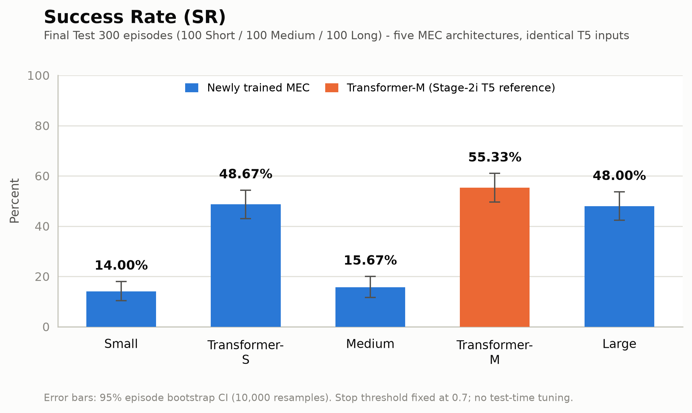
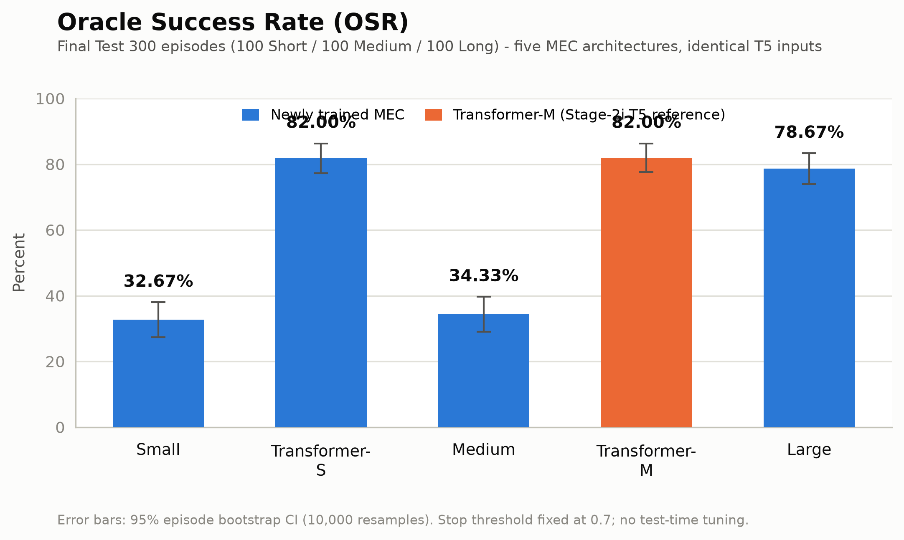
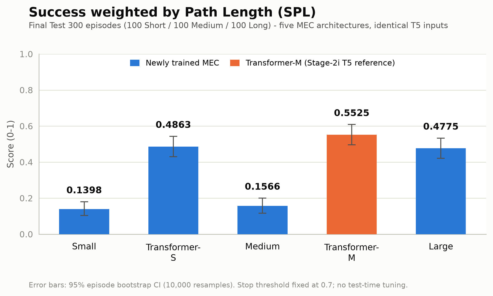
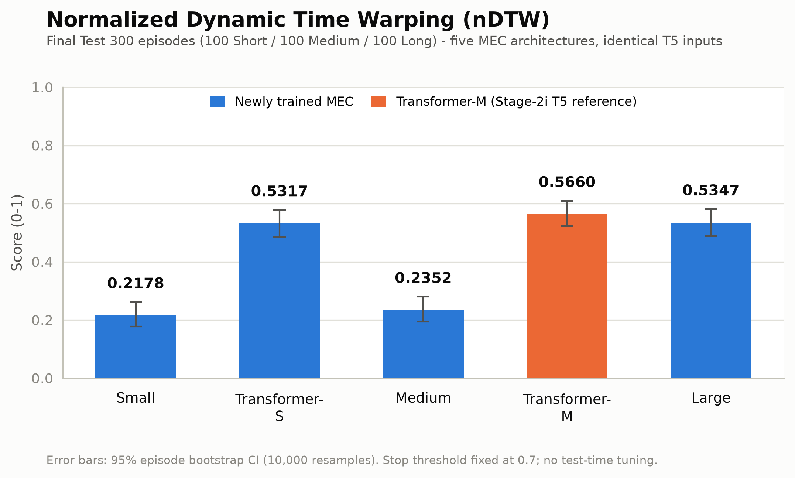

# V8.3 Stage-2j — Five MEC Architectures on T5 Map-Assisted Inputs

Date: 2026-10-19

Branch: `experiment/v83-spatial-foundation`  
Repository: `JLU-MCNS-MEC/mec-v8.2`

Nature: **formal Final Test 300 closed-loop comparison** of five native MEC architectures under exactly the same Stage-2i T5 map-assisted multimodal inputs. Single seed per model. The test set was read once per frozen model, after protocol freeze.

## 0. TL;DR

- Best SR: **Transformer-M (55.33%)**; best OSR: **Transformer-S (82.00%)**; best SPL: **Transformer-M (0.5525)**; best nDTW: **Transformer-M (0.5660)**.
- Lowest Premature-Stop: **Transformer-M (34.33%)**; lowest Timeout: **Transformer-M (10.33%)**; fastest MEC forward: **Medium (0.930 ms)**.
- Parameter range: Small **611,716** → Large **5,248,932** (8.58×). Pearson r(params, SR) = **+0.562**, Spearman ρ = **+0.500**; r(params, SPL) = **+0.559**, r(params, nDTW) = **+0.586** (n=5; descriptive only, not a significance test).
- All five models use the identical anonymous landmark database, Top-5 retrieval, coordinate transform and 22-D map feature; clean retrieval is saturated at **100% Top-1 / 100% Top-5**. The comparison is therefore architecture-only under a map-assisted prior, not a pure-vision claim.
- Single seed (20264017), Dev Val 180 used for model selection, Final Test 300 used once. These are not multi-seed generalisation estimates.

## 1. Protocol and data isolation

- Train 600 (200/200/200) and Dev Val 180 (60/60/60) are the same Stage-2i splits. Final Test 300 is 100/100/100 Short/Medium/Long.
- The task list was derived only from the sealed token shards (`episode_id`, `episode_seed`, `network_layout_seed`, `trajectory_band_id`); no episode was regenerated or selected. Every file in `SEALED.json` was SHA256-verified before evaluation.
- Each of the five models was evaluated once on the same 300 episodes with its selected best checkpoint. No weight updates, no Stop-threshold changes (fixed 0.7), no test-time tuning.
- The shared RGB encoder is frozen. History, pose, GAB and map features are causal and reset per episode. True labels, target coordinates and distances are evaluation-only.

## 2. Five native architectures

| MEC | Native architecture | Parameters | Best epoch | Train min | Checkpoint SHA256 (prefix) |
|---|---|---:|---:|---:|---|
| Small | `late_fusion_mlp` | 611,716 | 28 | 21 | `7349ec9d0c809a09` |
| Transformer-S | `explicit_transformer` | 1,332,868 | 24 | 15 | `ceac7506b3b3e18b` |
| Medium | `goal_cross_attention` | 1,991,044 | 28 | 15 | `1fcce0f33dfff368` |
| Transformer-M | `explicit_transformer` | 3,033,732 | 24 | 17 | `57c88b7d71e1a7f1` |
| Large | `explicit_transformer` | 5,248,932 | 28 | 22 | `310c9d2648dec7fe` |

Small remains a late-fusion MLP; Medium remains Goal→Current cross-attention + late fusion; Transformer-S/M/L are explicit Transformers at their native widths (192/1/4, 256/2/8, 352/2/8). Transformer-M is the Stage-2i T5 checkpoint, reused without retraining and verified equivalent by state dict, fixed-batch outputs and a full Dev Val 180 reproduction.

## 3. Final Test 300 — overall

| MEC | Params | SR | OSR | SPL | nDTW | Premature | Timeout | Steps | MEC forward ms |
|---|---:|---:|---:|---:|---:|---:|---:|---:|---:|
| Small | 611,716 | 14.00% | 32.67% | 0.1398 | 0.2178 | 64.00% | 22.00% | 183.2 | 0.971 |
| Transformer-S | 1,332,868 | 48.67% | 82.00% | 0.4863 | 0.5317 | 36.00% | 15.33% | 147.7 | 1.285 |
| Medium | 1,991,044 | 15.67% | 34.33% | 0.1566 | 0.2352 | 62.33% | 22.00% | 182.3 | 0.930 |
| Transformer-M | 3,033,732 | 55.33% | 82.00% | 0.5525 | 0.5660 | 34.33% | 10.33% | 128.3 | 1.185 |
| Large | 5,248,932 | 48.00% | 78.67% | 0.4775 | 0.5347 | 38.67% | 13.33% | 147.7 | 1.257 |

### 3.1 Bootstrap 95% CI (10,000 episode resamples)

| MEC | SR CI | OSR CI | SPL CI | nDTW CI |
|---|---:|---:|---:|---:|
| Small | 14.00 [10.33, 18.00] | 32.67 [27.33, 38.00] | 0.1398 [0.1031, 0.1798] | 0.2178 [0.1770, 0.2614] |
| Transformer-S | 48.67 [43.00, 54.33] | 82.00 [77.33, 86.33] | 0.4863 [0.4297, 0.5429] | 0.5317 [0.4861, 0.5781] |
| Medium | 15.67 [11.67, 20.00] | 34.33 [29.00, 39.67] | 0.1566 [0.1166, 0.1998] | 0.2352 [0.1938, 0.2797] |
| Transformer-M | 55.33 [49.67, 61.00] | 82.00 [77.67, 86.33] | 0.5525 [0.4962, 0.6084] | 0.5660 [0.5228, 0.6094] |
| Large | 48.00 [42.33, 53.67] | 78.67 [74.00, 83.33] | 0.4775 [0.4207, 0.5332] | 0.5347 [0.4882, 0.5809] |

### 3.2 Paired deltas vs Transformer-M

| MEC | ΔSR | ΔSPL | ΔnDTW |
|---|---:|---:|---:|
| Small | -41.33 pp [-47.00, -35.67] | -0.4126 | -0.3482 |
| Transformer-S | -6.67 pp [-12.67, -0.33] | -0.0662 | -0.0343 |
| Medium | -39.67 pp [-45.33, -34.00] | -0.3959 | -0.3308 |
| Large | -7.33 pp [-13.00, -1.67] | -0.0750 | -0.0313 |

## 4. Short / Medium / Long

| MEC | Short SR | Medium SR | Long SR | Best band | SR spread (max-min) |
|---|---:|---:|---:|---|---:|
| Small | 11.00% | 13.00% | 18.00% | long | 7.00 pp |
| Transformer-S | 51.00% | 53.00% | 42.00% | medium | 11.00 pp |
| Medium | 13.00% | 16.00% | 18.00% | long | 5.00 pp |
| Transformer-M | 57.00% | 58.00% | 51.00% | medium | 7.00 pp |
| Large | 45.00% | 52.00% | 47.00% | medium | 7.00 pp |

Full band metrics:

| MEC | Band | SR | OSR | SPL | nDTW | Premature | Timeout |
|---|---|---:|---:|---:|---:|---:|---:|
| Small | Short | 11.00% | 32.00% | 0.1100 | 0.2096 | 69.00% | 20.00% |
| Small | Medium | 13.00% | 33.00% | 0.1300 | 0.1925 | 65.00% | 22.00% |
| Small | Long | 18.00% | 33.00% | 0.1795 | 0.2514 | 58.00% | 24.00% |
| Transformer-S | Short | 51.00% | 81.00% | 0.5099 | 0.5666 | 36.00% | 13.00% |
| Transformer-S | Medium | 53.00% | 83.00% | 0.5300 | 0.5379 | 31.00% | 16.00% |
| Transformer-S | Long | 42.00% | 82.00% | 0.4189 | 0.4907 | 41.00% | 17.00% |
| Medium | Short | 13.00% | 37.00% | 0.1300 | 0.2309 | 66.00% | 21.00% |
| Medium | Medium | 16.00% | 33.00% | 0.1600 | 0.2206 | 62.00% | 22.00% |
| Medium | Long | 18.00% | 33.00% | 0.1797 | 0.2542 | 59.00% | 23.00% |
| Transformer-M | Short | 57.00% | 82.00% | 0.5687 | 0.6001 | 34.00% | 9.00% |
| Transformer-M | Medium | 58.00% | 81.00% | 0.5794 | 0.5775 | 32.00% | 10.00% |
| Transformer-M | Long | 51.00% | 83.00% | 0.5094 | 0.5205 | 37.00% | 12.00% |
| Large | Short | 45.00% | 78.00% | 0.4500 | 0.5342 | 41.00% | 14.00% |
| Large | Medium | 52.00% | 81.00% | 0.5131 | 0.5432 | 33.00% | 15.00% |
| Large | Long | 47.00% | 77.00% | 0.4695 | 0.5267 | 42.00% | 11.00% |

## 5. Map retrieval and inference latency

| MEC | Top-1 | Top-5 | Mean goal cosine | MEC forward ms | p50 ms | p95 ms | Feature build ms | Decision pipeline ms |
|---|---:|---:|---:|---:|---:|---:|---:|---:|
| Small | 100.00% | 100.00% | 0.9999998 | 0.971 | 0.795 | 1.886 | 1.526 | 2.497 |
| Transformer-S | 100.00% | 100.00% | 0.9999998 | 1.285 | 1.145 | 1.754 | 1.812 | 3.098 |
| Medium | 100.00% | 100.00% | 0.9999998 | 0.930 | 0.919 | 0.950 | 1.247 | 2.177 |
| Transformer-M | 100.00% | 100.00% | 0.9999998 | 1.185 | 1.173 | 1.223 | 1.252 | 2.437 |
| Large | 100.00% | 100.00% | 0.9999998 | 1.257 | 1.244 | 1.281 | 1.256 | 2.513 |

## 6. Figures

### Success Rate

### Oracle Success Rate

### SPL

### nDTW

Each figure is also available as SVG in `v83_spatial_stage2/figures/stage2j/`.

## 7. Analysis

### 7.1 Parameters, latency and closed-loop metrics

Parameter count rises from 611,716 (Small) to 5,248,932 (Large), 8.58×. MEC-forward latency is fastest for Medium (0.930 ms) and slowest for Transformer-S (1.285 ms). All measurements are batch-1, after 5 warm-up decisions, with CUDA synchronization.

### 7.2 Does parameter growth improve SR / SPL / nDTW?

Across the five architectures, Pearson r(params, SR) = **+0.562**, r(params, SPL) = **+0.559**, r(params, nDTW) = **+0.586**; Spearman ρ(SR) = **+0.500**. The trend is positive but not monotonic across every model; the largest model does not automatically win every metric. With n=5 these correlations are descriptive, not inferential.

### 7.3 Small and Transformer-S: capability floor

Small reaches SR 14.00% / SPL 0.1398. Transformer-S changes SR by **+34.67 pp** (95% CI [+28.67, +40.67]), SPL by **+0.3464**, nDTW by **+0.3139**. The CI excludes zero, so the extra capacity has a measurable floor effect in this single-seed test.

### 7.4 Transformer-M and Large: stability

Large − Transformer-M: ΔSR **-7.33 pp** (95% CI [-13.00, -1.67]), ΔSPL **-0.0750**, ΔnDTW **-0.0313**. Transformer-M has band-SR spread **7.00 pp** and premature/timeout 34.33% / 10.33%; Large has **7.00 pp** and 38.67% / 13.33%. Large is not a consistent stability improvement over Transformer-M on this test.

### 7.5 Short / Medium / Long differences

The band table shows whether a model's gain is concentrated in Short, Medium or Long episodes. Substantial band spread with the same 100 episodes per band indicates that episode horizon remains a major source of variance; it is not evidence of a separate control policy.

### 7.6 Same map conditions; differences are MEC decisions

All five models use the same map construction, frozen encoder, cosine Top-5 retrieval and 22-D feature. The retrieval summaries are identical across models (Top-1 100.00%, Top-5 100.00%). History, pose, GAB and map tensors are also the same inputs; the five models differ only in the MEC decision backbone. Therefore the closed-loop differences are attributable to the decision network (movement head, fusion, and the independently learned Arrival head), not to different map information.

### 7.7 Map-assisted premise, retrieval saturation and limits

- All five results are **map-assisted**: they use an anonymous global landmark database (positions + appearance) and UAV self-pose. They are not pure visual navigation results.
- Clean retrieval is saturated at 100% Top-1/Top-5 because the map nodes and Goal reference share the same renderer and frozen encoder. Stage-2i noise diagnostics showed Top-1 falling to 23.89% at 5% embedding noise and 10.56% at 15%; the clean 100% is not a real-world retrieval-robustness claim.
- Single seed (20264017) for each newly trained model; Dev Val 180 was used for checkpoint selection, so test 300 is not a multi-seed or fully unbiased generalisation estimate.
- The Final Test 300 was read once per frozen model. No test result was used to change architectures, hyperparameters, epochs or the Stop threshold.

## 8. Artifacts

- Protocol / freeze: `v83_spatial_stage2/STAGE2J_PROTOCOL.md`, `v83_spatial_stage2/stage2j_protocol_freeze.json`.
- Code/tests: `v83_spatial_stage2/stage2j_model.py`, `stage2j_train.py`, `stage2j_eval.py`, `stage2j_freeze.py`, `stage2j_equivalence.py`, `stage2j_analyze.py`, `stage2j_pipeline.sh`, `test_stage2j.py`.
- Per-model checkpoints, configs, histories, per-episode CSVs, steps CSVs, metrics and logs: `runs/v83_spatial_stage2/stage2j/<MEC>/` (server-side).
- Figures and summary: `v83_spatial_stage2/figures/stage2j/`.

Commit, push, test count and working-tree status are recorded in `v83_spatial_stage2/STAGE2J_COMMIT_STATUS.md`.
