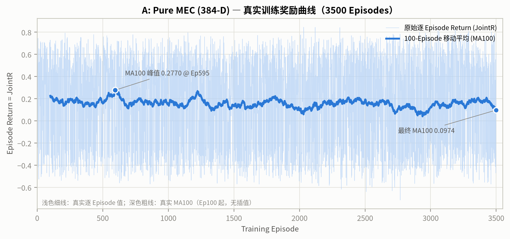
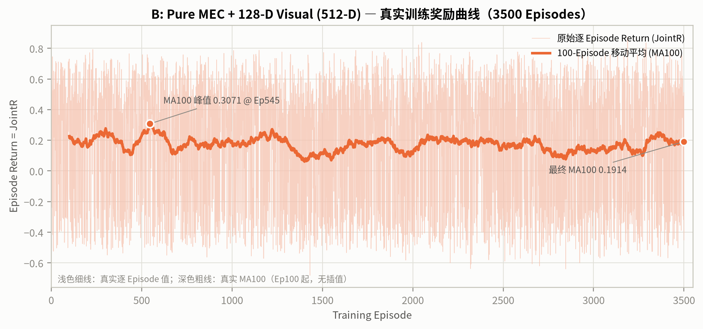
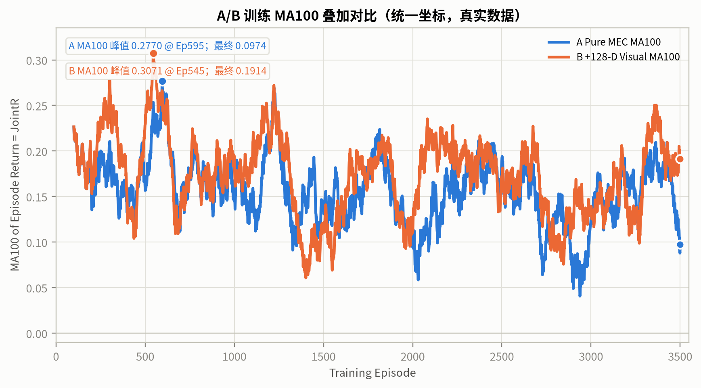
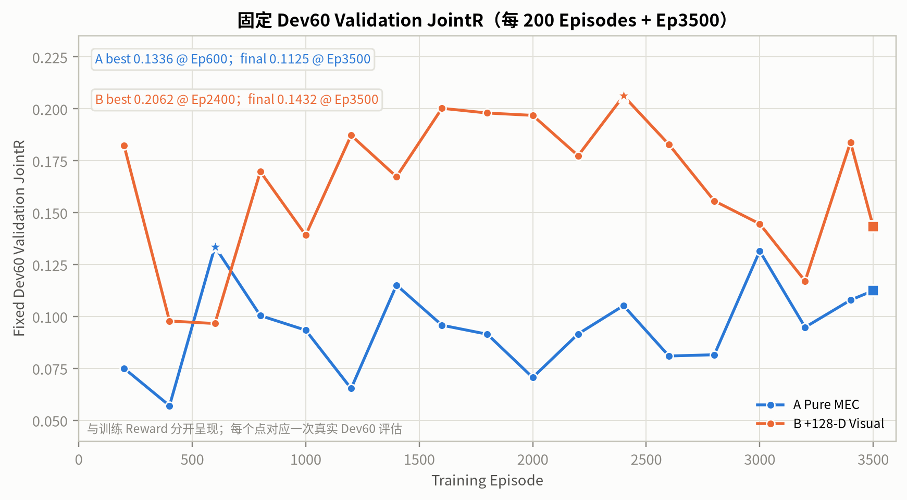
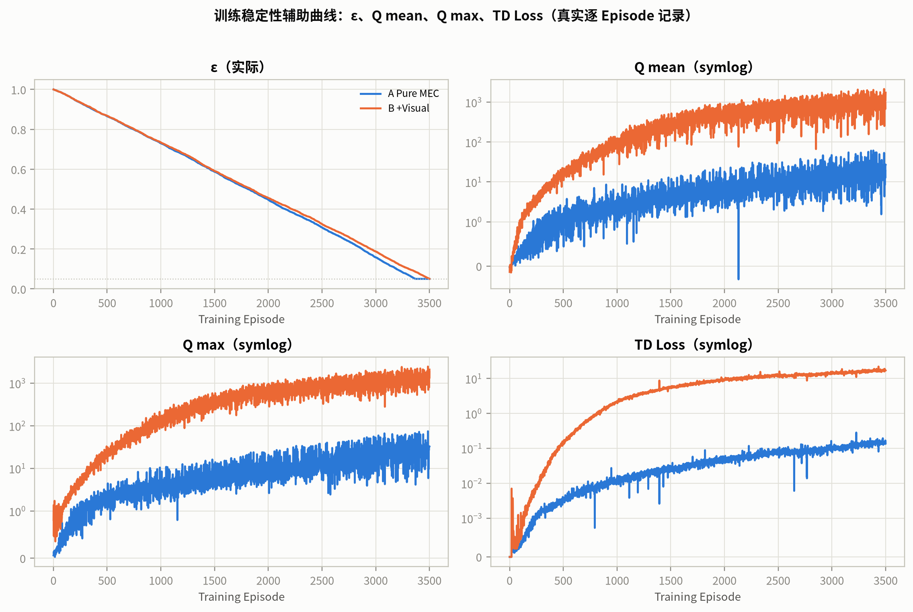

# Stage-2k V2 A/B 真实训练曲线与视觉增强分析

- 生成时间（UTC）：2026-10-21T11:31:19.377015+00:00
- 分支：`experiment/v83-spatial-foundation`
- 数据：A=`stage2k_pure_mec_v2`（384-D），B=`stage2k_visual_ablation_v2`（512-D）；不是 Stage-2l 固定城市实验。
- 训练数据：A/B 各 **3500** 个真实 Episode；没有插值、补点或人工奖励。
- Final Test：**未读取**（Stage-2j Final Test 300 与 Association Final Test 180 均未读取）。

## 0. 结论摘要

- A（Pure MEC）MA100 峰值 **0.2770 @ Ep595**，最终 MA100 **0.0974**。
- B（+128-D Visual）MA100 峰值 **0.3071 @ Ep545**，最终 MA100 **0.1914**。
- Dev60 最佳验证：A **0.1336 @ Ep600**，B **0.2062 @ Ep2400**；最终验证 A 0.1125、B 0.1432。
- Dev180 best：A **0.1116**，B **0.1687**，B−A **+0.0570**，95% CI **[+0.0002, +0.1130]**。
- 但在未参与 checkpoint 选择的 **120** 个 Dev episodes 上，ΔJointR 为 **+0.0492**，95% CI **[-0.0234, +0.1191]**，跨 0。
- B 的 Q 尺度严重漂移（训练 Q mean Ep200 2.579→1726.5，约 669×），因此即使 Dev180 点估计更高，也**不能**视为可部署或收敛。

## 1. 数据与方法

| 项 | A | B |
|---|---|---|
| 数据目录 | `runs/v83_spatial_stage2/stage2k_pure_mec_v2` | `runs/v83_spatial_stage2/stage2k_visual_ablation_v2` |
| Episode 数 | 3500 | 3500 |
| 原始 Return | 逐 Episode `episode_return` / `episode_jointR` | 同 A |
| 平滑 | 100-Episode 移动平均（Ep100 起） | 同 A |
| Dev 验证 | 每 200 Episodes + Ep3500，固定 60 个 Dev Episodes | 同 A |
| Dev180 | 180 个 Dev Episodes，best Checkpoint | 同 A |

MA100 只在 100 个真实 Episode 都存在时计算；前 99 个 Episode 的 MA100 为空，没有用 0、前向填充或插值补齐。

## 2. 训练奖励曲线（A、B 分开）

| 指标 | A Pure MEC | B +128-D Visual |
|---|---:|---:|
| MA100 峰值 | **0.2770** | **0.3071** |
| 峰值 Episode | 595 | 545 |
| 最终 MA100 | **0.0974** | **0.1914** |
| MA100 @ Ep1000 | 0.1577 | 0.1881 |
| MA100 @ Ep2000 | 0.0944 | 0.1132 |
| MA100 @ Ep3000 | 0.1260 | 0.1365 |
| 前 500 Episode 均值 | 0.1741 | 0.2034 |
| 最后 500 Episode 均值 | 0.1530 | 0.1762 |

观察：

- 两者 MA100 峰值都出现在早期（A Ep595、B Ep545），之后都没有保持；MA100 峰值本身不是收敛。
- A 的最终 MA100 相对峰值变化 -0.1796；B 为 -0.1158。
- B 的 MA100 在 Ep2000 附近降到 0.1132，随后在 Ep3000–3500 回升到 0.1914；训练奖励存在明显的中后期波动。

## 3. Dev60 Validation JointR（与训练 Reward 分开）

| 指标 | A | B |
|---|---:|---:|
| 最佳 Dev60 JointR | **0.1336** | **0.2062** |
| 最佳 Episode | 600 | 2400 |
| 最终 Dev60 JointR | 0.1125 | 0.1432 |
| 最佳−最终 | 0.0211 | 0.0630 |

验证曲线与训练 MA100 不是同一指标：A 的 MA100 峰值在 Ep595，但 Dev60 最佳在 Ep600；B 的 MA100 峰值在 Ep545，但 Dev60 最佳在 Ep2400。因此不能用训练 reward 峰值选择 Checkpoint。

## 4. Dev180 best Checkpoint 与视觉增强

| 指标 | A best (Ep600) | B best (Ep2400) | B−A | 95% paired CI (all 180) |
|---|---:|---:|---:|---:|
| JointR | 0.1116 | 0.1687 | +0.0570 | [+0.0002, +0.1130] |
| SR | 39.44% | 48.33% | +8.89 pp | [+1.11, +16.67] pp |
| SPL | 0.3942 | 0.4833 | +0.0891 | [+0.0111, +0.1673] |
| nDTW | 0.4851 | 0.5162 | +0.0311 | [-0.0228, +0.0849] |
| E2E (ms) | 149.38 | 139.01 | -10.37 ms | [-16.56, -4.30] ms |

**关键区分：数值提升 vs 统计显著提升**

- 在全部 180 个 Dev episodes 上，B−A 的 JointR 为 **+0.0570**，CI [+0.0002, +0.1130]，下界刚高于 0，属于**边缘显著**；
- 但固定 Dev60 是这 180 个 episodes 的**子集**，且用于选择 best Checkpoint。剔除这 60 个 episodes 后，剩下 120 个 episodes 上 B−A JointR 为 **+0.0492**，CI [-0.0234, +0.1191]，**跨 0**；
- nDTW 在全部 180 上 CI [-0.0228, +0.0849] 跨 0；
- E2E 的下降在全部 180 和 120 上都显著（120 上 CI [-19.77, -3.48] ms）；
- 因此：视觉增强的**点估计**为正，SR/SPL/E2E 有可检测改善，但 Navigation JointR 的提升在剔除选择重叠后**不稳健显著**；不能把它当成普遍提升。

同一 Dev180 的非特权 Baseline JointR：Random 0.2010、Min-Latency 0.2477、Max-Quality 0.2256、Heuristic 0.2617。A/B 的 best 都低于这些点估计。

## 5. 训练稳定性：ε、Q 与 TD Loss

| 指标 | A | B |
|---|---:|---:|
| ε 首/末 | 0.9999 / 0.0500 | 0.9999 / 0.0505 |
| ε 首次到 0.05 的 Episode | 3370 | — |
| 环境交互步 | 521,491 | 499,728 |
| Q mean Ep200→末（倍数） | 0.448→27.14（60.6×） | 2.579→1726.5（669.5×） |
| Q mean 峰值 | 61.27 | 2133.7 |
| Q max 末值 | 32.58 | 2073.4 |
| TD Loss 末值 | 0.1374 | 16.96 |
| 梯度范数末值 | 3.383 | 177.5 |

A 的 Q mean 从 Ep200 的 0.448 增长到 27.14（约 61×）；B 从 2.579 增长到 1726.5（约 669×），TD Loss 到 16.96，梯度范数到 177.5。这属于明显的 Q 过估计/尺度漂移，不是收敛。预注册的 1e6 数值中止阈值没有触发，但该阈值对 B 的尺度漂移不敏感；报告据此把 B 标记为不稳定、不可部署。

## 6. 解释与限制

- 视觉增强（B）在 Dev180 best 上的 JointR 点估计高于 A，但提升在剔除Dev60 选择重叠后不显著；不能声称视觉特征带来稳健的导航收益。
- B 的 SR/SPL/E2E 改善更稳定（SR/SPL 的 180-CI 下界 >0，E2E 的 180/120-CI 均 <0），但 nDTW 与 held-out JointR 不支持“全面视觉增益”。
- B 的 Q 尺度严重漂移，best/last 策略差异大；即使点估计更高，也不满足部署或Final Test 条件。
- A/B 都低于所有非特权 Baseline 的点估计；本报告不使用 Final Test，因此不给出测试集结论。
- 单 seed、180 个 Dev episodes、MA100 依赖 Episode 顺序/任务组成；这些都不构成统计显著性的强证据。

## 7. 产物

- 报告：`v83_spatial_stage2/figures/stage2k_v2_ablation/STAGE2K_V2_TRAINING_CURVES_REPORT.md`
- 摘要 JSON：`v83_spatial_stage2/figures/stage2k_v2_ablation/stage2k_v2_training_curves_summary.json`
- 逐 Episode CSV：`v83_spatial_stage2/figures/stage2k_v2_ablation/stage2k_v2_train_A_episodes.csv`、`v83_spatial_stage2/figures/stage2k_v2_ablation/stage2k_v2_train_B_episodes.csv`
- 曲线 PNG/SVG：`stage2k_v2_train_A.*`、`stage2k_v2_train_B.*`、`stage2k_v2_train_ma100_compare.*`、`stage2k_v2_dev60_validation_jointr.*`、`stage2k_v2_train_diagnostics.*`

所有原始训练日志、Checkpoint、TensorBoard 和旧实验均未修改或覆盖。