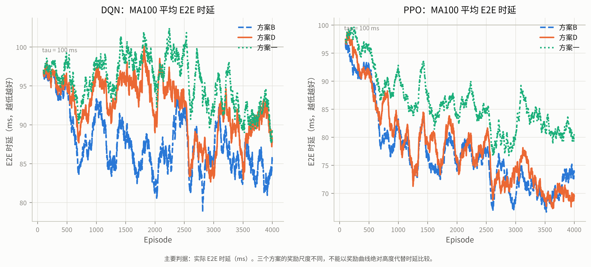
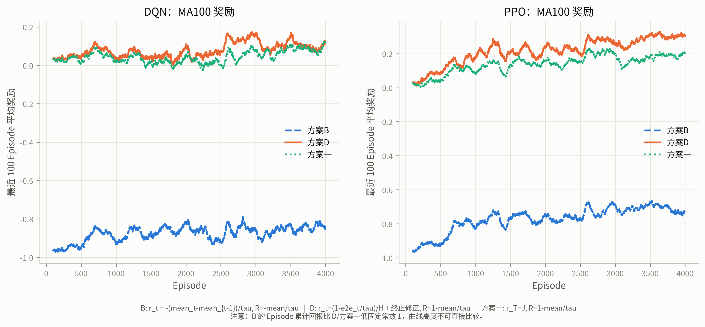
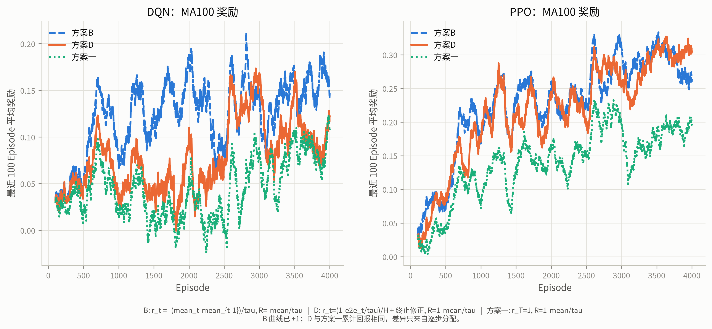
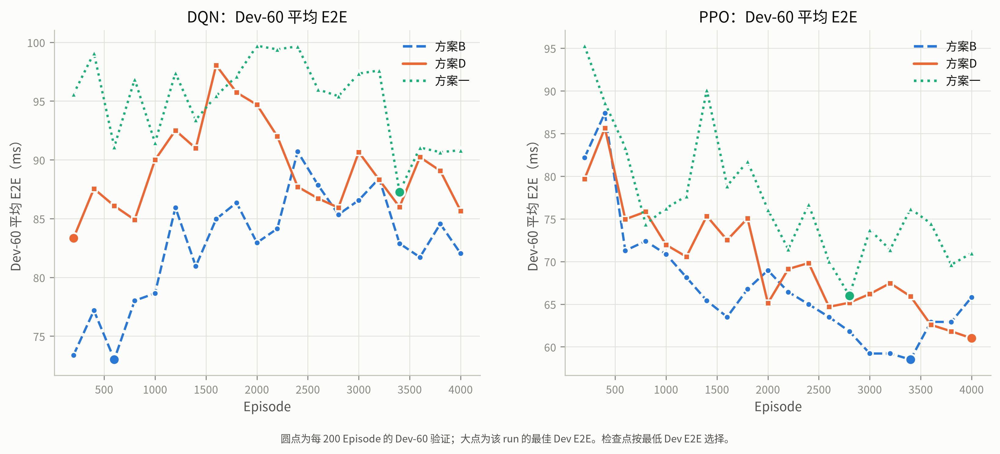
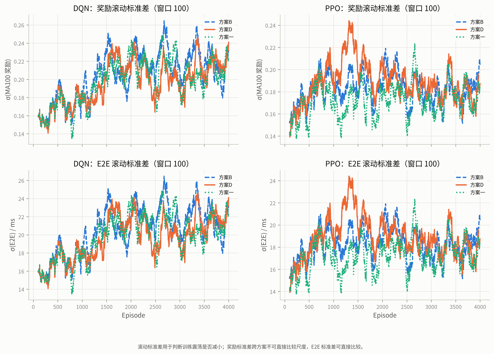
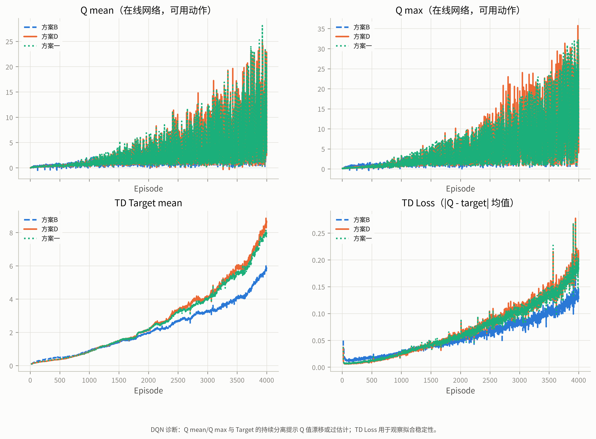
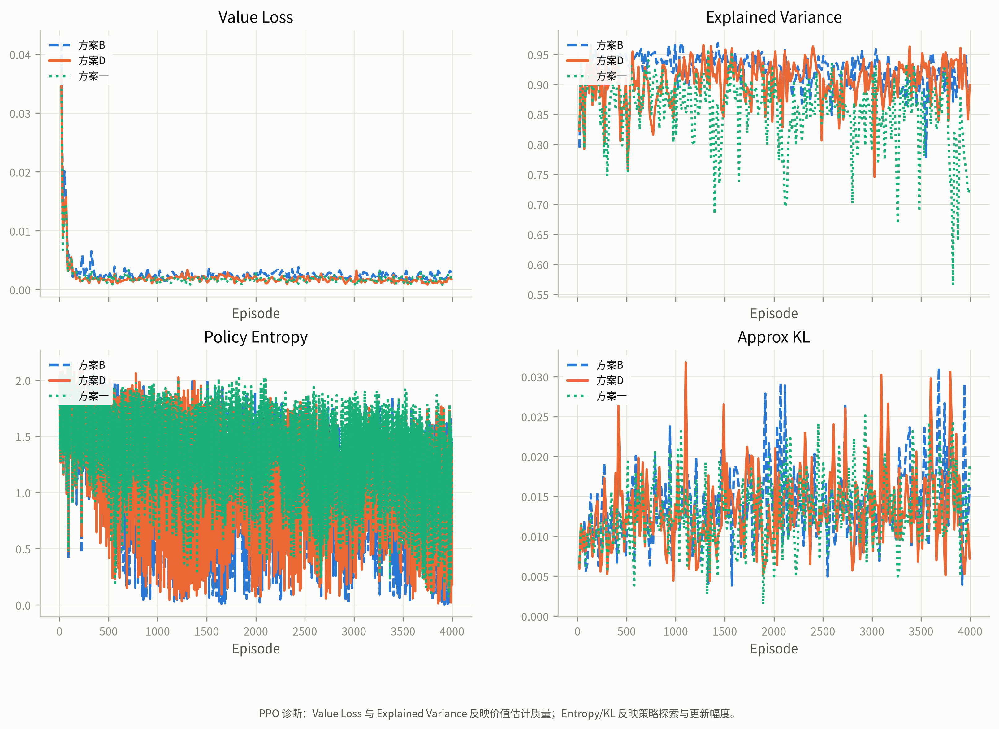
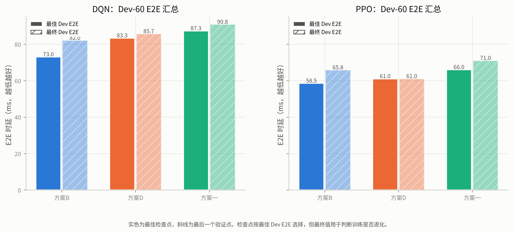
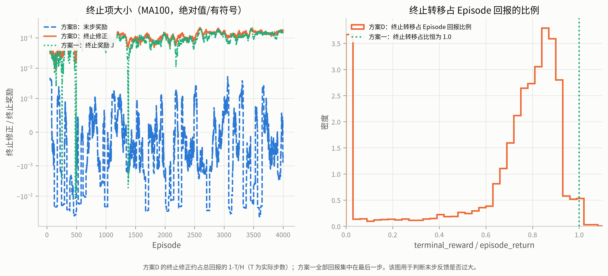

# Stage-2o 最终报告：时延奖励设计对 DQN/PPO 收敛的影响

- 日期：2026-10-23
- 分支：`experiment/v83-spatial-foundation`
- 仓库：`JLU-MCNS-MEC/mec-v8.2`
- 实验协议：`v83_spatial_stage2/stage2o/STAGE2O_PROTOCOL.md`
- 冻结文件：`v83_spatial_stage2/stage2o/evidence/protocol_freeze.json`
- 随机种子：`0`（单种子初步筛选）
- Test-400：**未读取**（`final_test_read = false`）

> 本报告的所有结论只基于固定城市、A 拓扑、20 个同质 Transformer-M MEC、
> Stage-2n Train-4000 / Dev-60 任务池与单随机种子。单种子结果不构成统计
> 显著性证据；排序只用于下一轮筛选。

## 0. 核心结论

1. **下降最快的是方案 B。** 在 DQN 与 PPO 上，B 都取得最低的 MA100 E2E
   AUC（87.37 / 76.75 ms）和最低的最终 MA100 E2E（85.30 / 73.64 ms）；
   PPO 的最佳 Dev E2E 也是 B 最好（**58.51 ms @Ep3400**，与 Stage-2n 原奖励
   三 seed 最佳的 58.39 ms 基本持平）。
2. **PPO 末段最稳的是方案 D。** D/PPO 从 Ep2000 起稳定在 61–69 ms，最终
   **61.01 ms @Ep4000 = 自身最佳**，Value Loss 0.0014、EV 0.920，无价值
   发散。B/PPO 峰值更好（58.51）但末段退化 12.5%（→65.82），熵最低、
   后段波动增大；方案一/PPO 的 Value 与 Episode 回报均值比 1.05，直接
   验证了方案一目标实现，但 E2E 最差。
3. **方案一最差。** 实现完全正确（24,000 个 Episode 的最大奖励恒等式误差
   **3.55e-15**），但纯终止奖励学习更慢：DQN/PPO 最佳 Dev 只有
   87.26 / 65.99 ms，最终 90.82 / 70.97 ms，均明显落后于 B 与 D。
4. **三个 DQN 全部失败于 Q 过估计。** Q mean 从 Ep200 的 0.17–0.21 增长到
   Ep4000 的 **5.63–8.20**，Q max 达 **23–36**；而 B 的理论最大 Episode
   回报为 0、D/方案一为 1。Q 与 Target 同步发散、TD Loss 从约 0.01 升到
   0.13–0.18，三个 DQN 的 Dev 都明显退化。**换奖励没有解决 DQN 的最大化
   偏差**。
5. **收敛判据：六个 run 全部 `not_converged`。** D/PPO 最接近（最终=最佳、
   最近三次极差 2.57%），但仍高于预注册的 1% 门槛；其余 run 的最终差距
   为 2.78–12.48%。Dev-60 的验证噪声（Stage-2n 六次 run 末 5 次标准差
   0.89–1.67 ms）与 1% 判据同量级甚至更大，因此“未收敛”不等于训练失败。
6. **不建议直接对六组做 3-seed 扩展。** 值得做的是一个聚焦的 **3-seed
   PPO：B vs D（方案一作为稀疏奖励对照）**——B 峰值领先 D 2.50 ms、D 末段
   领先 B 4.81 ms，二者都领先方案一 5–10 ms，但 B/D 的胜负随指标翻转。
   DQN 应先修算法（Double DQN、奖励裁剪/缩放、target 更新策略），再谈
   奖励种子的扩展。

## 1. 实验设置

本轮只改变奖励函数，其余条件与 Stage-2n 完全一致：

| 项目 | 固定值 |
|---|---|
| 城市 | `map_seed = 10,000,001`，160 个地标，1500 m × 1500 m |
| 拓扑 | Stage-2l `A_fixed` 的 20 个节点位置（拓扑种子 9,000,000） |
| MEC | 20 个完全同质节点，同一 Transformer-M（Stage-2j，3,033,732 参数） |
| 权重 SHA256 | `57c88b7d71e1a7f17862aaa8429afa8a041cba5e747f744f3a7febf47f273c6d` |
| 部署 SHA256 | `4c0950cf6e438cff41454eee6daefb831fa984f425ec1a41cf3974257c6d1148` |
| 任务池 | Stage-2n Train 4000 / Dev 60（Test 400 封存） |
| 任务顺序 | Stage-2n 固定顺序（种子 20261022），六组共用 |
| 状态 | 384-D Pure-MEC v2 + 独立 20-D 可用性 Mask |
| 动作空间 | 20 个 MEC 节点 |
| 时延阈值 | `tau = 100 ms` |
| 最大决策步数 | `H = 400` |
| 折扣因子 | `gamma = 1.0` |
| 算法超参数 | 与 Stage-2n/Stage-2l 标准 DQN、PPO 完全一致 |

六个实验：`{B, D, 方案一} × {DQN, PPO}`，统一 `seed=0`，每个 4000
Episodes，每 200 Episodes 在固定 Dev-60 上验证。六路并行运行在单张
RTX 5090（32.6 GB）上，训练期间 GPU 占用约 23.6 GB；已有的 Stage-2l
暂停态进程未被停止或覆盖。所有 run 在 3.49–3.81 h 内完成，无崩溃或重启。

## 2. 三个奖励方案与数学恒等式

记 Episode 实际步数 `T`，第 `t` 步端到端时延 `e2e_t`，运行均值

```text
mean_t = mean_{t-1} + (e2e_t - mean_{t-1}) / t,   mean_0 = 0
J      = 1 - mean_E2E / tau
```

### 方案 B

```text
r_t = -(mean_t - mean_{t-1}) / tau
R_B = -mean_E2E / tau
```

这是 Stage-2n 奖励 `-0.25/100 * (mean_t - mean_{t-1})` 去掉 0.25 后的
结果，逐步与 Episode 累计回报都精确等于原奖励的 4 倍。

### 方案 D

```text
u_t = 1 - e2e_t / tau
r_t = u_t / H                        （每个转移）
r_T <- r_T + (1 - T/H) * J           （仅最后一个转移）

R_D = (1/H) * sum_t u_t + (1 - T/H) * J
    = (T/H) * (1 - mean_E2E/tau) + (1 - T/H) * J
    = J = 1 - mean_E2E / tau
```

终止修正只依赖实际时延与 Episode 长度，不依赖成功标签、目标位置或任何
导航质量量。

### 方案一

```text
r_t = 0        (t < T)
r_T = J        （仅最后一个转移）
R_one = J = 1 - mean_E2E / tau
```

DQN/PPO 的训练目标、价值目标、经验回放与优势估计都按轨迹级 Episode
平均回报处理，而不是把 `1 - e2e_t/tau` 当作逐步奖励后继续使用 Stage-2n
的累计回报目标。

### 比较口径

```text
R_D = R_one = 1 + R_B
```

D 与方案一的 Episode 累计回报完全相同，但逐步分配不同；B 比它们低固定
常数 1。因此**不能用奖励曲线绝对高度判断优劣**。本报告以实际 E2E 时延、
MA100 趋势、AUC、滚动标准差、Dev-60 与收敛判据为准；奖励图同时给出
原始尺度和 B+1 对齐尺度。

## 3. 实现与数学审计

### 3.1 终止转移与无未来信息泄漏

- 方案 B 的每一步奖励在 `apply()` 后立即计算；
- 方案 D 的非终止步奖励只依赖当前 `e2e_t`，Episode 结束时用实际 `T` 与
  `mean_E2E` 计算终止修正，**只加到最后一个转移**；
- 方案一的非终止步奖励恒为 0，`J_episode` **只赋给最后一个转移**。

改变未来某一步的时延不会改变任何更早转移的奖励。该性质由
`NoFutureLeakageTests` 对三个方案逐一验证。

### 3.2 DQN 目标

- 终止转移：`done=1`，TD 目标为 `r_T`（方案一即 `J_episode`），不 bootstrap；
- 非终止转移：`gamma=1.0`，TD 目标为 `r_t + max_a' Q_target(s_{t+1}, a')`；
- 方案一的链式目标从终止的 `J_episode` 沿轨迹反向传播，固定点为轨迹上
  所有状态的动作价值等于 `J_episode`；
- 终止状态 `next_state=None` 在 ReplayBuffer 中写零向量且 `done=1`，目标
  计算不会使用它。

`DQNTargetTests` 用常量 Q 网络验证：终止转移的 target 精确等于 `r_T`，
非终止转移的 target 精确等于 `gamma * Q_target(s_{t+1})`。

### 3.3 PPO 优势估计

- 沿用 Stage-2n 的 PPO：`gamma=1.0`、`GAE lambda=0.95`、clip 0.2 等；
- `RolloutBuffer.compute_gae` 在 `done` 处重置优势递推，多个 Episode 可以
  共用一个 rollout；
- 方案一下，`lambda=1.0` 时所有状态的值目标精确等于 `J_episode`；
  `lambda=0.95` 时终止状态的值目标仍精确为 `J_episode`，早期状态使用标准
  GAE 的 lambda 加权（PPO 的方差—偏差折中，不改变 Episode 回报目标）。

`PPOAdvantageTests` 验证单 Episode、双 Episode 的 GAE 终止重置与
`J_episode` 目标。

### 3.4 单元测试、冒烟与正式训练恒等式

- `test_stage2o.py`：**16 项测试全部通过**（奖励恒等式、100 ms 阈值、
  终止修正、无未来泄漏、DQN 终止 target、PPO GAE）；
- 六个 30-Episode 冒烟运行全部通过，最大奖励恒等式误差 `1.55e-15`；
  六组 Dev-60 的 SR/SPL/nDTW 完全一致（60.00% / 0.5993 / 0.5569）；
- 正式训练 6 × 4000 = **24,000 个 Episode**：
  - 最大奖励恒等式误差：**3.55e-15**；
  - 最大 `R_scheme − 4·LatencyReturn − (scheme≠B)` 偏移误差：**4.88e-15**；
  - 所有 run 的 SR/SPL/nDTW 恒为 60.00% / 0.5993 / 0.5569。
- 协议在正式训练前冻结；训练相关 10 个源码文件的当前哈希与冻结哈希
  完全一致（`evidence/provenance_check.json`），分析/绘图脚本在训练后
  的改进不影响 checkpoint。

## 4. 正式训练结果

### 4.1 训练概况与收敛

**表 1 训练概况**

| 方案 | 算法 | Episodes | 耗时/h | 最佳 Dev E2E/ms | @Ep | 最终 Dev E2E/ms | 收敛 |
|---|---|---|---:|---:|---:|---:|---|
| B | DQN | 4000 | 3.80 | 73.01 | 600 | 82.03 | 否 |
| D | DQN | 4000 | 3.79 | 83.34 | 200 | 85.66 | 否 |
| 方案一 | DQN | 4000 | 3.81 | 87.26 | 3400 | 90.82 | 否 |
| B | PPO | 4000 | 3.49 | **58.51** | 3400 | 65.82 | 否 |
| D | PPO | 4000 | 3.51 | 61.01 | 4000 | **61.01** | 否 |
| 方案一 | PPO | 4000 | 3.51 | 65.99 | 2800 | 70.97 | 否 |

**表 4 收敛判据**

| 方案 | 算法 | 最佳 Dev/ms | @Ep | 最近三次极差/% | 最终差距/% | 状态 |
|---|---|---|---:|---:|---:|---|
| B | DQN | 73.01 | 600 | 3.88 | 12.35 | not_converged |
| D | DQN | 83.34 | 200 | 5.48 | 2.78 | not_converged |
| 方案一 | DQN | 87.26 | 3400 | 0.45 | 4.08 | not_converged |
| B | PPO | 58.51 | 3400 | 4.97 | 12.48 | not_converged |
| D | PPO | 61.01 | 4000 | 2.57 | 0.00 | not_converged |
| 方案一 | PPO | 65.99 | 2800 | 7.31 | 7.55 | not_converged |

判据为“最近三次 Dev E2E 极差 ≤ 最佳值的 1% 且最终值 ≤ 最佳值的 101%”。
六个 run 全部未满足。D/PPO 的最终差距为 0，但最近三次极差 2.57% 仍高于
1%；方案一/DQN 的极差 0.45% 很小，但最终比最佳差 4.08%。两者都不能算
收敛。

### 4.2 MA100 E2E 时延：下降速度与最终水平



**表 2 MA100 E2E 轨迹**

| 方案 | 算法 | Ep1000 | Ep2000 | Ep3000 | Ep4000 | AUC/ms | 最小 MA100/ms | 滚动σ/ms | 达到自身最佳5%/Ep |
|---|---|---:|---:|---:|---:|---:|---:|---:|---:|
| B | DQN | 93.31 | 81.85 | 85.81 | 85.30 | **87.37** | **78.78** | 20.90 | 1696 |
| D | DQN | 97.33 | 89.33 | 83.11 | 87.77 | 92.06 | 82.65 | 20.03 | 2571 |
| 方案一 | DQN | 98.73 | 94.80 | 91.84 | 89.28 | 95.56 | 87.62 | 20.14 | 683 |
| B | PPO | 83.22 | 74.16 | 68.87 | 73.64 | **76.75** | **66.66** | 18.41 | 2577 |
| D | PPO | 82.94 | 75.55 | 74.56 | **69.44** | 77.87 | 67.28 | 19.09 | 2600 |
| 方案一 | PPO | 92.80 | 83.50 | 80.59 | 80.05 | 85.83 | 76.72 | 17.36 | 2580 |

- DQN：B 的 AUC、最小 MA100 和最终 MA100 都最低，是三个 DQN 中下降最快、
  水平最好的；但三个 DQN 的 MA100 都在 80–100 ms 间大幅震荡，且 Dev
  退化（见 4.6）。
- PPO：B 的 AUC 和最小 MA100 最低（下降最快、峰值最好），D 的最终
  MA100 最低（69.44 vs 73.64）且末段仍在改善；方案一全面落后
  （AUC 85.83、最终 80.05）。
- 单看 MA100 曲线，B 与 D 在 PPO 上差距约 1–4 ms，接近 Dev 噪声；
  方案一与它们的差距为 8–11 ms，明显更大。

### 4.3 奖励曲线与常数平移





原始奖励图（图 1）中 B 在 −0.9 左右，D/方案一在 0.0–0.2，看上去 B 最差；
这是 `R_D=R_one=1+R_B` 的常数平移，不是训练差异。把 B 加 1 对齐后（图 2）：

- DQN：B 曲线最高，D 次之，方案一最低；
- PPO：B 与 D 接近，均高于方案一；
- 与 4.2 的 E2E 排序一致。

因此，**B 的“低奖励”完全是尺度问题；对齐后 B 反而是回报最高的方案。**
但奖励曲线的绝对高度仍不能替代 E2E 时延与 Dev 表现，尤其 D/方案一的
逐步分配不同、滚动标准差也不同。

### 4.4 Dev-60 验证轨迹



六个 run 的 20 次 Dev-60 验证（图 4）：

- DQN：B 在 Ep600 达到 73.01 ms 的最佳值，随后震荡上行到 82–87 ms；
  D 最佳在 Ep200 的 83.34 ms，之后在 85–95 ms；方案一在 87–100 ms 间，
  最佳 87.26 ms @Ep3400。三个 DQN 都没有持续改善。
- PPO：B 从 82.17 ms（Ep200）持续下降到 58.51 ms（Ep3400），随后回升到
  65.82 ms；D 从 79.67 ms 下降到 61.01 ms（Ep4000，仍在改善）；方案一从
  95.28 ms 下降到 65.99 ms（Ep2800），随后回升到 70.97 ms。
- 所有验证点的 SR/SPL/nDTW 恒为 60.00% / 0.5993 / 0.5569，与关联策略无关。

### 4.5 奖励与 E2E 的滚动标准差



**表 3 稳定性与诊断（最后 200 Episode）**

| 方案 | 算法 | Dev近5次极差/% | 最终比最佳差/% | 奖励CV(末500) | E2E滚动σ/ms | Q mean | Target | TD Loss | Value Loss | EV |
|---|---|---:|---:|---:|---:|---:|---:|---:|---:|---:|
| B | DQN | 7.99 | 12.35 | 0.25 | 20.90 | 5.63 | 5.38 | 0.13 | — | — |
| D | DQN | 5.20 | 2.78 | 2.24 | 20.03 | 8.20 | 7.82 | 0.18 | — | — |
| 方案一 | DQN | 11.30 | 4.08 | 2.43 | 20.14 | 7.94 | 7.44 | 0.17 | — | — |
| B | PPO | 11.81 | 12.48 | 0.26 | 18.41 | — | — | — | 0.0023 | 0.914 |
| D | PPO | 10.12 | **0.00** | 0.59 | 19.09 | — | — | — | 0.0014 | 0.920 |
| 方案一 | PPO | 9.04 | 7.55 | 0.90 | 17.36 | — | — | — | 0.0018 | 0.752 |

- DQN 三组的 E2E 滚动标准差都在 20 ms 左右，并且随训练上升；这与 Q 值
  发散和策略退化一致，不是“稳定”。
- PPO 三组在 18–19 ms；方案一的 σ 最低（17.36 ms），但它的 E2E 水平
  最差（最终 80.05 ms）。稳定性必须与水平一起看，不能只比 σ。
- 奖励 CV 对 D/方案一在早期是近零均值伪警报（见 4.9），不用于跨方案
  比较；E2E σ、Dev 极差和最终差距更可靠。

### 4.6 DQN 诊断：三个方案都在 Q 过估计



**DQN Q 值演化（每 1000 Episode 的汇报点）**

| 方案 | Ep200 Q mean | Ep1000 | Ep2000 | Ep3000 | Ep4000 | Q max @4000 | Target @4000 | TD Loss @4000 |
|---|---:|---:|---:|---:|---:|---:|---:|---:|
| B | 0.205 | 0.769 | 1.753 | 2.998 | **5.629** | 23.10 | 5.384 | 0.1270 |
| D | 0.167 | 0.717 | 1.882 | 3.624 | **8.197** | 35.75 | 7.817 | 0.1818 |
| 方案一 | 0.168 | 0.704 | 1.892 | 3.477 | **7.941** | 32.31 | 7.438 | 0.1741 |

Q mean / Target 为末 200 Episode 的均值；Q max 为末 200 Episode 的最大值。

- **方案一**：奖励只在终止步为 `J ≤ 1`，因此任意状态的 Q 都应 ≤ 1；
  实际 Q mean **7.94**、Q max **32.31**，可严格判定为过估计。
- **方案 D**：剩余回报 ≤ 未来逐步效用之和 + 终止修正 ≤ `1 + 1 = 2`
  （每步 `u_t/H ≤ 1/H`，至多 H 步；修正 ≤ 1）；实际 Q mean **8.20**、
  Q max **35.75**，同样可严格判定为过估计。
- **方案 B**：Q 是“剩余运行均值差”，不能直接用满回报 0 作上界；但其
  单步奖励量级约 `1e-3`，Q mean 却从 0.205 涨到 **5.63**、Q max
  **23.10**，且 Q 与 Target 同步上升、TD Loss 从 0.015 涨到 0.127。
  即使按剩余回报的合理范围估计，这一量级也不合理，表现为发散。
- 注意：B/D 的 Q 是**剩余回报**，不是完整 Episode 回报；因此不把“Q 与
  完整回报的相关系数”作为主要证据。方案一的 Q 理论上应等于 J，其
  相关系数 −0.33、均值比 77 只是辅助证据，说明它也没有学到 J。
- 三个 DQN 的 Dev 最佳分别出现在 Ep600 / Ep200 / Ep3400，随后或大幅
  退化（B +12.35%）、或停在远差于 PPO 的水平（D 85.66、方案一 90.82）。
  **奖励方案没有改变 DQN 的失败模式。**

### 4.7 PPO 诊断：B 峰值最好，D 末段最稳



**表 6 PPO 的 Value 与 Episode 回报（方案一为精确比较，B/D 仅作诊断）**

| 方案 | 均值比 | 相关 | 末 200 Value 均值 | 末 200 Episode 回报均值 | 末 200 Entropy | EV |
|---|---:|---:|---:|---:|---:|---:|
| B | 0.049 | −0.513 | −0.08 | −0.73 | 0.943 | 0.914 |
| D | 0.865 | 0.686 | 0.26 | 0.31 | 0.942 | 0.920 |
| 方案一 | **1.051** | **0.567** | 0.20 | 0.19 | 1.133 | 0.752 |

- **方案一/PPO：这是唯一的精确比较。** 方案一的回报只在终止产生，
  `V(s_t) = J` 在理论上成立；Value 与 Episode 回报均值比 **1.05**、相关
  **0.57**，直接验证了 Episode 平均回报目标被正确实现。
- **D/PPO：Value 是剩余回报**，均值比 0.87 只能作粗略诊断；其最终
  61.01 ms = 自身最佳、Value Loss 0.0014、EV 0.920，末段最稳。
- **B/PPO：Value 也是剩余回报**，均值比 0.05 不能单独证明“校准失败”；
  但 B 的末段从 58.51 退化到 65.82（+12.5%），熵最低（0.943）、后段
  波动增大，这是性能事实。B 与 D 的稳定性差异需要结合熵、策略更新和
  终止分配进一步分析；本报告不把该均值比作为因果解释。
- 方案一/PPO 的熵最高（1.133）、EV 最低（0.752）、E2E 最差
  （65.99 → 70.97）；纯终止奖励下策略探索消退更慢，学习效率更低。
- 三组 KL 都在 0.011–0.016，Value Loss 在 500 Episode 内降到约 0.002，
  没有 KL 爆炸或价值发散。

### 4.8 最佳/最终 Dev E2E 汇总



- 最佳 Dev：B/PPO 58.51 < D/PPO 61.01 < 方案一/PPO 65.99 <
  B/DQN 73.01 < D/DQN 83.34 < 方案一/DQN 87.26。
- 最终 Dev：D/PPO 61.01 < B/PPO 65.82 < 方案一/PPO 70.97 <
  B/DQN 82.03 < D/DQN 85.66 < 方案一/DQN 90.82。
- B/PPO 峰值最好但末段退化；D/PPO 峰值次好但末段最稳；DQN 全面落后。

### 4.9 D 的终止修正与信用分配



**表 5 D 终止修正（最后 200 Episode 的逐 Episode 统计）**

| 算法 | 修正均值 | 修正中位数 | 修正最大 | 终止占比均值 | 终止占比中位数 | 修正/非终止步尺度 | 平均 T/H |
|---|---:|---:|---:|---:|---:|---:|---:|
| DQN | 0.061 | 0.030 | 0.641 | 0.682 | 0.793 | 18.3 | 0.317 |
| PPO | 0.155 | 0.139 | 0.641 | 0.682 | 0.792 | 85.7 | 0.317 |

- D 的终止修正确实很大：平均占 Episode 回报的 **68%**，中位数 **79%**；
  典型 Episode 的 T/H 约 0.32，即 `1 − T/H ≈ 0.68–0.79`。修正相对非终止
  步尺度为 18×（DQN）到 86×（PPO），最大修正 0.641。
- 图 9 右显示终止占比呈双峰：满长度 T=400 的 Episode 修正为 0；短
  Episode 的终止占比可达 0.8–0.9。这是 `(1−T/H)` 的直接结果，不是实现
  错误。
- 但**没有证据表明它造成了不可接受的信用分配问题**：D/PPO 是六组中
  末段最稳的 run（最终=最佳 61.01），Value Loss 0.0014、EV 0.920，没有
  价值发散。注意 D 的 Value 是剩余回报，不能用“Value/完整回报均值比”
  判断校准精度。D/DQN 仍然失败，但三个 DQN 方案都因 Q 过估计失败，
  不能归因于 D 的终止修正。
- D 的代价是峰值略低：D/PPO 最佳 61.01 vs B/PPO 58.51（+2.50 ms）。
  这可能是末步反馈过大造成的优化折中，也可能是单 seed 噪声；需要 3 seeds
  才能区分。

## 5. 五个问题的回答

### 5.1 Q1：B、D、方案一中，哪个使 MA100 E2E 下降更快、更稳定？

**下降更快：方案 B。** 无论是 DQN 还是 PPO，B 的 MA100 E2E AUC 都最低
（DQN 87.37、PPO 76.75 ms），最小 MA100 也最低（78.78 / 66.66 ms），
PPO 的最佳 Dev 也是 B 最好（58.51 ms @Ep3400）。

**更稳定：要分算法看。**

- **DQN：没有真正稳定的方案。** 三个 DQN 都出现 Q 过估计和 Dev 退化；
  B 在三个 DQN 中水平最好（最终 82.03、最佳 73.01），但退化幅度最大
  （+12.35%）；D 的最终差距最小（+2.78%），但水平差 3.6 ms；方案一最差。
  若必须选一个 DQN，选 B，但它不可部署。
- **PPO：D 末段最稳，B 峰值最好。** B 的 AUC/峰值最好，但末段退化
  12.5%、后段熵最低且波动增大；D 的最终=最佳（61.01 ms）、Value 诊断
  不显示发散（Value Loss 0.0014、EV 0.920），但峰值落后 B 2.50 ms。
  方案一在 PPO 上全面最差（AUC 85.83、最终 80.05、熵最高）。
- **综合：B 下降最快；D 在 PPO 上末段最稳；方案一最差。** B 与 D 是
  “峰值 vs 末段稳定”的折中，单 seed 无法判定谁更好。

### 5.2 Q2：D 的终止修正是否造成过大的末步反馈或信用分配问题？

**末步反馈确实很大，但没有证据表明它造成了灾难性的信用分配问题。**

- 量化：D 的终止修正平均占 Episode 回报 68%、中位数 79%；相对非终止步
  尺度为 18×（DQN）/86×（PPO）；最大修正 0.641；终止占比呈双峰
  （满长度 Episode 为 0，短 Episode 0.8–0.9）。
- 经验结果：D/PPO 的末段稳定性（最终=最佳 61.01）和 Value 诊断
  （Value Loss 0.0014、EV 0.920、无发散）是六组最好的；这说明在 PPO 中，
  稠密逐步效用 `u_t/H` 加正确终止修正的分配是可学的，没有出现明显的
  信用分配崩溃。注意 D 的 Value 是剩余回报，不能把“Value/完整回报均值比”
  直接解释为校准精度。
- 代价：D 的峰值比 B 低 2.50 ms。若 B 的峰值优势来自更均衡的逐步信号，
  那么 D 的末步反馈可能略大；但这一差异与单 seed 噪声同量级，不能下
  因果结论。
- DQN 的失败不能归因于 D：三个 DQN 方案（包括 B 和方案一）都出现 Q 过
  估计；这是 DQN 算法层面的最大化偏差，而不是终止修正的专属问题。

### 5.3 Q3：方案一的目标是否正确实现？DQN/PPO 是否因此改善？

**实现正确，但没有带来改善。**

- 正确性证据：
  - 16 项单元测试全部通过，包括方案一的终止 target、PPO GAE 终止重置和
    无未来泄漏；
  - 正式训练 24,000 个 Episode 的最大奖励恒等式误差 **3.55e-15**；
    方案一的 `R_one − 4·LatencyReturn − 1` 最大误差 **4.66e-15**
    （全体方案最大偏移误差 4.88e-15）；
  - 方案一/PPO 的 Value 与 Episode 回报相关 0.57、均值比 1.05；方案一的
    回报只在终止产生，`V(s_t)=J` 在理论上成立，因此这一比较直接说明
    Value 在跟踪 Episode 平均回报，而不是旧的累计目标。
- 性能结果：
  - 方案一/DQN：最佳 Dev 87.26 ms、最终 90.82 ms；Q mean 7.94、Q max
    32.31、Q 与回报相关 −0.33——和另外两个 DQN 一样过估计。
  - 方案一/PPO：最佳 65.99 ms @Ep2800、最终 70.97 ms；比 B/PPO 的
    58.51/65.82 差 4.5–7.5 ms，比 D/PPO 的 61.01 差 5–10 ms；熵最高
    （1.133）、EV 最低（0.752）。
- 结论：**数学实现是正确的，但纯终止奖励把全部信用压到末步，学习更慢、
  最终更差；它没有改善 DQN 的过估计，也没有超过 B/D 的 PPO。**

### 5.4 Q4：哪些方案达到预设收敛判据，哪些未收敛？

**六个 run 全部未达到收敛判据，均为 `not_converged`。**

- 最接近的是 D/PPO：最终=最佳（61.01 ms）、最终差距 0%，但最近三次
  Dev E2E 极差 2.57%，仍高于 1% 门槛。
- 方案一/DQN 的最近三次极差最小（0.45%），但最终比最佳差 4.08%，不满足。
- B/PPO 与 B/DQN 的最终差距分别为 12.48% / 12.35%，末段退化明显。
- D/DQN 的最终差距 2.78%，但最近三次极差 5.48%，且 Q 已严重过估计。
- 说明：预注册的 1% 判据对应约 0.5–0.8 ms，而 Stage-2n 六次 run 的末 5 次
  Dev E2E 标准差为 0.89–1.67 ms。判据比验证噪声更严格，因此“未收敛”
  是预期结果，不应单独解释为训练失败；但六个 run 也没有一个能稳定到
  该精度。

### 5.5 Q5：是否有充分证据值得下一轮使用至少三个随机种子扩大实验？

**部分有，但不是对全部六组。**

- **PPO 的 B vs D 值得做聚焦 3-seed 复跑。**
  - B 最佳 Dev 58.51 vs D 61.01：B 领先 **2.50 ms**，约为 Stage-2n Dev
    噪声（1.26 ms）的 2 倍；
  - D 最终 Dev 61.01 vs B 65.82：D 领先 **4.81 ms**，约为噪声的 3.8 倍；
  - AUC：B 76.75 vs D 77.87，差 1.12 ms，小于噪声；
  - 两者都明显领先方案一（最佳 65.99、最终 70.97，差 5–10 ms，约
    4–8 倍噪声）。
  - 但 **B 与 D 的胜负随指标翻转**（峰值 B、末段 D），单 seed 无法判定。
    因此值得用 3 seeds 回答“要峰值还是末段稳定”，并把方案一作为稀疏
    奖励对照保留。
- **DQN 不值得直接扩 reward seed。** 三个 DQN 的差异（B 73.01/82.03、
  D 83.34/85.66、方案一 87.26/90.82）虽然大，但全部被 Q 过估计主导：
  Q mean 5.63–8.20、Q max 23–36，而 B 的理论上限是 0、D/方案一是 1。
  在这种情况下扩种子只会更精确地测量同一个算法失败。应先修 DQN
  （Double DQN、奖励裁剪/缩放、target 更新策略），再重新做奖励对比。
- **不建议**直接对六组做 3 seeds 的全面扩展；那会消耗大量算力，且无法
  回答“B vs D 的峰值/稳定折中”这一核心问题。
- 单 seed 限制：以上所有差值都只来自一个 seed，不能宣称统计显著；
  3-seed 复跑必须在相同的任务池、Dev-60 和冻结协议下进行。

## 6. 与 Stage-2n 原奖励及启发式基线的参照

Stage-2n 在同一 Dev-60、同一部署上评估过启发式基线与原奖励（0.25 系数）
的 3 个 seed（`v83_spatial_stage2/stage2n_evidence/dev_summary_snapshot.json`）：

| 参考策略 | Dev-60 E2E/ms | P95/ms | SR | SPL | nDTW |
|---|---:|---:|---:|---:|---:|
| Random | 95.43 | 161.12 | 60.00% | 0.5993 | 0.5569 |
| Nearest / Max-Uplink / Greedy-Min-E2E | **49.18** | 99.76 | 60.00% | 0.5993 | 0.5569 |
| DQN seed 0 / 1 / 2（Stage-2n 原奖励） | 75.76 / 80.11 / 78.53 | 149.06 / 152.81 / 159.02 | 60.00% | 0.5993 | 0.5569 |
| PPO seed 0 / 1 / 2（Stage-2n 原奖励） | 62.63 / 58.70 / 58.39 | 142.61 / 123.40 / 127.02 | 60.00% | 0.5993 | 0.5569 |

**Stage-2o 最佳 Dev 相对参照：**

| 方案 | 算法 | 最佳 Dev/ms | 相对 Greedy 49.18 ms | 相对 Stage-2n 同算法最佳 |
|---|---|---:|---:|---:|
| B | DQN | 73.01 | +23.83 (+48.45%) | **−2.75** |
| B | PPO | 58.51 | +9.33 (+18.97%) | **+0.12** |
| D | DQN | 83.34 | +34.16 (+69.46%) | +7.58 |
| D | PPO | 61.01 | +11.83 (+24.05%) | +2.62 |
| 方案一 | DQN | 87.26 | +38.08 (+77.43%) | +11.50 |
| 方案一 | PPO | 65.99 | +16.81 (+34.19%) | +7.60 |

- 方案 B 的奖励恰为 Stage-2n 原奖励的 4 倍。B/DQN 比 Stage-2n DQN 最佳
  好 2.75 ms，B/PPO 与 Stage-2n PPO 最佳只差 0.12 ms——都在 Dev 噪声与
  3-seed 方差范围内。**仅去掉 0.25 系数（B）基本保留了 Stage-2n 的最佳
  Dev 水平**，符合“正比例缩放不改变最优策略”的预期。
- D/PPO 的 61.01 比 Stage-2n PPO 最佳差 2.62 ms；方案一/PPO 差 7.60 ms。
  在峰值上，D/方案一都没有超过“只改尺度”的 B。
- 所有方案与 Greedy-Min-E2E 的 49.18 ms 仍有 9.3–38.1 ms 的差距。
  奖励设计改善了 DQN/PPO 的收敛与稳定性，但**没有让 RL 逼近同质部署下
  的逐时隙 argmin**；这与 Stage-2n 的结论一致。

## 7. 限制与下一步

1. **单随机种子**：每个方案只有一个 seed 0；所有排序只用于初步筛选，
   不构成统计显著性证据。
2. **单城市、单部署、单 MEC 检查点**：结论不外推到异质算力/带宽、其他
   拓扑或新城市。
3. **同质部署使问题接近逐时隙 argmin**：Greedy-Min-E2E 的 Dev 49.18 ms
   是近乎最优的参照；奖励设计能改善的是 DQN/PPO 逼近它的速度与稳定性，
   而不是改变最优策略。
4. **Dev-60 噪声**：Stage-2n 六次 run 的末 5 次 Dev E2E 标准差为
   0.89–1.67 ms、极差 2.39–4.37 ms；预注册的 1% 收敛判据（约 0.5–0.8 ms）
   比该噪声更严格，因此“未收敛”不等于训练失败。
5. **DQN 的失败是算法层面的**：Q mean 超过理论最大回报、Q max 23–36，
   与奖励方案无关；在没有 Double DQN/奖励裁剪/target 修复前，不应根据
   本轮 DQN 结果选择奖励方案。
6. **信用分配分析是观察性的**：D 的终止占比、Value 诊断与最终 E2E 只能
   说明相关性；B 的峰值与 D 的末段稳定之间的因果归因需要多种子实验。
7. **未读取 Test-400**：本阶段没有 Test 指标；任何 Test 结论都必须等到
   方案冻结后的最终评估。
8. **下一步建议**：
   - 先修 DQN 算法（Double DQN、奖励裁剪/缩放、target 更新策略），再
     重跑 DQN 的 B/D/方案一；
   - 对 PPO 做聚焦 3-seed：B vs D（方案一作为稀疏奖励对照），保持相同
     任务池、Dev-60 和冻结协议；
   - 在 3-seed 结果稳定后，再决定是否读取 Test-400 做最终报告。

## 8. 产物清单

| 类型 | 路径 |
|---|---|
| 代码 | `v83_spatial_stage2/stage2o/{rewards,train,progress,launch,status,plot,analyze,freeze_protocol,render_report,answer_questions,baseline_compare,round_table,verify_provenance,fill_report}.py` |
| 测试 | `v83_spatial_stage2/stage2o/test_stage2o.py`（16 项） |
| 协议 | `v83_spatial_stage2/stage2o/STAGE2O_PROTOCOL.md` |
| 冻结 | `v83_spatial_stage2/stage2o/evidence/protocol_freeze.json` |
| 逐 200 Episode 汇总 | `v83_spatial_stage2/stage2o/evidence/per_200_episodes.csv` |
| 逐 Episode 曲线 | `v83_spatial_stage2/stage2o/evidence/training_curves.csv` |
| Dev 验证曲线 | `v83_spatial_stage2/stage2o/evidence/validation_curves.csv` |
| 图表 | `v83_spatial_stage2/stage2o/evidence/fig01..fig09*.png` |
| 图表数据 | `v83_spatial_stage2/stage2o/evidence/figure_data/*.csv` |
| 数据表 | `evidence/SUMMARY_TABLES.md`、`REPORT_TABLES.md`、`ANSWERS.md`、`BASELINE_COMPARE.md`、`NOISE_REFERENCE.md` |
| 溯源校验 | `v83_spatial_stage2/stage2o/evidence/provenance_check.json` |
| 原始 checkpoint / TensorBoard / 大日志 | `runs/v83_spatial_stage2/stage2o/`（`.gitignore` 排除） |

Test-400 未读取；本阶段不产生 Test 指标。

## 附录 A：复现命令

```bash
PY=/home/ubuntu5/miniconda3/envs/DRL/bin/python

# 单元测试
$PY v83_spatial_stage2/stage2o/test_stage2o.py

# 30-Episode 冒烟（六路）
$PY v83_spatial_stage2/stage2o/launch.py --smoke --max-episodes 30 \
    --validation-every 30 --wait

# 冻结协议
$PY v83_spatial_stage2/stage2o/freeze_protocol.py

# 正式训练（六路，4000 Episodes）
$PY v83_spatial_stage2/stage2o/launch.py --wait --poll-seconds 120 \
    --max-parallel 6 --min-free-mb 12000 --max-restarts 2

# 汇总、绘图、数据表与五问草稿
$PY v83_spatial_stage2/stage2o/analyze.py
$PY v83_spatial_stage2/stage2o/render_report.py
$PY v83_spatial_stage2/stage2o/answer_questions.py
$PY v83_spatial_stage2/stage2o/baseline_compare.py
$PY v83_spatial_stage2/stage2o/verify_provenance.py
```

## 附录 B：关键 Episode 的 Dev-60 E2E（ms）

| Episode | B/DQN | D/DQN | 方案一/DQN | B/PPO | D/PPO | 方案一/PPO |
|---:|---:|---:|---:|---:|---:|---:|
| 200 | 73.39 | 83.34 | 95.59 | 82.17 | 79.67 | 95.28 |
| 1000 | 78.64 | 89.99 | 91.45 | 70.86 | 71.95 | 76.24 |
| 2000 | 82.95 | 94.69 | 99.70 | 66.43 | 69.12 | 71.44 |
| 3000 | 86.56 | 90.65 | 97.33 | 59.21 | 67.46 | 71.38 |
| 4000 | 82.03 | 85.66 | 90.82 | 65.82 | 61.01 | 70.97 |

完整 20 个汇报点见 `evidence/per_200_episodes.csv`；逐 Episode 训练曲线
见 `evidence/training_curves.csv`；Dev 验证曲线见
`evidence/validation_curves.csv`。
