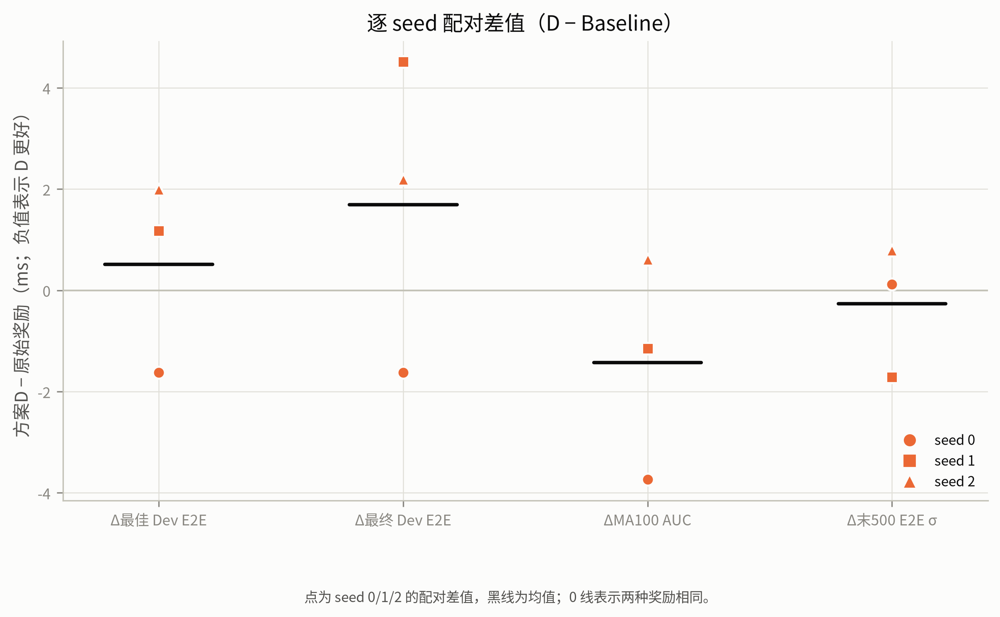
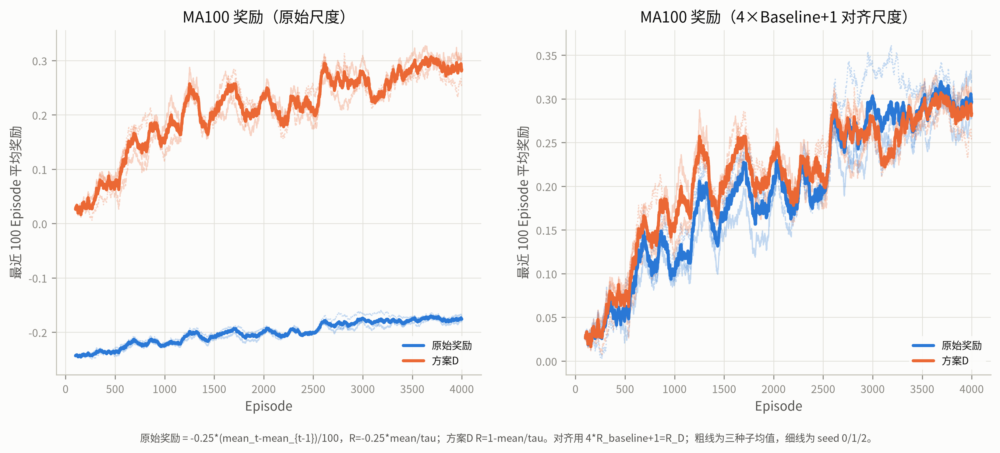
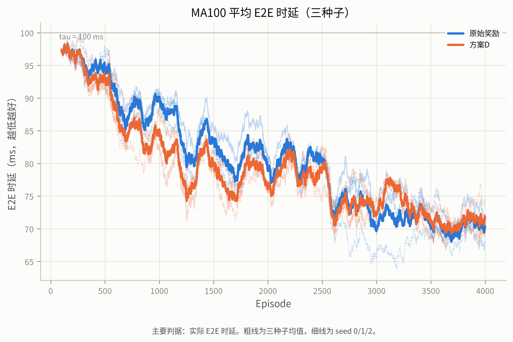
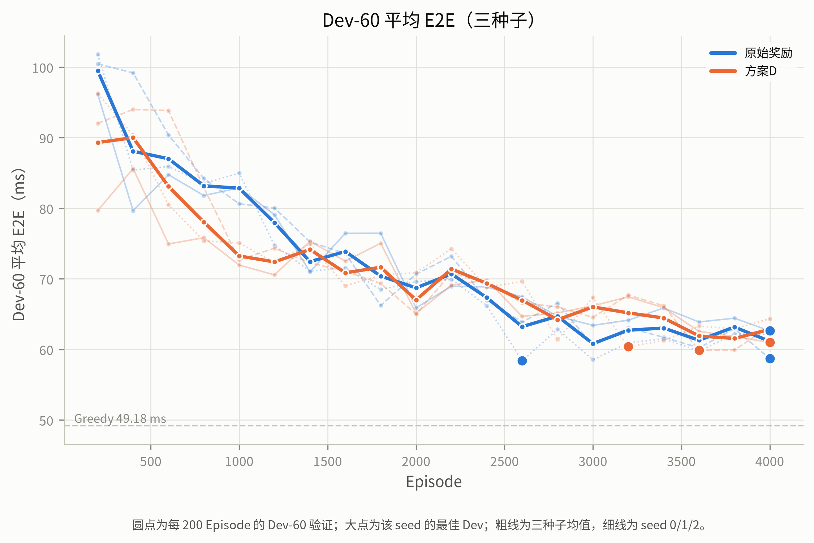
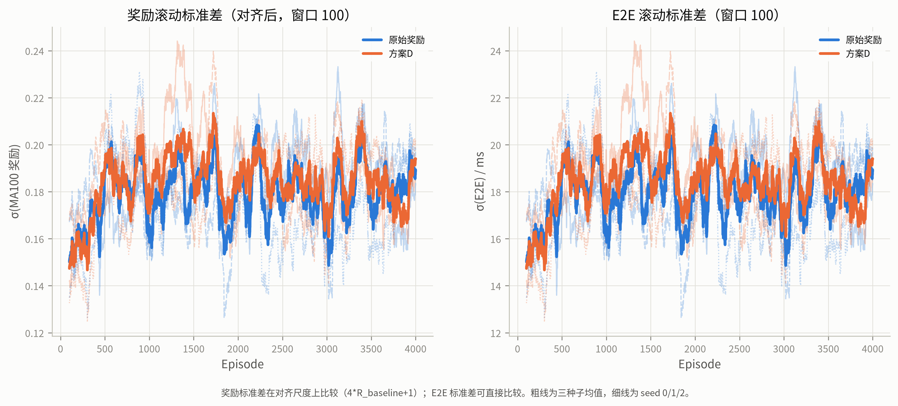
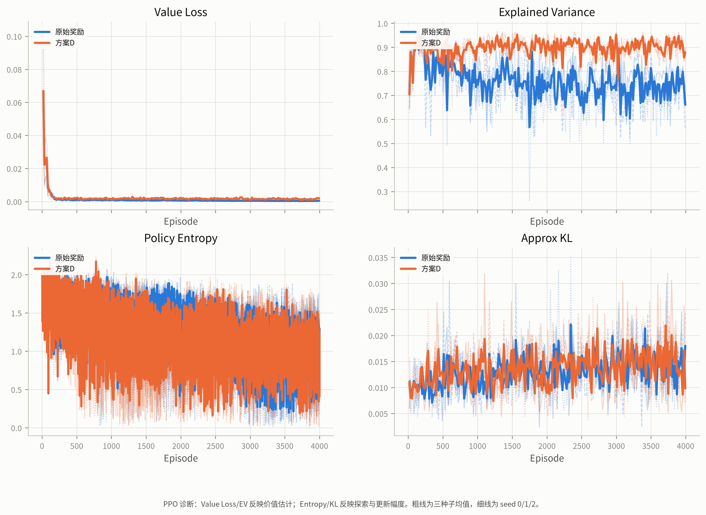
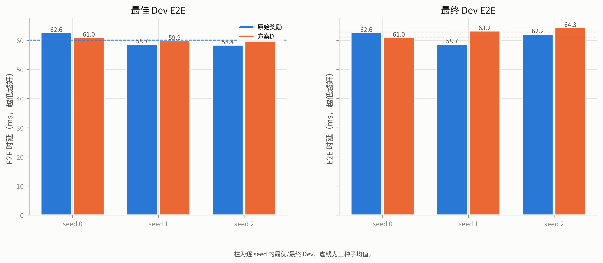

# Stage-2p 最终报告：PPO 原始奖励 vs 方案 D

- 日期：2026-10-23
- 分支：`experiment/v83-spatial-foundation`
- 仓库：`JLU-MCNS-MEC/mec-v8.2`
- 协议：`v83_spatial_stage2/stage2p/STAGE2P_PROTOCOL.md`
- 冻结：`v83_spatial_stage2/stage2p/evidence/protocol_freeze.json`
- 种子：0 / 1 / 2
- Test-400：**未读取**

## 0. 核心结论

## 0. 核心结论

1. **D 的 MA100 E2E AUC 更低（下降更快），但 Baseline 的最终/最佳 Dev 更低。**
   AUC 均值 D 78.70 ± 0.94 vs Baseline 80.12 ± 1.96 ms（D 低 1.42 ms，2/3 seeds
   更低）；最佳 Dev 均值 D 60.42 ± 0.57 vs Baseline 59.91 ± 2.36 ms（D 高
   0.52 ms，仅 1/3 seeds 更好）。
2. **Baseline 的末段退化更少、最终 Dev 更低。** 最终相对最佳的退化均值
   Baseline 2.15% vs D 4.04%（D 在 0/3 seeds 更好）；最终 Dev 均值
   Baseline 61.16 vs D 62.86 ms。D 的末 500 Episode E2E σ 均值略低
   （18.05 vs 18.31 ms），但只在 1/3 seeds 更低，不能称为“退化更少”。
3. **D 的终止修正没有带来可重复的最终 E2E 收益。** 最佳 Dev 配对差
   −1.62/+1.18/+1.99 ms（均值 +0.52，D 仅 1/3 更好）；最终 Dev 配对差
   −1.62/+4.51/+2.19 ms（均值 +1.69，D 仅 1/3 更好）；退化配对差
   0.00/+5.57/+0.11%（D 0/3 更好）。D 的可重复优势只体现在**跨 seed 方差
   更小**（最佳 Dev std 0.57 vs 2.36；最终 Dev std 1.70 vs 2.15）和
   **AUC 略低**。
4. **三种子的差异不足以支持继续采用 D。** 最佳/最终 Dev 只有 1/3 seeds
   支持 D，方向和均值都不支持；AUC 2/3 支持 D 且均值低 1.42 ms。D 降低
   了 seed 方差，但以略差的均值 E2E 为代价。若目标是“平均 E2E 更低”，
   应保留原始奖励；若目标是“跨 seed 更一致”，D 值得作为候选，但需更多
   seeds 验证。
5. **与 Greedy 的差距：** Baseline 最佳 Dev 距 Greedy 49.18 ms 均值
   +10.73 ms；D 为 +11.24 ms。Baseline 平均领先 0.52 ms，但配对差
   −1.62/+1.18/+1.99 ms，且 0.52 ms 小于 Stage-2n 的 Dev 噪声参照
   1.26 ms；**两者都没有接近 Greedy，D 也没有带来超过噪声的改善**。
6. **收敛：两种奖励均为 0/3 seeds 达到收敛判据**；D/PPO 的最近三次极差
   2.34–5.57%、最终差距 0–6.56%；Baseline 为 2.88–7.21% / 0–6.45%。
   1% 判据比 Dev 验证噪声更严格（见 4.5 与 `NOISE_REFERENCE`）。

## 1. 实验设置

| 项目 | 固定值 |
|---|---|
| 城市 | `map_seed = 10,000,001`，160 个地标，1500 m × 1500 m |
| 拓扑 | Stage-2l `A_fixed` 的 20 个节点位置 |
| MEC | 20 个完全同质节点，同一 Transformer-M（Stage-2j） |
| 权重 SHA256 | `57c88b7d71e1a7f17862aaa8429afa8a041cba5e747f744f3a7febf47f273c6d` |
| 部署 SHA256 | `4c0950cf6e438cff41454eee6daefb831fa984f425ec1a41cf3974257c6d1148` |
| 任务池 | Stage-2n Train 4000 / Dev 60（Test 400 封存） |
| 任务顺序 | Stage-2n 固定顺序（种子 20261022），六组共用 |
| 状态 | 384-D Pure-MEC v2 + 独立 20-D Mask |
| 时延阈值 | `tau = 100 ms` |
| 最大决策步数 | `H = 400` |
| 折扣因子 | `gamma = 1.0` |
| 算法 | PPO，网络/优化器/GAE/超参数与 Stage-2n/2o 相同 |

六个 run：`{baseline, D} × {0,1,2}`，每个 4000 Episodes，Dev 每 200。

## 2. 奖励与可比较尺度

记 Episode 实际步数 `T`，第 `t` 步端到端时延 `e2e_t`，运行均值

```text
mean_t = mean_{t-1} + (e2e_t - mean_{t-1}) / t,   mean_0 = 0
```

**Baseline（原始奖励）**

```text
r_t = -0.25 * (mean_t - mean_{t-1}) / 100
R_baseline = -0.25 * mean_E2E / 100
```

**方案 D**

```text
u_t = 1 - e2e_t / tau
r_t = u_t / H
r_T <- r_T + (1 - T/H) * J,   J = 1 - mean_E2E / tau
R_D = (1/H) * sum_t u_t + (1 - T/H) * J = J = 1 - mean_E2E / tau
```

**对齐关系**

```text
4 * R_baseline + 1 = R_D
```

因此两组的奖励曲线在原始尺度上相差一个与 `mean_E2E` 有关的量，不能直接
比较高度。报告同时给出原始尺度与 `4*R_baseline+1` 对齐尺度；主要判据是
实际 E2E 时延、Dev-60、收敛与稳定性。

## 2.1 PPO 超参数（不修改）

```text
actor-critic 384 → 256 → 256 → {20, 1}
gamma = 1.0
GAE lambda = 0.95
clip epsilon = 0.2
rollout = 2,048 steps
minibatch = 256
update epochs = 10
value coef = 0.5
entropy coef = 0.01
Adam lr = 3e-4
max grad norm = 0.5
target KL = 0.05
```

## 3. 复用审计与统一代码路径

Stage-2n 原始奖励 PPO 与 Stage-2o D/PPO 使用不同训练脚本。审计
（`evidence/reuse_audit.json`）确认：

- Train/Dev 任务池、训练顺序、部署、MEC 权重哈希完全一致；
- state/action 契约（384-D Pure-MEC v2 + 20-D Mask）一致；
- PPO 网络、优化器、GAE、clip、rollout、minibatch、epochs、学习率等
  超参数完全一致；
- **训练脚本和奖励应用代码路径不同**（`stage2n_train.py` vs
  `stage2o/train.py`），日志/溯源标签也不同。

因此 Stage-2p **不直接混用**旧结果，而是用统一的 Stage-2p PPO 循环重跑
`baseline` 与 `D` 的 seed 0/1/2，共 6 个 run。Stage-2n/2o 的 seed-0 结果
只作为复现对照：新 baseline seed0 对 Stage-2n PPO seed0；新 D seed0 对
Stage-2o D/PPO seed0。复现结果见 `evidence/reproduction_check.json`。

## 4. 结果

### 4.1 逐 seed 结果

## 表 1 逐 seed 结果

| 方案 | seed | 最佳 Dev/ms | @Ep | 最终 Dev/ms | MA100 AUC | 最小 MA100 | 末500 E2E σ | 最终比最佳差/% | 距 Greedy/ms | 收敛 |
|---|---|---|---|---|---|---|---|---|---|---|
| 原始奖励 | 0 | 62.63 | 4000 | 62.63 | 81.61 | 68.04 | 17.74 | 0.00 | 13.45 | 否 |
| 原始奖励 | 1 | 58.70 | 4000 | 58.70 | 80.86 | 66.76 | 19.44 | 0.00 | 9.52 | 否 |
| 原始奖励 | 2 | 58.39 | 2600 | 62.16 | 77.91 | 63.92 | 17.77 | 6.45 | 9.21 | 否 |
| 方案D | 0 | 61.01 | 4000 | 61.01 | 77.87 | 67.28 | 17.86 | 0.00 | 11.83 | 否 |
| 方案D | 1 | 59.88 | 3600 | 63.21 | 79.72 | 68.44 | 17.73 | 5.57 | 10.70 | 否 |
| 方案D | 2 | 60.38 | 3200 | 64.35 | 78.52 | 68.30 | 18.56 | 6.56 | 11.20 | 否 |

### 4.2 三种子汇总

## 表 2 三种子汇总

| 方案 | 最佳 Dev (mean±std) | 最终 Dev | MA100 AUC | 末500 E2E σ | 退化/% | 距 Greedy/ms | 收敛 |
|---|---|---|---|---|---|---|---|
| 原始奖励 | 59.91 ± 2.36 | 61.16 ± 2.15 | 80.12 ± 1.96 | 18.31 ± 0.97 | 2.15 ± 3.72 | 10.73 ± 2.36 | 0/3 |
| 方案D | 60.42 ± 0.57 | 62.86 ± 1.70 | 78.70 ± 0.94 | 18.05 ± 0.45 | 4.04 ± 3.54 | 11.24 ± 0.57 | 0/3 |

### 4.3 配对差值（D − Baseline）

## 表 3 配对差值（D − Baseline）

| seed | Δ最佳 Dev | Δ最终 Dev | ΔMA100 AUC | Δ末500 E2E σ | Δ退化/% | Δ距 Greedy |
|---|---|---|---|---|---|---|
| 0 | -1.62 | -1.62 | -3.74 | 0.12 | 0.00 | -1.62 |
| 1 | 1.18 | 4.51 | -1.15 | -1.71 | 5.57 | 1.18 |
| 2 | 1.99 | 2.19 | 0.61 | 0.79 | 0.11 | 1.99 |

注意：负的 Δ Dev/AUC/E2E σ 表示方案 D 更好；Δ退化 为负表示 D 的退化更小。



### 4.4 曲线













### 4.5 收敛与验证噪声

| 方案 | seed | 最佳 Dev/ms | @Ep | 最终 Dev/ms | 最近三次极差/% | 最终差距/% | Dev 末5次 σ/ms | 状态 |
|---|---|---|---|---|---|---|---|---|
| 方案D | 0 | 61.01 | 4000 | 61.01 | 2.57 | 0.00 | 2.49 | not_converged |
| 方案D | 1 | 59.88 | 3600 | 63.21 | 5.57 | 5.57 | 3.19 | not_converged |
| 方案D | 2 | 60.38 | 3200 | 64.35 | 2.34 | 6.56 | 1.43 | not_converged |
| 原始奖励 | 0 | 62.63 | 4000 | 62.63 | 2.88 | 0.00 | 1.04 | not_converged |
| 原始奖励 | 1 | 58.70 | 4000 | 58.70 | 7.21 | 0.00 | 1.67 | not_converged |
| 原始奖励 | 2 | 58.39 | 2600 | 62.16 | 4.09 | 6.45 | 0.89 | not_converged |

达到收敛判据：无。判据仍为最近三次 Dev E2E 极差 ≤ 最佳值的 1% 且最终值 ≤ 最佳值的 101%；Dev 末 5 次标准差作为验证噪声参照。

## 5. 五个问题的回答

### 5.1 Q1：原始奖励和 D 哪个使 E2E 下降更快？

**结论：按 MA100 AUC，D 下降更快；按最终/最佳 Dev，Baseline 更低。**

- AUC 均值：Baseline 80.12 ± 1.96 ms，D 78.70 ± 0.94 ms；D 低 1.42 ms，
  但配对差 −3.74 / −1.15 / +0.61 ms（仅 2/3 seeds D 更低）。
- 最佳 Dev 均值：Baseline 59.91 ± 2.36 ms，D 60.42 ± 0.57 ms；D 高
  0.52 ms，配对差 −1.62 / +1.18 / +1.99 ms（仅 seed0 D 更好）。
- 早期（Ep200）D 曾明显领先；Baseline 在 Ep1200–3000 追赶并在 2/3 seeds
  反超，因此“AUC 更低”主要反映 D 的早期学习加速，而不是最终 E2E 更低。

### 5.2 Q2：哪个方案的末段性能更稳定、退化更少？

**结论：Baseline 的末段退化更少、最终 Dev 更低；D 的逐 Episode σ 略低
但跨 seed 更一致，不能称为“退化更少”。**

- 最终相对最佳的退化：Baseline 2.15 ± 3.72%，D 4.04 ± 3.54%；配对差
  0.00 / +5.57 / +0.11%，D 在 0/3 seeds 更好。
- 最终 Dev：Baseline 61.16 ± 2.15 ms，D 62.86 ± 1.70 ms；D 高 1.69 ms，
  仅 seed0 更好（−1.62），seed1/2 更差（+4.51/+2.19）。
- 末 500 Episode E2E σ：Baseline 18.31 ± 0.97 ms，D 18.05 ± 0.45 ms；
  D 均值低 0.27 ms，但配对差 +0.12 / −1.71 / +0.79（仅 1/3 seeds 更低）。
- D 的跨 seed 方差明显更小（最佳 Dev std 0.57 vs 2.36；最终 Dev std
  1.70 vs 2.15），这是 D 唯一一致的稳定性优势，但它不是“退化更少”。

### 5.3 Q3：D 的终止修正是否带来可重复的收益？

**结论：没有可重复的最终 E2E 收益；D 的收益是早期 AUC 和跨 seed 方差，
不是最佳/最终 Dev。**

- 最佳 Dev 的 D−Baseline：−1.62 / +1.18 / +1.99 ms，均值 +0.52 ms，
  D 仅 1/3 seeds 更好。
- 最终 Dev 的 D−Baseline：−1.62 / +4.51 / +2.19 ms，均值 +1.69 ms，
  D 仅 1/3 seeds 更好。
- 退化幅度的 D−Baseline：0.00 / +5.57 / +0.11%，D 0/3 seeds 更好。
- AUC 的 D−Baseline：−3.74 / −1.15 / +0.61 ms，均值 −1.42 ms，D 2/3
  seeds 更好；这部分收益主要来自早期学习更快。
- 终止修正的数学实现正确（Stage-2o 已验证；本轮种子 0 的 D 轨迹与
  Stage-2o 逐位一致），但它没有转化为可重复的最终 E2E 改善。

### 5.4 Q4：三个种子的差异是否一致，是否值得继续采用 D？

**结论：不足以继续采用 D 作为平均 E2E 的改进方案；若关注跨 seed 一致性，
D 值得作为候选，但需要更多 seeds。**

- 最佳/最终 Dev 只有 1/3 seeds 支持 D，均值分别差 +0.52 / +1.69 ms；
  退化幅度 0/3 seeds 支持 D。方向不一致，均值也不支持。
- AUC 2/3 seeds 支持 D（均值 −1.42 ms），但 seed2 反向（+0.61 ms），
  不是 3/3 一致。
- 唯一一致的正向性质是 **跨 seed 方差更低**：最佳 Dev std 0.57 vs 2.36，
  最终 Dev std 1.70 vs 2.15；这可能是 D 的固定尺度逐步反馈带来的优化
  稳定性，但它以略差的均值 E2E 为代价。
- 因此，若下一轮只关心“平均 E2E 更低/更接近 Greedy”，应保留原始奖励；
  若关心“不同 seed 的部署风险更小”，可对 D 做更多 seeds 的验证，但
  不能把本轮 3 seeds 解释为 D 更好的证据。

### 5.5 Q5：哪个方案更接近 Greedy，改善幅度是否超过验证噪声？

**结论：Baseline 平均更接近 Greedy 0.52 ms，但该差异小于验证噪声；
两者都没有接近 Greedy，D 没有带来超过噪声的改善。**

- 最佳 Dev 距 Greedy 49.18 ms：Baseline 10.73 ± 2.36 ms，D 11.24 ± 0.57 ms；
  配对差 −1.62 / +1.18 / +1.99 ms（仅 seed0 D 更接近）。
- 0.52 ms 的均值差小于 Stage-2n 的 Dev 噪声参照 1.26 ms，也小于本轮
  各 run 的 Dev 末 5 次 σ（0.89–3.19 ms）；不能称为显著改善。
- 两者距 Greedy 仍有约 10–11 ms（约 21–23%）；奖励设计没有让 PPO 逼近
  同质部署下的逐时隙 argmin。D 的价值估计（EV 0.906–0.920）明显好于
  Baseline（0.726–0.773），但这没有转化为更低的 E2E。

## 6. 限制与下一步

1. **只有 3 个 seed**：可以检查方向一致性，但不足以做强统计推断；
   不能把 3-seed 的均值差直接当成总体显著差异。
2. **单城市、单部署、单 MEC 检查点**：结论不外推到异质算力/带宽、
   其他拓扑或新城市。
3. **同质部署下 SR/SPL/nDTW 与奖励方案无关**：它们只用于确认导航
   动作没有被改变，不能用于区分 baseline 与 D。
4. **收敛判据严格**：1% Dev E2E 判据约 0.5–0.8 ms，而 Stage-2n 六次
   run 的末 5 次 Dev 标准差为 0.89–1.67 ms；报告必须同时给出验证噪声，
   不能只凭单条曲线或单个最佳检查点宣布收敛。
5. **未读取 Test-400**：本阶段没有 Test 指标；任何 Test 结论都需等
   方案冻结后的最终评估。
6. **下一步**：本轮 D 没有在最佳/最终 Dev 上超过 Baseline（仅 seed0
   更好，均值差 +0.52 / +1.69 ms），退化幅度也没有改善；因此**不建议**
   以“平均 E2E 更低”为目标读取 Test-400 验证 D。若后续目标是降低跨
   seed 方差，可扩大 seeds 专门验证 D 的方差优势，但在那之前应保留
   原始奖励作为部署候选。

## 7. 产物

| 类型 | 路径 |
|---|---|
| 代码 | `v83_spatial_stage2/stage2p/*.py` |
| 测试 | `v83_spatial_stage2/stage2p/test_stage2p.py` |
| 协议/审计/冻结 | `STAGE2P_PROTOCOL.md`、`evidence/reuse_audit.json`、`evidence/protocol_freeze.json` |
| 逐 seed 指标 | `evidence/per_seed_metrics.csv` |
| 汇总/配对差值 | `evidence/seed_aggregate.csv`、`evidence/paired_differences.csv` |
| 复现/溯源 | `evidence/reproduction_check.json`、`evidence/provenance_check.json` |
| 数据汇总 | `evidence/summary.json`、`evidence/SUMMARY_TABLES.md`、`evidence/ANSWERS.md` |
| 逐 200 汇总 | `evidence/per_200_episodes.csv` |
| 曲线 | `evidence/training_curves.csv`、`evidence/validation_curves.csv` |
| 图/图数据 | `evidence/fig*.png`、`evidence/figure_data/*.csv` |
| 原始 checkpoint/TensorBoard/大日志 | `runs/v83_spatial_stage2/stage2p/`（`.gitignore` 排除） |
